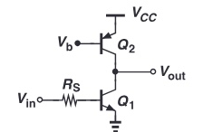

# 장말문제 11.37 — pnp 전류원 부하 CE 단(Fig 11.81)에 대해 문제 11.36 반복

## 원문
Repeat Problem 11.36 for the stage shown in Fig. 11.81.

## 조건
- 회로: Fig 11.81 — 베이스를 $V_b$로 바이어스한 pnp $Q_2$를 부하로 쓴 CE 단, 입력에 $R_S$
- 문제 11.36의 가정을 이어받음: $V_A < \infty$

## 구할 것
- 이 단에 대해 문제 11.36을 다시 풂: 밀러 이론을 이용해 입력 극점과 출력 극점을 구하고, 이로부터 회로의 전달 함수 구하기

## 상속·참조
- 문제 11.36 (P11.36): Fig 11.80의 전류원 부하 CE 단(입력에 $R_S$)에서 $V_A < \infty$로 가정하고 밀러 이론으로 입력·출력 극점과 전달 함수를 구함

## 회로 — Fig 11.81
```spice
Q2  Vout  Vb    VCC   pnp
RS  Vin   n1    {R_S}
Q1  Vout  n1    0     npn
```
- 단자: VCC = 전원, 값 미지정 (T 전원 기호) / Vb = 이상적 DC 바이어스 (점 단자) / Vin = 입력 (개방 원) / Vout = 출력 (개방 원)
- 표시: 노드 라벨 V_CC (T 기호 오른쪽), V_b (점 단자 왼쪽), V_in (입력 원 왼쪽), V_out (출력 원 오른쪽) / 소자 라벨 Q2 (Q2 오른쪽), R_S (저항 위), Q1 (Q1 오른쪽, 이미터 옆) / 부호 없음 / 화살표 없음 / 수치·면적 라벨 없음
- 배치: 한 세로줄 위→아래 V_CC T 기호, Q2, 컬렉터 접속점, Q1, 접지 / Q2 pnp(베이스 왼쪽, 이미터 위 → V_CC, 이미터 화살표는 베이스 쪽(안쪽)을 향함, 컬렉터 아래) / V_b 점 단자 → 가로선 → Q2 베이스 / Q1 npn 보통 방향(베이스 왼쪽, 컬렉터 위, 이미터 아래 → 접지) / V_in 원 → 가로 R_S → Q1 베이스 / 컬렉터 접속점에서 가로선이 오른쪽 V_out 원에서 끝남 / 접속점 (세 갈래 이상, 1곳): ① 출력 = 위 Q2 컬렉터 + 아래 Q1 컬렉터 + 오른쪽 V_out 선 (점) / 교차: 없음



## 풀이
### 출력 노드 저항과 이득
- $Q_2$ 베이스는 이상적인 DC 전압 $V_b$라 교류 접지이므로 $Q_2$는 컬렉터에서 저항 $r_{O2}$로만 보인다
- 출력 노드 저항 $R_L = r_{O1} \parallel r_{O2}$ ($r_{Oj}$: $Q_j$의 출력 저항 $V_A/I_C$), 베이스에서 컬렉터까지 이득 $A = -g_{m1} R_L$ ($g_{m1}$: $Q_1$의 트랜스컨덕턴스)
### 커패시턴스
- $Q_1$의 $C_{\pi 1}$(베이스–이미터), $C_{\mu 1}$(베이스–컬렉터), $C_{CS1}$(컬렉터–기판)을 넣는다
- $Q_2$는 베이스·이미터가 교류 접지라 $C_{\mu 2}$와 $C_{CS2}$가 출력 노드에서 접지로 붙는다: $C_{out} = C_{CS1} + C_{\mu 2} + C_{CS2}$
### 입력·출력 극점
- 베이스에서 본 저항 $R_S \parallel r_{\pi 1}$ ($r_{\pi 1}$: $Q_1$의 베이스 입력 저항): $|\omega_{p,in}| = \dfrac{1}{(R_S \parallel r_{\pi 1})[C_{\pi 1} + (1 + g_{m1} R_L)C_{\mu 1}]}$
- $|\omega_{p,out}| = \dfrac{1}{R_L\left[C_{out} + \left(1 + \dfrac{1}{g_{m1} R_L}\right)C_{\mu 1}\right]}$
### 저주파 이득
- 입력 분배 $r_{\pi 1}/(r_{\pi 1} + R_S)$에 $-g_{m1} R_L$을 곱한 값이 저주파 이득이고, 두 극점을 인수로 붙이면 전달 함수가 된다
### 답
- $R_L = r_{O1} \parallel r_{O2}$, $C_{out} = C_{CS1} + C_{\mu 2} + C_{CS2}$로 두면
- 입력 극점 $|\omega_{p,in}| = \dfrac{1}{(R_S \parallel r_{\pi 1})[C_{\pi 1} + (1 + g_{m1} R_L)C_{\mu 1}]}$
- 출력 극점 $|\omega_{p,out}| = \dfrac{1}{R_L\left[C_{out} + \left(1 + \dfrac{1}{g_{m1} R_L}\right)C_{\mu 1}\right]}$
- 전달 함수 $\dfrac{V_{out}}{V_{in}}(s) = \dfrac{-g_{m1} R_L\, r_{\pi 1}/(r_{\pi 1} + R_S)}{(1 + s/|\omega_{p,in}|)(1 + s/|\omega_{p,out}|)}$
