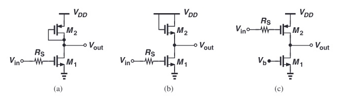

# 장말문제 11.38 — Fig 11.82 세 단의 입력·출력 극점 (λ > 0, 밀러 이론)

## 원문
Assuming $\lambda > 0$ and using Miller's theorem, determine the input and output poles of the stages depicted in Fig. 11.82.

## 조건
- 회로: Fig 11.82 (a)–(c) — 입력에 $R_S$가 달린 세 단 ((a) 다이오드 연결 PMOS $M_2$ 부하 CS 단, (b) 다이오드 연결 NMOS $M_2$ 부하 CS 단, (c) $V_b$로 바이어스한 NMOS $M_1$을 전류원 부하로 쓴 PMOS $M_2$ CS 단) (괄호 안 회로 이름은 원문에 없음)
- $\lambda > 0$으로 가정

## 구할 것
- 밀러 이론을 이용해 세 단 각각의 입력 극점과 출력 극점 구하기

## 회로 — Fig 11.82(a)
```spice
M2  Vout  Vout  VDD   pmos   ; 게이트가 선으로 드레인(Vout)에 이어짐 (다이오드 연결)
RS  Vin   n1    {R_S}
M1  Vout  n1    0     nmos
```
- 단자: VDD = 전원, 값 미지정 (T 전원 기호) / Vin = 입력 (개방 원) / Vout = 출력 (개방 원)
- 표시: 노드 라벨 V_DD (T 기호 오른쪽), V_in (입력 원 왼쪽), V_out (출력 원 오른쪽) / 소자 라벨 M2 (M2 오른쪽), R_S (저항 위), M1 (M1 오른쪽, 소스 옆) / 부호 없음 / 화살표 없음 / 수치·면적 라벨 없음
- 배치: 한 세로줄 위→아래 V_DD T 기호, M2, M2 드레인 접속점, 출력 접속점, M1, 접지 / M2 PMOS(게이트 왼쪽, 소스 위 → V_DD, 소스 화살표는 게이트 쪽을 향함, 드레인 아래) / M2 게이트에서 선이 왼쪽으로 나가 아래로 꺾이고 M2 드레인 접속점 높이에서 오른쪽으로 꺾여 M2 드레인 접속점 (다이오드 연결) / M2 드레인 접속점 바로 아래에 출력 접속점 / M1 NMOS 보통 방향(게이트 왼쪽, 드레인 위, 소스 아래 → 접지) / V_in 원 → 가로 R_S → M1 게이트 / 출력 접속점에서 가로선이 오른쪽 V_out 원에서 끝남 / 접속점 (세 갈래 이상, 2곳): ① M2 드레인 = 위 M2 드레인 + 왼쪽 다이오드 연결선 + 아래 세로선 (점) ② 출력 = 위 세로선 + 아래 M1 드레인 + 오른쪽 V_out 선 (점) / 교차: 없음

## 회로 — Fig 11.82(b)
```spice
M2  VDD   VDD   Vout  nmos   ; 게이트가 선으로 VDD 레일에 이어짐 (다이오드 연결)
RS  Vin   n1    {R_S}
M1  Vout  n1    0     nmos
```
- 단자: VDD = 전원, 값 미지정 (가로 레일, 짧고 굵은 가로선) / Vin = 입력 (개방 원) / Vout = 출력 (개방 원)
- 표시: 노드 라벨 V_DD (레일 오른쪽 끝), V_in (입력 원 왼쪽), V_out (출력 원 오른쪽) / 소자 라벨 M2 (M2 오른쪽, 소스 옆), R_S (저항 위), M1 (M1 오른쪽, 소스 옆) / 부호 없음 / 화살표 없음 / 수치·면적 라벨 없음
- 배치: 맨 위 굵은 가로 레일 V_DD / 한 세로줄 위→아래 M2, 출력 접속점, M1, 접지 / M2 NMOS(게이트 왼쪽, 드레인 위 → 레일, 소스 아래, 소스 화살표는 바깥(오른쪽)을 향함) / 레일 왼쪽 끝에서 선이 아래로 내려와 M2 게이트 높이에서 오른쪽으로 꺾여 M2 게이트 / M1 NMOS 보통 방향(게이트 왼쪽, 드레인 위, 소스 아래 → 접지) / V_in 원 → 가로 R_S → M1 게이트 / 출력 접속점에서 가로선이 오른쪽 V_out 원에서 끝남 / 접속점 (세 갈래 이상, 1곳): ① 출력 = 위 M2 소스 + 아래 M1 드레인 + 오른쪽 V_out 선 (점) / 교차: 없음

## 회로 — Fig 11.82(c)
```spice
RS  Vin   n1    {R_S}
M2  Vout  n1    VDD   pmos
M1  Vout  Vb    0     nmos
```
- 단자: VDD = 전원, 값 미지정 (T 전원 기호) / Vin = 입력 (개방 원) / Vb = 이상적 DC 바이어스 (점 단자) / Vout = 출력 (개방 원)
- 표시: 노드 라벨 V_DD (T 기호 오른쪽), V_in (입력 원 왼쪽), V_b (점 단자 왼쪽), V_out (출력 원 오른쪽) / 소자 라벨 R_S (저항 위), M2 (M2 오른쪽), M1 (M1 오른쪽, 소스 옆) / 부호 없음 / 화살표 없음 / 수치·면적 라벨 없음
- 배치: 한 세로줄 위→아래 V_DD T 기호, M2, 출력 접속점, M1, 접지 / M2 PMOS(게이트 왼쪽, 소스 위 → V_DD, 소스 화살표는 게이트 쪽을 향함, 드레인 아래) / V_in 원 → 가로 R_S → M2 게이트 / M1 NMOS 보통 방향(게이트 왼쪽, 드레인 위, 소스 아래 → 접지) / V_b 점 단자 → 가로선 → M1 게이트 / 출력 접속점에서 가로선이 오른쪽 V_out 원에서 끝남 / 접속점 (세 갈래 이상, 1곳): ① 출력 = 위 M2 드레인 + 아래 M1 드레인 + 오른쪽 V_out 선 (점) / 교차: 없음



## 풀이
### 공통 틀
- $M_j$의 커패시턴스 $C_{GSj}$, $C_{GDj}$, $C_{DBj}$, $C_{SBj}$, 트랜스컨덕턴스 $g_{mj}$, 출력 저항 $r_{Oj}$($\lambda > 0$이라 유한)
- 입력 트랜지스터의 $g_m$과 출력 노드 저항 $R_L$로 $C_{GD}$를 밀러로 나눈다: 입력 쪽 $(1 + g_m R_L)C_{GD}$, 출력 쪽 $(1 + 1/(g_m R_L))C_{GD}$. 게이트 전류가 없어 입력 쪽 저항은 $R_S$
### (a) 다이오드 연결 PMOS 부하
- 입력은 $M_1$. 다이오드 연결 $M_2$는 $1/g_{m2}$로 보인다: $R_L = (1/g_{m2}) \parallel r_{O1} \parallel r_{O2}$
- $C_{GS2}$는 출력과 $V_{DD}$ 사이, $C_{GD2}$는 양 끝이 같은 노드라 빠짐: $C_L = C_{DB1} + C_{GS2} + C_{DB2}$
### (b) 다이오드 연결 NMOS 부하
- 입력은 $M_1$. $M_2$ 소스에서 본 저항 $1/g_{m2}$(몸체 효과를 넣으면 $1/(g_{m2} + g_{mb2})$): $R_L = (1/g_{m2}) \parallel r_{O1} \parallel r_{O2}$
- $M_2$ 게이트·드레인이 $V_{DD}$라 소스 쪽만 남는다: $C_L = C_{DB1} + C_{GS2} + C_{SB2}$
### (c) NMOS 전류원 부하 PMOS CS 단
- 입력은 $M_2$. $M_1$ 게이트가 $V_b$(교류 접지)라 $M_1$은 $r_{O1}$: $R_L = r_{O1} \parallel r_{O2}$, $C_L = C_{DB1} + C_{GD1} + C_{DB2}$
### 답
- (a) $|\omega_{p,in}| = 1/\{R_S[C_{GS1} + (1 + g_{m1}R_L)C_{GD1}]\}$, $|\omega_{p,out}| = 1/\{R_L[C_{DB1} + C_{GS2} + C_{DB2} + (1 + 1/(g_{m1}R_L))C_{GD1}]\}$, $R_L = (1/g_{m2}) \parallel r_{O1} \parallel r_{O2}$
- (b) $|\omega_{p,in}|$와 $R_L$은 (a)와 같고 $|\omega_{p,out}| = 1/\{R_L[C_{DB1} + C_{GS2} + C_{SB2} + (1 + 1/(g_{m1}R_L))C_{GD1}]\}$
- (c) $|\omega_{p,in}| = 1/\{R_S[C_{GS2} + (1 + g_{m2}R_L)C_{GD2}]\}$, $|\omega_{p,out}| = 1/\{R_L[C_{DB1} + C_{GD1} + C_{DB2} + (1 + 1/(g_{m2}R_L))C_{GD2}]\}$, $R_L = r_{O1} \parallel r_{O2}$
