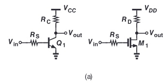

# 장말문제 11.39 — Fig 11.31(a) CS 단의 극점: 밀러 근사와 식 (11.73)의 전달 함수 비교

## 원문
In the CS stage of Fig. 11.31(a), $R_S = 200\ \Omega$, $R_D = 1\ \text{k}\Omega$, $I_{D1} = 1\ \text{mA}$, $C_{GS} = 50\ \text{fF}$, $C_{GD} = 10\ \text{fF}$, $C_{DB} = 15\ \text{fF}$, and $V_{GS} - V_{TH} = 200\ \text{mV}$. Determine the poles of the circuit using (a) Miller's approximation, and (b) the transfer function given by Eq. (11.73). Compare the results.

## 조건
- 회로: Fig 11.31(a)의 CS 단 (오른쪽 회로: $R_S$, $M_1$, $R_D$)
- $R_S = 200\ \Omega$
- $R_D = 1\ \text{k}\Omega$
- $I_{D1} = 1\ \text{mA}$
- $C_{GS} = 50\ \text{fF}$
- $C_{GD} = 10\ \text{fF}$
- $C_{DB} = 15\ \text{fF}$
- $V_{GS} - V_{TH} = 200\ \text{mV}$
- $\lambda$ 값은 주어지지 않음. 본문 해석(각주 10)처럼 채널길이 변조를 무시하는 것으로 봄 (원문에 없음)

## 구할 것
- 회로의 극점 구하기
  - (a) 밀러 근사 이용
  - (b) 식 (11.73)의 전달 함수 이용
- 두 결과 비교

## 상속·참조
- 본문 Fig 11.31(b)–(d) (교재 600쪽, 크롭 안 함): (b) CE 단에 $C_\pi$ (베이스–접지), $C_\mu$ (베이스–컬렉터), $C_{CS}$ (컬렉터–접지), CS 단에 $C_{GS}$ (게이트–접지), $C_{GD}$ (게이트–드레인), $C_{DB}$ (드레인–접지), $C_{SB}$ (양 끝 접지). (d) 두 회로의 통합 모델: $V_{Thev}$–$R_{Thev}$–노드 $X$, $X$–접지 $C_{in}$, $X$–$Y$ 사이 $C_{XY}$, $Y$ = $V_{out}$, $Y$→접지 종속 전류원 $g_m V_X$, $Y$–접지 $C_{out}$과 부하 저항. 즉 $C_{in} = C_\pi$ 또는 $C_{GS}$, $C_{XY} = C_\mu$ 또는 $C_{GD}$, $C_{out} = C_{CS}$ 또는 $C_{DB}$. 얼리 효과와 채널길이 변조는 무시 (각주 10). 부하 저항은 본문에서 $R_L$로 부름 ($R_C$ 또는 $R_D$ 자리)
- 밀러 근사 (식 11.59–11.60): $C_X = (1 + g_m R_L) C_{XY}$, $C_Y = \left(1 + \dfrac{1}{g_m R_L}\right) C_{XY}$
- 본문 Fig 11.32 (교재 601쪽, 크롭 안 함) 밀러 근사 통합 모델의 파라미터: CE 단은 $V_{Thev} = V_{in}\dfrac{r_\pi}{r_\pi + R_S}$, $R_{Thev} = R_S \parallel r_\pi$, $C_X = C_\mu(1 + g_m R_L)$, $C_Y = C_\mu\left(1 + \dfrac{1}{g_m R_L}\right)$ / CS 단은 $V_{Thev} = V_{in}$, $R_{Thev} = R_S$, $C_X = C_{GD}(1 + g_m R_L)$, $C_Y = C_{GD}\left(1 + \dfrac{1}{g_m R_L}\right)$
- 극점 (식 11.61–11.62): $|\omega_{p,in}| = \dfrac{1}{R_{Thev}[C_{in} + (1 + g_m R_L) C_{XY}]}$, $|\omega_{p,out}| = \dfrac{1}{R_L\left[C_{out} + \left(1 + \dfrac{1}{g_m R_L}\right) C_{XY}\right]}$
- 직접 해석 (11.4.4절, 통합 모델 Fig 11.31(d)의 두 노드 KCL): $\dfrac{V_{out}}{V_{Thev}}(s) = \dfrac{(C_{XY}s - g_m)R_L}{as^2 + bs + 1}$ (식 11.73), $a = R_{Thev}R_L(C_{in}C_{XY} + C_{out}C_{XY} + C_{in}C_{out})$ (식 11.74), $b = (1 + g_m R_L)C_{XY}R_{Thev} + R_{Thev}C_{in} + R_L(C_{XY} + C_{out})$ (식 11.75). 영점 $\omega_z = g_m/C_{XY}$ (식 11.76)
- 이 문제에서 부하 저항 $R_L$은 그림의 $R_D = 1\ \text{k}\Omega$ 자리이고, $I_{D1}$은 $M_1$의 드레인 전류. $g_m = \dfrac{2I_D}{V_{GS} - V_{TH}}$로 구함 (원문에 없음)

## 회로 — Fig 11.31(a)
```spice
* 한 패널 (a)에 두 회로가 좌우로 나란히: 왼쪽 CE 단, 오른쪽 CS 단
* 두 회로 모두 입력 V_in, 출력 V_out으로 인쇄됨. 서로 다른 회로라 노드·소자 이름에 _CE, _CS를 붙임 (원문에 없음)
* 왼쪽: CE 단
RS_CE  Vin_CE   n1       {R_S}
Q1     Vout_CE  n1       0  npn
RC     VCC      Vout_CE  {R_C}
* 오른쪽: CS 단
RS_CS  Vin_CS   n2       {R_S}
M1     Vout_CS  n2       0  nmos
RD     VDD      Vout_CS  {R_D}
```
- 단자: VCC, VDD = 전원, 값 미지정 (T 전원 기호, 두 회로에 각각) / Vin_CE, Vin_CS = 입력 (개방 원) / Vout_CE, Vout_CS = 출력 (개방 원)
- 표시: 노드 라벨 V_CC (왼쪽 T 기호 오른쪽), V_DD (오른쪽 T 기호 오른쪽), V_in (각 입력 원 왼쪽), V_out (각 출력 원 오른쪽) / 소자 라벨 R_S (각 저항 위), R_C (저항 왼쪽), Q1 (트랜지스터 오른쪽, 이미터 옆), R_D (저항 왼쪽), M1 (트랜지스터 오른쪽, 소스 옆) / 부호 없음 / 화살표 없음 / 수치·면적 라벨 없음
- 배치: 두 회로가 좌우로 나란히, 같은 높이. 패널 글자 (a)는 두 회로 아래 가운데에 하나 / 왼쪽(CE): 세로줄 위→아래 V_CC T 기호, R_C, 컬렉터 접속점, Q1, 접지 / Q1 npn 보통 방향(베이스 왼쪽, 컬렉터 위, 이미터 아래) / V_in 원 → 가로 R_S → 베이스 / 컬렉터 접속점에서 가로선이 오른쪽 V_out 원에서 끝남 / 오른쪽(CS): 세로줄 위→아래 V_DD T 기호, R_D, 드레인 접속점, M1, 접지 / M1 NMOS 보통 방향(게이트 왼쪽, 드레인 위, 소스 아래) / V_in 원 → 가로 R_S → 게이트 / 드레인 접속점에서 가로선이 오른쪽 V_out 원에서 끝남 / 접지 기호는 Q1 이미터 아래, M1 소스 아래에 하나씩 / 접속점 (세 갈래 이상, 2곳): ① CE 컬렉터 = 위 R_C + 아래 Q1 컬렉터 + 오른쪽 V_out 선 (점) ② CS 드레인 = 위 R_D + 아래 M1 드레인 + 오른쪽 V_out 선 (점) / 교차: 없음


> 참고: 크롭은 (a)만. 본문 그림 11.31의 (b) 트랜지스터 커패시턴스 포함, (c) 소신호 등가 회로, (d) 통합 모델은 크롭하지 않음 (상속·참조에 글로)
> 참고: Fig 11.31은 본문 그림(교재 600쪽, PDF 16)
