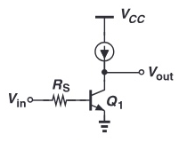

# 장말문제 11.40 — 전류원 부하 CE 증폭기(Fig 11.83)의 극점: 밀러 근사와 식 (11.73) 비교

## 원문
Consider the amplifier shown in Fig. 11.83, where $V_A = \infty$. Determine the poles of the circuit using (a) Miller's approximation, and (b) the transfer function expressed by Eq. (11.73). Compare the results.

## 조건
- 회로: Fig 11.83 — 전류원 부하 CE 증폭기, 입력에 $R_S$
- $V_A = \infty$
- 식 (11.73)–(11.75): 통합 모델 $V_{Thev}$–$R_{Thev}$–노드 X, X–접지 $C_{in}$, X–Y 사이 $C_{XY}$, Y = $V_{out}$, Y–접지 $C_{out}$과 부하 $R_L$, 종속 전류원 $g_m V_X$에서 $\dfrac{V_{out}}{V_{Thev}}(s) = \dfrac{(C_{XY}s - g_m)R_L}{as^2 + bs + 1}$, $a = R_{Thev}R_L(C_{in}C_{XY} + C_{out}C_{XY} + C_{in}C_{out})$, $b = (1 + g_m R_L)C_{XY}R_{Thev} + R_{Thev}C_{in} + R_L(C_{XY} + C_{out})$ (본문 식, 원문에 없음)
- CE 단 대응: $R_{Thev} = R_S \parallel r_\pi$, $C_{in} = C_\pi$, $C_{XY} = C_\mu$, $C_{out} = C_{CS}$, 부하가 전류원뿐이고 $V_A = \infty$이므로 $R_L \to \infty$ (원문에 없음)

## 구할 것
- 회로의 극점 구하기
  - (a) 밀러 근사 이용
  - (b) 식 (11.73)으로 나타낸 전달 함수 이용
- 두 결과 비교

## 상속·참조
- 본문 Fig 11.31(b)–(d) (교재 600쪽, 크롭 안 함): (b) CE 단에 $C_\pi$ (베이스–접지), $C_\mu$ (베이스–컬렉터), $C_{CS}$ (컬렉터–접지), CS 단에 $C_{GS}$ (게이트–접지), $C_{GD}$ (게이트–드레인), $C_{DB}$ (드레인–접지), $C_{SB}$ (양 끝 접지). (d) 두 회로의 통합 모델: $V_{Thev}$–$R_{Thev}$–노드 $X$, $X$–접지 $C_{in}$, $X$–$Y$ 사이 $C_{XY}$, $Y$ = $V_{out}$, $Y$→접지 종속 전류원 $g_m V_X$, $Y$–접지 $C_{out}$과 부하 저항. 즉 $C_{in} = C_\pi$ 또는 $C_{GS}$, $C_{XY} = C_\mu$ 또는 $C_{GD}$, $C_{out} = C_{CS}$ 또는 $C_{DB}$. 얼리 효과와 채널길이 변조는 무시 (각주 10). 부하 저항은 본문에서 $R_L$로 부름 ($R_C$ 또는 $R_D$ 자리)
- 밀러 근사 (식 11.59–11.60): $C_X = (1 + g_m R_L) C_{XY}$, $C_Y = \left(1 + \dfrac{1}{g_m R_L}\right) C_{XY}$
- 본문 Fig 11.32 (교재 601쪽, 크롭 안 함) 밀러 근사 통합 모델의 파라미터: CE 단은 $V_{Thev} = V_{in}\dfrac{r_\pi}{r_\pi + R_S}$, $R_{Thev} = R_S \parallel r_\pi$, $C_X = C_\mu(1 + g_m R_L)$, $C_Y = C_\mu\left(1 + \dfrac{1}{g_m R_L}\right)$ / CS 단은 $V_{Thev} = V_{in}$, $R_{Thev} = R_S$, $C_X = C_{GD}(1 + g_m R_L)$, $C_Y = C_{GD}\left(1 + \dfrac{1}{g_m R_L}\right)$
- 극점 (식 11.61–11.62): $|\omega_{p,in}| = \dfrac{1}{R_{Thev}[C_{in} + (1 + g_m R_L) C_{XY}]}$, $|\omega_{p,out}| = \dfrac{1}{R_L\left[C_{out} + \left(1 + \dfrac{1}{g_m R_L}\right) C_{XY}\right]}$
- 직접 해석 (11.4.4절, 통합 모델 Fig 11.31(d)의 두 노드 KCL): $\dfrac{V_{out}}{V_{Thev}}(s) = \dfrac{(C_{XY}s - g_m)R_L}{as^2 + bs + 1}$ (식 11.73), $a = R_{Thev}R_L(C_{in}C_{XY} + C_{out}C_{XY} + C_{in}C_{out})$ (식 11.74), $b = (1 + g_m R_L)C_{XY}R_{Thev} + R_{Thev}C_{in} + R_L(C_{XY} + C_{out})$ (식 11.75). 영점 $\omega_z = g_m/C_{XY}$ (식 11.76)
- 이 그림에서 출력 노드의 부하는 전류원뿐이고 $V_A = \infty$이므로, 위 식의 부하 저항 $R_L$ 자리에 들어갈 소신호 저항은 무한대가 됨. 입력 쪽은 CE 단이므로 $R_{Thev} = R_S \parallel r_\pi$, $C_{in} = C_\pi$, $C_{XY} = C_\mu$, $C_{out} = C_{CS}$ (원문에 없음)

## 회로 — Fig 11.83
```spice
I1  VCC   Vout             ; 라벨·값 없는 전류원, 화살표 아래
RS  Vin   n1    {R_S}
Q1  Vout  n1    0     npn
```
- 단자: VCC = 전원, 값 미지정 (T 전원 기호) / Vin = 입력 (개방 원) / Vout = 출력 (개방 원)
- 표시: 노드 라벨 V_CC (T 기호 오른쪽), V_in (입력 원 왼쪽), V_out (출력 원 오른쪽) / 소자 라벨 I1 (라벨 없음), R_S (저항 위), Q1 (트랜지스터 오른쪽, 이미터 옆) / 부호 없음 / 화살표 없음 / 수치·면적 라벨 없음
- 배치: 한 세로줄 위→아래 V_CC T 기호, 전류원(원 안 화살표 아래), 컬렉터 접속점, Q1, 접지 / Q1 npn 보통 방향(베이스 왼쪽, 컬렉터 위, 이미터 아래 → 접지) / V_in 원 → 가로 R_S → Q1 베이스 / 컬렉터 접속점에서 가로선이 오른쪽 V_out 원에서 끝남 / 접속점 (세 갈래 이상, 1곳): ① 컬렉터 = 위 전류원 + 아래 Q1 컬렉터 + 오른쪽 V_out 선 (점) / 교차: 없음


> 참고: Fig 11.83은 문제 11.36의 Fig 11.80과 같은 모양 (원문에 없음)

## 힌트
### (b) 부하 저항으로 나눈 뒤 극한
- 전류원 부하에 $V_A = \infty$면 출력 노드의 부하 저항이 무한대라, 식 (11.73)의 분자와 $a$, $b$가 함께 발산한다
- 분자와 분모를 그 저항으로 나눈 뒤 극한을 보면 유한한 식이 남아 극점을 그대로 읽을 수 있다

## 풀이
### 출력 노드 저항
- $V_A = \infty$이고 전류원이 이상적이라 컬렉터 노드에서 접지로 가는 저항 $R_L \to \infty$. 이득 $g_m R_L \to \infty$ ($g_m$: $Q_1$의 트랜스컨덕턴스)
- 입력 쪽 저항 $R_{Th} = R_S \parallel r_\pi$ ($r_\pi$: $Q_1$의 베이스 입력 저항), 커패시턴스는 $C_\pi$, $C_\mu$, $C_{CS}$
### (a) 밀러 근사
- $|\omega_{p,in}| = \dfrac{1}{R_{Th}[C_\pi + (1 + g_m R_L)C_\mu]} \to 0$, $|\omega_{p,out}| = \dfrac{1}{R_L[C_{CS} + (1 + 1/(g_m R_L))C_\mu]} \to 0$ (밀러 커패시턴스와 $R_L$이 모두 발산)
### (b) 전달 함수를 $R_L$로 나눈 극한
- 두 노드 KCL로 구한 전달 함수: $\dfrac{V_{out}}{V_{Thev}} = \dfrac{(C_\mu s - g_m)R_L}{as^2 + bs + 1}$, $a = R_{Th}R_L(C_\pi C_\mu + C_{CS}C_\mu + C_\pi C_{CS})$, $b = (1 + g_m R_L)C_\mu R_{Th} + R_{Th}C_\pi + R_L(C_\mu + C_{CS})$
- 분자, $a$, $b$가 모두 $R_L$에 비례해 발산하므로 분자·분모를 $R_L$로 나누고 $R_L \to \infty$로 보내면
- $\dfrac{V_{out}}{V_{Thev}} = \dfrac{C_\mu s - g_m}{s[R_{Th}(C_\pi C_\mu + C_{CS}C_\mu + C_\pi C_{CS})s + g_m R_{Th} C_\mu + C_\mu + C_{CS}]}$
- 극점 하나는 원점, 다른 하나는 $|\omega_{p2}| = \dfrac{g_m R_{Th} C_\mu + C_\mu + C_{CS}}{R_{Th}(C_\pi C_\mu + C_{CS}C_\mu + C_\pi C_{CS})}$
### 답
- (a) 밀러 근사: $|\omega_{p,in}| \to 0$, $|\omega_{p,out}| \to 0$ (두 극점 모두 원점)
- (b) $|\omega_{p1}| = 0$, $|\omega_{p2}| = \dfrac{g_m R_{Th} C_\mu + C_\mu + C_{CS}}{R_{Th}(C_\pi C_\mu + C_{CS}C_\mu + C_\pi C_{CS})}$, $R_{Th} = R_S \parallel r_\pi$
- 비교: 원점 극점 하나는 맞지만(전류원 출력이 커패시턴스만 충전하는 적분기), 밀러 근사는 유한한 높은 주파수 극점 $|\omega_{p2}|$를 놓친다. 이득이 무한대라 밀러 분할이 성립하지 않는다
