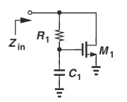

# 장말문제 11.42 — 능동 인덕터(Fig 11.84)의 Z_in과 |Z_in| 보데 선도

## 원문
The circuit depicted in Fig. 11.84 is called an "active inductor." Neglecting other capacitances and assuming $\lambda = 0$, compute $Z_{in}$. Use Bode's rule to plot $|Z_{in}|$ as a function of frequency and explain why it exhibits inductive behavior.

## 조건
- 회로: Fig 11.84 — "능동 인덕터(active inductor)"라고 부르는 회로 ($R_1$, $C_1$, $M_1$)
- 다른 커패시턴스는 무시 ($C_1$만 고려) (원문에 없음, 괄호 안 설명)
- $\lambda = 0$으로 가정

## 구할 것
- $Z_{in}$ 계산
- 보데 규칙으로 $|Z_{in}|$을 주파수의 함수로 그리기
- 회로가 왜 유도성 동작을 보이는지 설명

## 회로 — Fig 11.84
```spice
* 입력 단자는 라벨 없이 Z_in 화살표만 붙은 개방 원 → 측정 단자 out (원문에 없음)
R1  out   n1    {R_1}
M1  out   n1    0     nmos
C1  n1    0     {C_1}
```
- 단자: out = 입력, Z_in 측정 단자 (개방 원)
- 표시: 노드 라벨 없음 / 소자 라벨 R_1 (저항 왼쪽), M1 (트랜지스터 오른쪽, 소스 옆), C_1 (커패시터 오른쪽) / 부호 없음 / 화살표 "Z_in": 입력 단자에서 회로 쪽(오른쪽)을 들여다봄, 오른쪽 방향, 도선 옆 별도 화살표 (┌ 꺾임: 입력 원 아래 왼쪽에 세로선, 위 끝에서 가로선이 입력 원 아래로 오른쪽으로 뻗고 화살촉은 오른쪽 끝, 글자 Z_in은 세로선 아래 끝) / 수치·면적 라벨 없음
- 배치: 왼쪽 위 입력 원 → 맨 위 가로선 → 위 접속점 → 가로선이 계속 오른쪽으로 가서 아래로 꺾여 M1 드레인 / 위 접속점에서 R_1이 세로로 내려가 아래 접속점 / 아래 접속점에서 가로선이 오른쪽 M1 게이트, 아래로 C_1 → 접지 / M1 NMOS 보통 방향(게이트 왼쪽, 드레인 위, 소스 아래 → 접지, 소스 화살표는 바깥을 향함) / 접지 기호는 C_1 아래, M1 소스 아래에 따로 / 접속점 (세 갈래 이상, 2곳): ① 위 = 왼쪽 입력선 + 오른쪽 M1 드레인으로 가는 선 + 아래 R_1 (점) ② 아래 = 위 R_1 + 오른쪽 M1 게이트 선 + 아래 C_1 (점) / 교차: 없음



## 힌트
### 게이트는 $R_1 C_1$ 거쳐 드레인을 늦게 따름
- 게이트는 전류를 끌지 않으므로 $R_1$–$C_1$ 가지는 입력 전압을 나누는 저역 분배기이고, $M_1$ 전류는 게이트에 걸린 몫만큼만 흐른다
- 주파수가 아주 낮을 때와 아주 높을 때 $C_1$이 어떻게 보이는지에 따라 게이트가 어느 전압에 묶이는지 나눠 보면 $|Z_{in}|$의 양 끝이 정해진다

## 풀이
### 게이트 전압
- 게이트는 전류를 끌지 않으므로 $R_1$–$C_1$ 가지가 입력 전압 $v_x$를 나누는 저역 분배기다: $v_g = \dfrac{v_x}{1 + sR_1C_1}$
### 입력 전류와 $Z_{in}$
- 입력 전류 = $R_1$ 가지 전류 + $M_1$ 드레인 전류 ($g_m$: $M_1$의 트랜스컨덕턴스, $\lambda = 0$): $i_x = \dfrac{sC_1 v_x}{1 + sR_1C_1} + \dfrac{g_m v_x}{1 + sR_1C_1}$
- $Z_{in} = \dfrac{v_x}{i_x} = \dfrac{1 + sR_1C_1}{g_m + sC_1}$
### 보데 선도
- 영점 $\omega_z = \dfrac{1}{R_1C_1}$, 극점 $\omega_p = \dfrac{g_m}{C_1}$. 저주파수에서 $|Z_{in}| = 1/g_m$, 고주파수에서 $|Z_{in}| \to R_1$
- $R_1 > 1/g_m$이면 $\omega_z < \omega_p$: $|Z_{in}|$은 $1/g_m$로 평탄하다가 $\omega_z$부터 $+20\ \text{dB/dec}$로 오르고 $\omega_p$부터 $R_1$에서 평탄해진다
### 유도성 동작의 까닭
- 낮은 주파수에서는 $C_1$이 개방이라 게이트가 드레인을 따라가 $M_1$이 다이오드 연결($1/g_m$)처럼 보인다
- 주파수가 오르면 $C_1$이 게이트를 접지에 묶어 $M_1$ 전류가 줄고, 입력 전류가 $R_1$로만 흐르게 된다. 그래서 $\omega_z$와 $\omega_p$ 사이에서 $|Z_{in}|$이 $\omega$에 비례해 인덕터처럼 커진다
### 답
- $Z_{in} = \dfrac{1 + sR_1C_1}{g_m + sC_1}$
- $|Z_{in}|$: $\omega < 1/(R_1C_1)$에서 $1/g_m$, $1/(R_1C_1) < \omega < g_m/C_1$에서 $+20\ \text{dB/dec}$로 증가, $\omega > g_m/C_1$에서 $R_1$ ($R_1 > 1/g_m$일 때)
- 주파수가 오르면 $C_1$이 게이트 전압을 줄여 $M_1$ 전류가 작아지므로, 두 꺾임 주파수 사이에서 임피던스가 주파수에 비례해 커진다(유도성)
