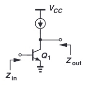

# 장말문제 11.43 — 전류원 부하 CE 단(Fig 11.85)의 입력·출력 임피던스 (밀러 이론 없이)

## 원문
Determine the input and output impedances of the stage depicted in Fig. 11.85 without using Miller's theorem. Assume $V_A = \infty$.

## 조건
- 회로: Fig 11.85 — 전류원 부하 CE 단, 입력은 $Q_1$ 베이스, 출력은 $Q_1$ 컬렉터
- $V_A = \infty$로 가정

## 구할 것
- 밀러 이론을 쓰지 않고 이 단의 입력 임피던스 $Z_{in}$과 출력 임피던스 $Z_{out}$ 구하기

## 회로 — Fig 11.85
```spice
* 입력·출력 단자는 라벨 없이 Z_in, Z_out 화살표만 붙은 개방 원 → 측정 단자 out1(입력), out2(출력) (원문에 없음)
I1  VCC   out2             ; 라벨·값 없는 전류원, 화살표 아래
Q1  out2  out1  0     npn
```
- 단자: VCC = 전원, 값 미지정 (T 전원 기호) / out1 = 입력, Z_in 측정 단자 (개방 원) / out2 = 출력, Z_out 측정 단자 (개방 원)
- 표시: 노드 라벨 V_CC (T 기호 오른쪽) / 소자 라벨 I1 (라벨 없음), Q1 (트랜지스터 오른쪽, 이미터 옆) / 부호 없음 / 화살표 "Z_in": 입력 단자에서 회로 쪽(오른쪽)을 들여다봄, 오른쪽 방향, 도선 옆 별도 화살표 (┌ 꺾임: 입력 원 아래 왼쪽에 세로선, 위 끝에서 가로선이 오른쪽으로 뻗고 화살촉은 오른쪽 끝, 글자 Z_in은 세로선 아래 끝) / "Z_out": 출력 단자에서 회로 쪽(왼쪽)을 들여다봄, 왼쪽 방향, 도선 옆 별도 화살표 (┌ 꺾임을 좌우 반전: 출력 원 아래 오른쪽에 세로선, 위 끝에서 가로선이 왼쪽으로 뻗고 화살촉은 왼쪽 끝, 글자 Z_out은 세로선 아래 끝) / 수치·면적 라벨 없음
- 배치: 한 세로줄 위→아래 V_CC T 기호, 전류원(원 안 화살표 아래), 컬렉터 접속점, Q1, 접지 / Q1 npn 보통 방향(베이스 왼쪽, 컬렉터 위, 이미터 아래 → 접지) / 입력 원 → 짧은 가로선 → Q1 베이스 / 컬렉터 접속점에서 가로선이 오른쪽 출력 원에서 끝남 / 접속점 (세 갈래 이상, 1곳): ① 컬렉터 = 위 전류원 + 아래 Q1 컬렉터 + 오른쪽 출력 선 (점) / 교차: 없음


> 참고: 문제 문장은 636쪽(PDF 36) 오른쪽 단 끝에 있고, Fig 11.85는 다음 쪽 637쪽(PDF 36) 왼쪽 단 위에 인쇄됨
