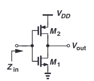

# 장말문제 11.45 — NMOS·PMOS 게이트를 묶은 단(Fig 11.87)의 입력 임피던스 (밀러 이론 없이)

## 원문
Calculate the input impedance of the stage illustrated in Fig. 11.87 without using Miller's theorem. Assume $\lambda = 0$.

## 조건
- 회로: Fig 11.87 — 입력 단자가 $M_1$(NMOS)과 $M_2$(PMOS)의 게이트에 함께 연결되고, 두 드레인이 함께 $V_{out}$
- $\lambda = 0$으로 가정

## 구할 것
- 밀러 이론을 쓰지 않고 이 단의 입력 임피던스 $Z_{in}$ 계산

## 회로 — Fig 11.87
```spice
* 입력 단자는 라벨 없이 Z_in 화살표만 붙은 개방 원 → 측정 단자 out (원문에 없음)
M2  Vout  out   VDD   pmos
M1  Vout  out   0     nmos
```
- 단자: VDD = 전원, 값 미지정 (T 전원 기호) / out = 입력, Z_in 측정 단자 (개방 원) / Vout = 출력 (개방 원)
- 표시: 노드 라벨 V_DD (T 기호 오른쪽), V_out (출력 원 오른쪽) / 소자 라벨 M2 (M2 오른쪽), M1 (M1 오른쪽, 소스 옆) / 부호 없음 / 화살표 "Z_in": 입력 단자에서 회로 쪽(오른쪽)을 들여다봄, 오른쪽 방향, 도선 옆 별도 화살표 (┌ 꺾임: 입력 원 아래 왼쪽에 세로선, 위 끝에서 가로선이 오른쪽으로 뻗고 화살촉은 오른쪽 끝, 글자 Z_in은 세로선 아래 끝) / 수치·면적 라벨 없음
- 배치: 가운데 세로줄 위→아래 V_DD T 기호, M2, 출력 접속점, M1, 접지 / M2 PMOS(게이트 왼쪽, 소스 위 → V_DD, 소스 화살표 게이트 쪽), M1 NMOS 보통 방향(게이트 왼쪽, 소스 아래·화살표 바깥 → 접지) / 입력 원 → 짧은 가로선 → 게이트 접속점 / 게이트 접속점에서 세로선이 위로 M2 게이트 높이까지 올라가 오른쪽으로 꺾여 M2 게이트, 아래로 M1 게이트 높이까지 내려가 오른쪽으로 꺾여 M1 게이트 / 출력 접속점 → 가로선 → V_out 원 / 접속점 (세 갈래 이상, 2곳): ① 게이트 = 왼쪽 입력 선 + 위 M2 게이트로 가는 선 + 아래 M1 게이트로 가는 선 (점) ② 출력 = 위 M2 드레인 + 아래 M1 드레인 + 오른쪽 V_out 선 (점) / 교차: 없음



## 풀이
### 두 소자를 한 CS 소자로 합치기
- $M_2$의 소스는 $V_{DD}$(AC 접지)이고 게이트·드레인이 $M_1$과 같은 노드라 소신호로는 병렬인 한 소자다: $g_m = g_{m1} + g_{m2}$ ($g_{m1}$, $g_{m2}$: $M_1$, $M_2$의 트랜스컨덕턴스)
- 게이트–접지 $C_{GS} = C_{GS1} + C_{GS2}$, 게이트–$V_{out}$ $C_{GD} = C_{GD1} + C_{GD2}$, $V_{out}$–접지 $C_{DB} = C_{DB1} + C_{DB2}$ ($C_{SB}$는 양 끝 AC 접지)
- $\lambda = 0$이고 출력에 다른 부하가 없어 $V_{out}$ 노드에는 저항이 없다
### 출력 노드 KCL
- 게이트에 $V_x$를 걸면 $C_{GD}s(V_x - V_{out}) = g_m V_x + C_{DB}s V_{out}$
- $V_x - V_{out} = \dfrac{g_m + C_{DB}s}{(C_{GD} + C_{DB})s}V_x$
### 입력 전류
- $I_x = C_{GS}sV_x + C_{GD}s(V_x - V_{out})$에 넣으면 $\dfrac{I_x}{V_x} = C_{GS}s + \dfrac{C_{GD}(g_m + C_{DB}s)}{C_{GD} + C_{DB}}$
- 곧 $C_{GS}$에 컨덕턴스 $\dfrac{g_m C_{GD}}{C_{GD} + C_{DB}}$와 직렬 조합 $\dfrac{C_{GD}C_{DB}}{C_{GD} + C_{DB}}$가 병렬로 붙는다. $C_{DB} = 0$이면 $Z_{in} = 1/(g_m + C_{GS}s)$
### 답
- $Z_{in} = \left[C_{GS}s + \dfrac{C_{GD}(g_m + C_{DB}s)}{C_{GD} + C_{DB}}\right]^{-1}$, $g_m = g_{m1} + g_{m2}$, $C_{GS} = C_{GS1} + C_{GS2}$, $C_{GD} = C_{GD1} + C_{GD2}$, $C_{DB} = C_{DB1} + C_{DB2}$
