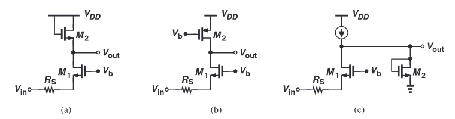

# 장말문제 11.46 — R_S로 구동되는 세 CG 단(Fig 11.88 (a)–(c))의 전달 함수

## 원문
Determine the transfer function of the circuits shown in Fig. 11.88. Assume $\lambda = 0$ for $M_1$.

## 조건
- 회로: Fig 11.88 (a)–(c) — $V_{in}$이 $R_S$를 거쳐 $M_1$ 소스로 들어가고 $M_1$ 게이트는 $V_b$인 CG 단. 부하가 (a) 게이트가 $V_{DD}$에 묶인 NMOS $M_2$, (b) 게이트가 $V_b$인 PMOS $M_2$, (c) 전류원과 다이오드 연결 NMOS $M_2$ (부하 설명은 그림에서 읽음, 원문 문장에는 없음)
- $M_1$에 대해 $\lambda = 0$으로 가정

## 구할 것
- (a), (b), (c) 각 회로의 전달 함수 $V_{out}/V_{in}$

## 회로 — Fig 11.88(a)
```spice
M2  VDD   VDD   Vout  nmos
M1  Vout  Vb    n1    nmos    ; 좌우 반전 (게이트 오른쪽)
RS  Vin   n1    {R_S}
```
- 단자: VDD = 전원, 값 미지정 (가로 레일) / Vb = 이상적 DC 바이어스, 값 미지정 (점 단자) / Vin = 입력 (개방 원) / Vout = 출력 (개방 원)
- 표시: 노드 라벨 V_DD (레일 오른쪽 끝), V_out (출력 원 오른쪽), V_b (점 단자 오른쪽), V_in (입력 원 왼쪽) / 소자 라벨 M2 (M2 오른쪽, 소스 옆), M1 (M1 왼쪽 위), R_S (저항 위) / 부호 없음 / 화살표 없음 / 수치·면적 라벨 없음
- 배치: 맨 위 굵은 가로 레일 V_DD / 세로줄 위→아래 레일, M2, 출력 접속점, M1 / M2 NMOS 보통 방향(게이트 왼쪽, 드레인 위 → 레일, 소스 아래·화살표 바깥), 게이트선은 왼쪽으로 나가 위로 꺾여 레일 왼쪽 끝 부분에 닿음 / M2 소스 → 출력 접속점 → M1 드레인 / 출력 접속점 → 가로선 → V_out 원 / M1 NMOS 좌우 반전(게이트 오른쪽 → 가로선 → V_b 점 단자, 소스 아래·화살표 왼쪽 바깥) / M1 소스 → 세로선 아래로 → 왼쪽으로 꺾여 가로 R_S → V_in 원 (R_S와 V_in 원은 M1보다 아래 높이) / 접지 없음 / 접속점 (세 갈래 이상, 1곳): ① 출력 = 위 M2 소스 + 아래 M1 드레인 + 오른쪽 V_out 선 (점) / 교차: 없음

## 회로 — Fig 11.88(b)
```spice
* 두 바이어스 점 단자가 모두 "V_b"로 인쇄됨 → 인쇄된 라벨대로 같은 노드 이름 Vb (같은 전압인지는 원문에 없음)
M2  Vout  Vb    VDD   pmos
M1  Vout  Vb    n1    nmos    ; 좌우 반전 (게이트 오른쪽)
RS  Vin   n1    {R_S}
```
- 단자: VDD = 전원, 값 미지정 (T 전원 기호) / Vb = 이상적 DC 바이어스, 값 미지정 (점 단자, M2 게이트 왼쪽과 M1 게이트 오른쪽에 하나씩) / Vin = 입력 (개방 원) / Vout = 출력 (개방 원)
- 표시: 노드 라벨 V_DD (T 기호 오른쪽), V_b (M2 게이트 점 단자 왼쪽), V_out (출력 원 오른쪽), V_b (M1 게이트 점 단자 오른쪽), V_in (입력 원 왼쪽) / 소자 라벨 M2 (M2 오른쪽), M1 (M1 왼쪽 위), R_S (저항 위) / 부호 없음 / 화살표 없음 / 수치·면적 라벨 없음
- 배치: 세로줄 위→아래 V_DD T 기호, M2, 출력 접속점, M1 / M2 PMOS(게이트 왼쪽 ← 가로선 ← V_b 점 단자, 소스 위 → V_DD, 소스 화살표 게이트 쪽) / M2 드레인 → 출력 접속점 → M1 드레인 / 출력 접속점 → 가로선 → V_out 원 / M1 NMOS 좌우 반전(게이트 오른쪽 → 가로선 → V_b 점 단자, 소스 아래·화살표 왼쪽 바깥) / M1 소스 → 세로선 아래로 → 왼쪽으로 꺾여 가로 R_S → V_in 원 / 접지 없음 / 접속점 (세 갈래 이상, 1곳): ① 출력 = 위 M2 드레인 + 아래 M1 드레인 + 오른쪽 V_out 선 (점) / 교차: 없음

## 회로 — Fig 11.88(c)
```spice
I1  VDD   Vout             ; 라벨·값 없는 전류원, 화살표 아래
M1  Vout  Vb    n1    nmos    ; 좌우 반전 (게이트 오른쪽)
RS  Vin   n1    {R_S}
M2  Vout  Vout  0     nmos    ; 다이오드 연결
```
- 단자: VDD = 전원, 값 미지정 (T 전원 기호) / Vb = 이상적 DC 바이어스, 값 미지정 (점 단자) / Vin = 입력 (개방 원) / Vout = 출력 (개방 원)
- 표시: 노드 라벨 V_DD (T 기호 오른쪽), V_out (출력 원 오른쪽), V_b (점 단자 오른쪽), V_in (입력 원 왼쪽) / 소자 라벨 I1 (라벨 없음), M1 (M1 왼쪽 위), R_S (저항 위), M2 (M2 오른쪽, 소스 옆) / 부호 없음 / 화살표 없음 / 수치·면적 라벨 없음
- 배치: 왼쪽 세로줄 위→아래 V_DD T 기호, 전류원(원 안 화살표 아래), 왼쪽 접속점, M1 / M1 NMOS 좌우 반전(게이트 오른쪽 → 가로선 → V_b 점 단자, 소스 아래·화살표 왼쪽 바깥) / M1 소스 → 세로선 아래로 → 왼쪽으로 꺾여 가로 R_S → V_in 원 / 왼쪽 접속점에서 긴 가로선이 오른쪽으로 오른쪽 위 접속점을 지나 V_out 원에서 끝남 / 오른쪽 세로줄 위→아래 오른쪽 위 접속점, M2 드레인 접속점, M2, 접지 / M2 NMOS 보통 방향(게이트 왼쪽, 소스 아래·화살표 바깥 → 접지), 다이오드 연결: 게이트선이 왼쪽으로 나가 위로 꺾여 M2 드레인 접속점 높이에서 오른쪽으로 꺾여 M2 드레인 접속점 / 접속점 (세 갈래 이상, 3곳): ① 왼쪽 = 위 전류원 + 아래 M1 드레인 + 오른쪽 가로선 (점) ② 오른쪽 위 = 왼쪽 가로선 + 오른쪽 V_out 선 + 아래 세로선 (점) ③ M2 드레인 = 위 세로선 + 아래 M2 드레인 + 왼쪽 다이오드 연결 선 (점) / 교차: 없음



## 풀이
### 공통 틀: 두 노드가 따로 논다
- $M_1$ 소스 노드를 $X$라 한다. 게이트가 AC 접지이고 $\lambda = 0$이라 $X$와 $V_{out}$ 사이에 소자가 없어 두 극점이 따로 정해진다 ($g_{m1}$: $M_1$의 트랜스컨덕턴스, 몸체 효과 무시)
- $X$: $\dfrac{V_{in} - V_X}{R_S} = (g_{m1} + C_X s)V_X$, $C_X = C_{GS1} + C_{SB1}$. 출력: $g_{m1}V_X = V_{out}\left(\dfrac{1}{R_L} + C_Y s\right)$
- $\dfrac{V_{out}}{V_{in}} = \dfrac{g_{m1}R_L}{1 + g_{m1}R_S}\cdot\dfrac{1}{[1 + (R_S \parallel \frac{1}{g_{m1}})C_X s](1 + R_L C_Y s)}$, $C_Y$는 $C_{GD1} + C_{DB1}$에 $M_2$ 몫을 더한 것
### (a) 게이트가 $V_{DD}$인 $M_2$
- 소스에서 본 $R_L = \frac{1}{g_{m2}} \parallel r_{O2}$ ($g_{m2}$, $r_{O2}$: $M_2$의 값). $C_{GS2}$, $C_{SB2}$는 출력–접지, $C_{GD2}$, $C_{DB2}$는 양 끝 AC 접지
### (b) PMOS 전류원 $M_2$
- $R_L = r_{O2}$. $C_{GD2}$, $C_{DB2}$는 출력–접지, $C_{GS2}$, $C_{SB2}$는 양 끝 AC 접지
### (c) 전류원과 다이오드 연결 $M_2$
- 이상적 전류원은 개방, $R_L = \frac{1}{g_{m2}} \parallel r_{O2}$. $C_{GS2}$, $C_{DB2}$는 출력–접지, $C_{GD2}$는 양 끝이 같은 노드, $C_{SB2}$는 양 끝 접지
### 답
- 공통: $\dfrac{V_{out}}{V_{in}} = \dfrac{g_{m1}R_L}{1 + g_{m1}R_S}\cdot\dfrac{1}{\left[1 + (R_S \parallel \frac{1}{g_{m1}})(C_{GS1} + C_{SB1})s\right](1 + R_L C_Y s)}$
- (a) $R_L = \frac{1}{g_{m2}} \parallel r_{O2}$, $C_Y = C_{GD1} + C_{DB1} + C_{GS2} + C_{SB2}$
- (b) $R_L = r_{O2}$, $C_Y = C_{GD1} + C_{DB1} + C_{GD2} + C_{DB2}$
- (c) $R_L = \frac{1}{g_{m2}} \parallel r_{O2}$, $C_Y = C_{GD1} + C_{DB1} + C_{GS2} + C_{DB2}$
