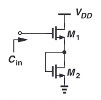

# 장말문제 11.47 — 전류원 대신 다이오드 연결 소자가 들어간 소스 폴로어(Fig 11.89)의 입력 커패시턴스

## 원문
Consider the source follower shown in Fig. 11.89, where the current source is mistakenly replaced with a diode-connected device. Taking into account only $C_{GS1}$, compute the input capacitance of the circuit. Assume $\lambda \neq 0$.

## 조건
- 회로: Fig 11.89 — 소스 폴로어 $M_1$의 전류원이 실수로 다이오드 연결 소자 $M_2$로 바뀐 회로
- 커패시턴스는 $C_{GS1}$만 고려
- $\lambda \neq 0$으로 가정

## 구할 것
- 회로의 입력 커패시턴스 $C_{in}$

## 회로 — Fig 11.89
```spice
* 입력 단자는 라벨 없이 C_in 화살표만 붙은 개방 원 → 측정 단자 out (원문에 없음)
M1  VDD   out   n1    nmos
M2  n1    n1    0     nmos    ; 다이오드 연결
```
- 단자: VDD = 전원, 값 미지정 (T 전원 기호) / out = 입력, C_in 측정 단자 (개방 원)
- 표시: 노드 라벨 V_DD (T 기호 오른쪽) / 소자 라벨 M1 (M1 오른쪽, 소스 옆), M2 (M2 오른쪽, 소스 옆) / 부호 없음 / 화살표 "C_in": 입력 단자에서 회로 쪽(오른쪽)을 들여다봄, 오른쪽 방향, 도선 옆 별도 화살표 (┌ 꺾임: 입력 원 아래 왼쪽에 세로선, 위 끝에서 가로선이 입력 가로선 아래로 오른쪽으로 뻗고 화살촉은 오른쪽 끝, 글자 C_in은 세로선 아래 끝) / 수치·면적 라벨 없음
- 배치: 오른쪽 세로줄 위→아래 V_DD T 기호, M1, 소스 접속점, M2, 접지 / M1, M2 모두 NMOS 보통 방향(게이트 왼쪽, 드레인 위, 소스 아래·화살표 바깥) / 입력 원 → 긴 가로선 → M1 게이트 / M2 다이오드 연결: 게이트선이 왼쪽으로 나가 위로 꺾여 소스 접속점 높이에서 오른쪽으로 꺾여 소스 접속점 / 접속점 (세 갈래 이상, 1곳): ① 소스 = 위 M1 소스 + 아래 M2 드레인 + 왼쪽 다이오드 연결 선 (점) / 교차: 없음



## 풀이
### 소스 노드의 저항
- $M_1$ 소스 노드에서 접지까지: 다이오드 연결 $M_2$의 $\dfrac{1}{g_{m2}} \parallel r_{O2}$와, 드레인이 $V_{DD}$(AC 접지)인 $M_1$의 $r_{O1}$이 병렬이다 ($g_{m2}$, $r_{O1}$, $r_{O2}$: 각 소자의 값, $\lambda \neq 0$)
- $R_L = \dfrac{1}{g_{m2}} \parallel r_{O1} \parallel r_{O2}$ (몸체 효과는 무시)
### 폴로어 전압 이득
- $C_{GS1}$만 두면 저주파 이득은 소스 폴로어 식 그대로: $A_v = \dfrac{v_S}{v_G} = \dfrac{g_{m1}R_L}{1 + g_{m1}R_L}$ ($g_{m1}$: $M_1$의 트랜스컨덕턴스)
### 밀러로 옮긴 입력 커패시턴스
- $C_{GS1}$은 게이트와 소스 사이에 있고 두 노드의 전압비가 $A_v$라, 밀러 이론으로 게이트–접지 커패시턴스 $C_{in} = (1 - A_v)C_{GS1}$이 된다
- $C_{in} = \dfrac{C_{GS1}}{1 + g_{m1}R_L}$
- 전류원이었다면 $R_L$이 $r_O$ 수준으로 커서 $C_{in}$이 거의 0이었을 텐데, 다이오드 연결 소자는 $R_L \approx 1/g_{m2}$로 작아 $C_{in} \approx \dfrac{C_{GS1}}{1 + g_{m1}/g_{m2}}$까지 커진다
### 답
- $C_{in} = (1 - A_v)C_{GS1} = \dfrac{C_{GS1}}{1 + g_{m1}\left(\frac{1}{g_{m2}} \parallel r_{O1} \parallel r_{O2}\right)}$
