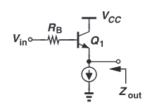

# 장말문제 11.48 — C_μ를 포함한 이미터 폴로어(Fig 11.90)의 출력 임피던스와 |Z_out| 스케치

## 원문
Determine the output impedance of the emitter follower depicted in Fig. 11.90, including $C_\mu$. Sketch $|Z_{out}|$ as a function of frequency. Assume $V_A = \infty$.

## 조건
- 회로: Fig 11.90 — $V_{in}$이 $R_B$를 거쳐 $Q_1$ 베이스로 들어가고 이미터에 전류원이 달린 이미터 폴로어
- $C_\mu$를 포함해서 계산
- $V_A = \infty$로 가정

## 구할 것
- 이미터 폴로어의 출력 임피던스 $Z_{out}$
- 주파수에 따른 $|Z_{out}|$의 개형 스케치

## 회로 — Fig 11.90
```spice
* 출력 단자는 라벨 없이 Z_out 화살표만 붙은 개방 원 → 측정 단자 out (원문에 없음)
RB  Vin   n1    {R_B}
Q1  VCC   n1    out   npn
I1  out   0                ; 라벨·값 없는 전류원, 화살표 아래
```
- 단자: VCC = 전원, 값 미지정 (T 전원 기호) / Vin = 입력 (개방 원) / out = 출력, Z_out 측정 단자 (개방 원)
- 표시: 노드 라벨 V_CC (T 기호 오른쪽), V_in (입력 원 왼쪽) / 소자 라벨 R_B (저항 위), Q1 (트랜지스터 오른쪽, 이미터 옆), I1 (라벨 없음) / 부호 없음 / 화살표 "Z_out": 출력 단자에서 회로 쪽(왼쪽)을 들여다봄, 왼쪽 방향, 도선 옆 별도 화살표 (┌ 꺾임을 좌우 반전: 출력 원 아래 오른쪽에 세로선, 위 끝에서 가로선이 왼쪽으로 뻗고 화살촉은 왼쪽 끝, 글자 Z_out은 세로선 아래 끝) / 수치·면적 라벨 없음
- 배치: 세로줄 위→아래 V_CC T 기호, Q1, 이미터 접속점, 전류원(원 안 화살표 아래), 접지 / Q1 npn 보통 방향(베이스 왼쪽, 컬렉터 위 → V_CC, 이미터 아래·화살표 바깥) / V_in 원 → 가로 R_B → Q1 베이스 / 이미터 접속점 → 가로선 → 출력 원 / 접속점 (세 갈래 이상, 1곳): ① 이미터 = 위 Q1 이미터 + 아래 전류원 + 오른쪽 출력 선 (점) / 교차: 없음



## 힌트
### $C_\mu$는 $R_B$와 병렬인 베이스 임피던스
- 컬렉터가 $V_{CC}$(AC 접지)에 붙어 있으므로 $C_\mu$는 베이스에서 AC 접지로 가는 커패시터가 되고, $V_{in}$을 AC 접지하면 $R_B$와 병렬이다
- 그러면 본문의 저항으로 구동되는 폴로어 출력 임피던스에서 구동 저항 자리를 이 병렬 임피던스로 바꾼다($r_\pi$는 $C_\pi$와 병렬로 둔다)

## 풀이
### 베이스 쪽과 $C_\pi$ 쪽 임피던스
- 컬렉터가 AC 접지라 $C_\mu$는 베이스–접지이고, $V_{in}$을 AC 접지하면 $Z_B = R_B \parallel \frac{1}{C_\mu s}$. 베이스–이미터는 $Z_\pi = r_\pi \parallel \frac{1}{C_\pi s}$, 이상적 전류원은 개방 ($g_m$, $r_\pi$: $Q_1$의 값, $\beta = g_m r_\pi$)
### 출력 임피던스
- 이미터에 $V_X$, $V_\pi = V_B - V_X$: 이미터 KCL $I_X = -(g_m + 1/Z_\pi)V_\pi$, 베이스 $V_B = -Z_B V_\pi/Z_\pi$
- $Z_{out} = \dfrac{Z_\pi + Z_B}{1 + g_m Z_\pi} = \dfrac{r_\pi + R_B + r_\pi R_B(C_\pi + C_\mu)s}{(1 + R_B C_\mu s)(\beta + 1 + r_\pi C_\pi s)}$
### 꺾임 주파수
- $Z_{out}(0) = \dfrac{R_B + r_\pi}{\beta + 1}$, 영점 $\omega_z = \dfrac{1}{(R_B \parallel r_\pi)(C_\pi + C_\mu)}$, 극점 $\dfrac{1}{R_B C_\mu}$, $\dfrac{\beta + 1}{r_\pi C_\pi}$
- 고주파에서 $Z_{out} \to 1/(C_s s)$, $C_s = C_\pi C_\mu/(C_\pi + C_\mu)$ ($C_\pi$와 $C_\mu$의 직렬)
### $|Z_{out}|$ 개형
- 보통처럼 $1/g_m < R_B < r_\pi$, $C_\mu \ll C_\pi$이면 $\omega_z$가 두 극점보다 낮다. $Z_{out}(0)$에서 평평 → $\omega_z$부터 인덕터처럼 상승 → 첫 극점에서 평평 → 둘째 극점부터 $1/\omega$로 감소
- $C_\mu = 0$이면 $R_B$ 근처에서 계속 평평하지만, $C_\mu$ 때문에 고주파에서 다시 준다
### 답
- $Z_{out} = \dfrac{r_\pi + R_B + r_\pi R_B(C_\pi + C_\mu)s}{(1 + R_B C_\mu s)(\beta + 1 + r_\pi C_\pi s)}$
- 개형: $(R_B + r_\pi)/(\beta + 1)$에서 평평 → $\omega_z$부터 상승 → 두 극점 $1/(R_B C_\mu)$, $(\beta + 1)/(r_\pi C_\pi)$ 사이에서 평평 → 그 위에서 $1/(\omega C_s)$로 감소
