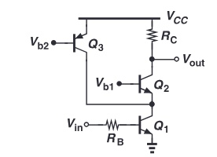

# 장말문제 11.49 — Q3가 Q1 바이어스 전류의 75%를 공급하는 캐스코드(Fig 11.91)의 극점

## 원문
In the cascode of Fig. 11.91, $Q_3$ serves as a constant current source, providing 75% of the bias current of $Q_1$. Assuming $V_A = \infty$ and using Miller's theorem, determine the poles of the circuit. Is Miller's effect more or less significant here than in the standard cascode topology of Fig. 11.50(a)?

## 조건
- 회로: Fig 11.91 — 바이폴라 캐스코드 ($Q_1$ 입력, $Q_2$ 캐스코드, 부하 $R_C$). $Q_3$는 $Q_1$ 컬렉터–$Q_2$ 이미터 노드에 연결된 일정 전류원으로 동작하며 $Q_1$ 바이어스 전류의 75%를 공급
- $V_A = \infty$로 가정
- 밀러 이론을 이용

## 구할 것
- 회로의 극점
- 여기서 밀러 효과가 Fig 11.50(a)의 표준 캐스코드 구조보다 더 중요한지 덜 중요한지

## 상속·참조
- 본문 Fig 11.50(a) (교재 619쪽, PDF 25, 크롭하지 않음): 표준 바이폴라 캐스코드. $V_{in}$ → $R_S$ → 노드 $X$ = $Q_1$ 베이스, $C_{\mu 1}$이 $X$와 $Y$ 사이, $Y$ = $Q_1$ 컬렉터 = $Q_2$ 이미터, $Q_2$ 베이스 = $V_{b1}$, $Q_2$ 컬렉터 = $V_{out}$, $R_L$이 $V_{CC}$와 $V_{out}$ 사이, $Q_1$ 이미터는 접지. 연결: `Q_1: C = Y, B = X, E = 0`, `Q_2: C = Vout, B = Vb1, E = Y`. $Q_3$ 같은 보조 전류원은 없음
- 본문 식 (11.134), (11.135) (교재 619쪽): 모든 트랜지스터에서 $r_O = \infty$이면 $Y$에서 본 임피던스가 $1/g_{m2}$이므로 $A_{v,XY} = \dfrac{v_Y}{v_X} = -\dfrac{g_{m1}}{g_{m2}}$. 표준 바이폴라 캐스코드에서는 $g_{m1} = g_{m2}$이므로 이 이득이 $-1$

## 회로 — Fig 11.91
```spice
RC  VCC   Vout  {R_C}
Q2  Vout  Vb1   n1    npn
Q3  n1    Vb2   VCC   pnp
Q1  n1    n2    0     npn
RB  Vin   n2    {R_B}
```
- 단자: VCC = 전원, 값 미지정 (가로 레일) / Vb1, Vb2 = 이상적 DC 바이어스, 값 미지정 (점 단자) / Vin = 입력 (개방 원) / Vout = 출력 (개방 원)
- 표시: 노드 라벨 V_CC (레일 오른쪽 끝), V_b2 (점 단자 왼쪽), V_out (출력 원 오른쪽), V_b1 (점 단자 왼쪽), V_in (입력 원 왼쪽) / 소자 라벨 Q3 (Q3 오른쪽), R_C (저항 오른쪽), Q2 (Q2 오른쪽, 이미터 옆), Q1 (Q1 오른쪽, 이미터 옆), R_B (저항 아래) / 부호 없음 / 화살표 없음 / 수치·면적 라벨 없음
- 배치: 맨 위 굵은 가로 레일 V_CC / 왼쪽: Q3 pnp(베이스 왼쪽 ← 가로선 ← V_b2 점 단자, 이미터 위 → 레일, 이미터 화살표 베이스 쪽), Q3 컬렉터에서 긴 세로선이 아래로 내려가 n1 접속점 높이에서 오른쪽으로 꺾여 n1 접속점 / 오른쪽 세로줄 위→아래 레일, R_C, 출력 접속점, Q2, n1 접속점, Q1, 접지 / Q2, Q1 npn 보통 방향(베이스 왼쪽, 컬렉터 위, 이미터 아래·화살표 바깥) / V_b1 점 단자 → 가로선 → Q2 베이스 / V_in 원 → 가로 R_B → Q1 베이스 / 출력 접속점 → 가로선 → V_out 원 / 접속점 (세 갈래 이상, 2곳): ① 출력 = 위 R_C + 아래 Q2 컬렉터 + 오른쪽 V_out 선 (점) ② n1 = 위 Q2 이미터 + 아래 Q1 컬렉터 + 왼쪽 Q3 컬렉터에서 오는 선 (점) / 교차: 없음


> 참고: 문제 문장은 637쪽(PDF 36) 오른쪽 단 끝에 있고, Fig 11.91은 다음 쪽 638쪽(PDF 37) 왼쪽 단 위에 인쇄됨

## 풀이
### 바이어스 전류 나누기
- $Q_3$이 $Q_1$ 전류의 75%를 대므로 $Q_2$에는 25%만 흐른다: $I_{C2} = I_{C1}/4$, $g_{m2} = g_{m1}/4$ ($g_{m1}$, $g_{m2}$: $Q_1$, $Q_2$의 트랜스컨덕턴스, $g_m = I_C/V_T$)
- $Q_1$ 컬렉터 노드를 $Y$라 한다. $V_A = \infty$라 $Q_3$은 개방이고 $Y$에서 본 저항은 $Q_2$ 이미터의 $1/g_{m2}$
### $C_{\mu 1}$의 밀러 분할
- $Y$까지의 이득 $A_{v} = -g_{m1}/g_{m2} = -4$
- 베이스 쪽: $(1 - A_v)C_{\mu 1} = 5C_{\mu 1}$. $Y$ 쪽: $(1 - 1/A_v)C_{\mu 1} = 1.25\,C_{\mu 1}$
### 세 극점
- 입력: $\omega_{p,in} = \dfrac{1}{(R_B \parallel r_{\pi 1})(C_{\pi 1} + 5C_{\mu 1})}$ ($r_{\pi 1}$: $Q_1$의 베이스 입력 저항)
- $Y$: $C_{CS1}$, $C_{\pi 2}$(베이스 $V_{b1}$이 AC 접지), $Q_3$의 $C_{\mu 3}$·$C_{CS3}$(베이스 $V_{b2}$가 AC 접지)가 모두 $Y$–접지라 $\omega_{p,Y} = \dfrac{g_{m2}}{1.25\,C_{\mu 1} + C_{CS1} + C_{\pi 2} + C_{\mu 3} + C_{CS3}}$
- 출력: $\omega_{p,out} = \dfrac{1}{R_C(C_{\mu 2} + C_{CS2})}$
### 표준 캐스코드와 비교
- Fig 11.50(a)에서는 $g_{m1} = g_{m2}$라 $A_v = -1$, 밀러 커패시턴스가 $2C_{\mu 1}$이다. 여기서는 $Q_2$ 전류가 1/4이라 $Y$ 저항이 4배가 되어 $5C_{\mu 1}$
### 답
- $\omega_{p,in} = \dfrac{1}{(R_B \parallel r_{\pi 1})(C_{\pi 1} + 5C_{\mu 1})}$, $\omega_{p,Y} = \dfrac{g_{m1}/4}{1.25\,C_{\mu 1} + C_{CS1} + C_{\pi 2} + C_{\mu 3} + C_{CS3}}$, $\omega_{p,out} = \dfrac{1}{R_C(C_{\mu 2} + C_{CS2})}$
- 밀러 효과가 더 크다. $C_{\mu 1}$이 입력에서 표준 캐스코드의 $2C_{\mu 1}$ 대신 $5C_{\mu 1}$로 보인다.
