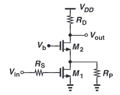

# 장말문제 11.50 — 기생 저항 R_p가 생긴 MOS 캐스코드(Fig 11.92)의 극점

## 조건
- 회로: Fig 11.92 — MOS 캐스코드 ($M_1$ 입력, $V_{in}$은 $R_S$를 거쳐 $M_1$ 게이트로, $M_2$ 캐스코드, 부하 $R_D$). 제조 오류로 $M_1$ 드레인–$M_2$ 소스 노드와 접지 사이에 기생 저항 $R_p$가 생김 (그림 라벨은 R_P)
- $\lambda = 0$으로 가정
- 밀러 이론을 이용

## 구할 것
- 회로의 극점

## 회로 — Fig 11.92
```spice
RD  VDD   Vout  {R_D}
M2  Vout  Vb    n1    nmos
M1  n1    n2    0     nmos
RS  Vin   n2    {R_S}
RP  n1    0     {R_P}
```
- 단자: VDD = 전원, 값 미지정 (T 전원 기호) / Vb = 이상적 DC 바이어스, 값 미지정 (점 단자) / Vin = 입력 (개방 원) / Vout = 출력 (개방 원)
- 표시: 노드 라벨 V_DD (T 기호 오른쪽), V_out (출력 원 오른쪽), V_b (점 단자 왼쪽), V_in (입력 원 왼쪽) / 소자 라벨 R_D (저항 오른쪽), M2 (M2 오른쪽, 소스 옆), R_S (저항 위), M1 (M1 오른쪽, 소스 옆), R_P (저항 오른쪽, 첨자 대문자 P로 인쇄) / 부호 없음 / 화살표 없음 / 수치·면적 라벨 없음
- 배치: 세로줄 위→아래 V_DD T 기호, R_D, 출력 접속점, M2, n1 접속점, M1, 접지 / M2, M1 NMOS 보통 방향(게이트 왼쪽, 드레인 위, 소스 아래·화살표 바깥) / V_b 점 단자 → 가로선 → M2 게이트 / V_in 원 → 가로 R_S → M1 게이트 / 출력 접속점 → 가로선 → V_out 원 / n1 접속점에서 가로선이 오른쪽으로 가서 아래로 꺾여 세로 R_P → 접지 (R_P는 M1 오른쪽, 접지는 M1 접지와 같은 높이에 따로) / 접속점 (세 갈래 이상, 2곳): ① 출력 = 위 R_D + 아래 M2 드레인 + 오른쪽 V_out 선 (점) ② n1 = 위 M2 소스 + 아래 M1 드레인 + 오른쪽 R_P로 가는 선 (점) / 교차: 없음


