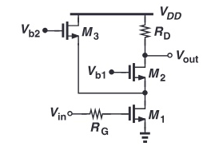
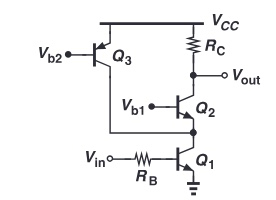

# 장말문제 11.51 — M3를 NMOS로 잘못 쓴 MOS 캐스코드(Fig 11.93)의 극점

## 조건
- 회로: Fig 11.93 — 학생이 Fig 11.91 회로를 본떠 만든 MOS 캐스코드 ($M_1$ 입력, $V_{in}$은 $R_G$를 거쳐 $M_1$ 게이트로, $M_2$ 캐스코드, 부하 $R_D$). Fig 11.91의 pnp 전류원 $Q_3$ 자리에 실수로 NMOS $M_3$를 씀 ($M_3$ 드레인은 $V_{DD}$, 소스는 $M_1$ 드레인–$M_2$ 소스 노드)
- $\lambda = 0$으로 가정
- 밀러 이론을 이용

## 구할 것
- 회로의 극점

## 회로 — Fig 11.93
```spice
RD  VDD   Vout  {R_D}
M2  Vout  Vb1   n1    nmos
M3  VDD   Vb2   n1    nmos
M1  n1    n2    0     nmos
RG  Vin   n2    {R_G}
```
- 단자: VDD = 전원, 값 미지정 (가로 레일) / Vb1, Vb2 = 이상적 DC 바이어스, 값 미지정 (점 단자) / Vin = 입력 (개방 원) / Vout = 출력 (개방 원)
- 표시: 노드 라벨 V_DD (레일 오른쪽 끝), V_b2 (점 단자 왼쪽), V_out (출력 원 오른쪽), V_b1 (점 단자 왼쪽), V_in (입력 원 왼쪽) / 소자 라벨 M3 (M3 오른쪽, 소스 옆), R_D (저항 오른쪽), M2 (M2 오른쪽, 소스 옆), M1 (M1 오른쪽, 소스 옆), R_G (저항 아래) / 부호 없음 / 화살표 없음 / 수치·면적 라벨 없음
- 배치: 맨 위 굵은 가로 레일 V_DD / 왼쪽: M3 NMOS 보통 방향(게이트 왼쪽 ← 가로선 ← V_b2 점 단자, 드레인 위 → 레일, 소스 아래·화살표 바깥), M3 소스에서 긴 세로선이 아래로 내려가 n1 접속점 높이에서 오른쪽으로 꺾여 n1 접속점 / 오른쪽 세로줄 위→아래 레일, R_D, 출력 접속점, M2, n1 접속점, M1, 접지 / M2, M1 NMOS 보통 방향(게이트 왼쪽, 드레인 위, 소스 아래·화살표 바깥) / V_b1 점 단자 → 가로선 → M2 게이트 / V_in 원 → 가로 R_G → M1 게이트 / 출력 접속점 → 가로선 → V_out 원 / 접속점 (세 갈래 이상, 2곳): ① 출력 = 위 R_D + 아래 M2 드레인 + 오른쪽 V_out 선 (점) ② n1 = 위 M2 소스 + 아래 M1 드레인 + 왼쪽 M3 소스에서 오는 선 (점) / 교차: 없음



## 회로 — Fig 11.91
```spice
RC  VCC   Vout  {R_C}
Q2  Vout  Vb1   n1    npn
Q3  n1    Vb2   VCC   pnp
Q1  n1    n2    0     npn
RB  Vin   n2    {R_B}
```
- 단자: VCC = 전원, 값 미지정 (가로 레일) / Vb1, Vb2 = 이상적 DC 바이어스, 값 미지정 (점 단자) / Vin = 입력 (개방 원) / Vout = 출력 (개방 원)
- 표시: 노드 라벨 V_CC (레일 오른쪽 끝), V_b2 (점 단자 왼쪽), V_out (출력 원 오른쪽), V_b1 (점 단자 왼쪽), V_in (입력 원 왼쪽) / 소자 라벨 Q3 (Q3 오른쪽), R_C (저항 오른쪽), Q2 (Q2 오른쪽, 이미터 옆), Q1 (Q1 오른쪽, 이미터 옆), R_B (저항 아래) / 부호 없음 / 화살표 없음 / 수치·면적 라벨 없음
- 배치: 맨 위 굵은 가로 레일 V_CC / 왼쪽: Q3 pnp(베이스 왼쪽 ← 가로선 ← V_b2 점 단자, 이미터 위 → 레일, 이미터 화살표 베이스 쪽), Q3 컬렉터에서 긴 세로선이 아래로 내려가 n1 접속점 높이에서 오른쪽으로 꺾여 n1 접속점 / 오른쪽 세로줄 위→아래 레일, R_C, 출력 접속점, Q2, n1 접속점, Q1, 접지 / Q2, Q1 npn 보통 방향(베이스 왼쪽, 컬렉터 위, 이미터 아래·화살표 바깥) / V_b1 점 단자 → 가로선 → Q2 베이스 / V_in 원 → 가로 R_B → Q1 베이스 / 출력 접속점 → 가로선 → V_out 원 / 접속점 (세 갈래 이상, 2곳): ① 출력 = 위 R_C + 아래 Q2 컬렉터 + 오른쪽 V_out 선 (점) ② n1 = 위 Q2 이미터 + 아래 Q1 컬렉터 + 왼쪽 Q3 컬렉터에서 오는 선 (점) / 교차: 없음


> 참고: Fig 11.91은 문제 11.49의 그림으로, 이 문제에서는 비교 대상("In analogy with the circuit of Fig. 11.91")으로만 쓰임
