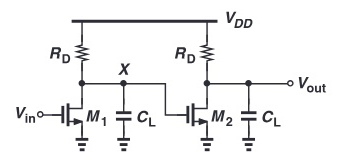

# 장말문제 11.52 — 문제 11.9, 11.10 결과로 두 단 증폭기(Fig 11.65) 설계: 전압 이득 20, −3 dB 대역폭 1 GHz

## 원문
Using the results obtained in Problems 11.9 and 11.10, design the two-stage amplifier of Fig. 11.65 for a total voltage gain of 20 and a −3 dB bandwidth of $1\ \text{GHz}$. Assume each stage carries a bias current of $1\ \text{mA}$, $C_L = 50\ \text{fF}$, and $\mu_n C_{ox} = 100\ \mu\text{A/V}^2$.

## 조건
- 설계 대상: Fig 11.65의 두 단 증폭기 (똑같은 CS 단 두 개의 캐스케이드)
- 문제 11.9와 11.10에서 얻은 결과를 이용
- 문제 11.9·11.10의 가정: 두 CS 단은 똑같고, 채널 길이 변조와 $C_L$ 외의 커패시턴스는 무시 (원문에 없음)
- 문제 11.10의 결과: $\dfrac{V_{out}}{V_{in}}(s) = \dfrac{(g_m R_D)^2}{(1 + R_D C_L s)^2}$, 겹친 두 극점의 $-3\ \text{dB}$ 대역폭 $\omega_{-3\text{dB}} = \dfrac{\sqrt{\sqrt{2} - 1}}{R_D C_L} \approx \dfrac{0.644}{R_D C_L}$ (원문에 없음)
- 전체 전압 이득 $20$, −3 dB 대역폭 $1\ \text{GHz}$
- 각 단의 바이어스 전류 $1\ \text{mA}$
- $C_L = 50\ \text{fF}$, $\mu_n C_{ox} = 100\ \mu\text{A/V}^2$

## 구할 것
- Fig 11.65 두 단 증폭기 설계 (정할 값 예: $R_D$, $M_1$·$M_2$의 $W/L$) (원문에 없음, 원문은 "설계하라"만 적음)

## 상속·참조
- 문제 11.9 (P11.09): Fig 11.65의 똑같은 CS 단 두 개 캐스케이드에서 채널길이 변조와 다른 커패시턴스를 무시하고 $|V_{out}/V_{in}|$의 보데 선도를 그림. $V_{out}/V_{in} = (V_X/V_{in})(V_{out}/V_X)$
- 문제 11.10 (P11.10): 같은 회로(같은 가정)의 전달 함수를 유도하고, $s = j\omega$를 대입해 $|V_{out}/V_{in}|$의 식을 구하고, 회로의 −3 dB 대역폭을 구함

## 회로 — Fig 11.65
```spice
* 두 저항 모두 R_D, 두 커패시터 모두 C_L로 인쇄 (넷리스트 이름 RD1/RD2, CL1/CL2는 원문에 없음)
RD1  VDD   X     {R_D}
M1   X     Vin   0  nmos
CL1  X     0     {C_L}
RD2  VDD   Vout  {R_D}
M2   Vout  X     0  nmos
CL2  Vout  0     {C_L}
```
- 단자: VDD = 전원, 값 미지정 (가로 레일) / Vin = 입력 (개방 원) / Vout = 출력 (개방 원)
- 표시: 노드 라벨 V_DD (레일 오른쪽 끝), X (X 접속점 위), V_in (입력 원 왼쪽), V_out (출력 원 오른쪽) / 소자 라벨 R_D (왼쪽 저항 왼쪽), R_D (오른쪽 저항 왼쪽), M1 (M1 오른쪽, 소스 옆), M2 (M2 오른쪽, 소스 옆), C_L (왼쪽 커패시터 오른쪽), C_L (오른쪽 커패시터 오른쪽) / 부호 없음 / 화살표 없음 / 수치·면적 라벨 없음
- 배치: 맨 위 굵은 가로 레일 V_DD, 두 R_D가 레일에 매달려 세로로 내려옴 / 왼쪽 단: R_D, M1 드레인 접속점, M1(NMOS 보통 방향), 접지 / V_in 원 → 가로선 → M1 게이트 / M1 드레인 접속점에서 가로선이 오른쪽으로 X 접속점(C_L이 세로로 매달려 접지)을 지나 더 오른쪽에서 아래로 꺾이고 M2 게이트 높이에서 다시 오른쪽으로 꺾여 M2 게이트 (계단 모양) / 오른쪽 단: R_D, M2 드레인 접속점, M2(NMOS 보통 방향), 접지 / M2 드레인 접속점에서 가로선이 오른쪽으로 C_L 접속점을 지나 V_out 원에서 끝남 / 접지 기호는 M1 소스, 왼쪽 C_L, M2 소스, 오른쪽 C_L 아래에 따로 (4개) / 접속점 (세 갈래 이상, 4곳): ① M1 드레인 = 위 R_D + 아래 M1 드레인 + 오른쪽 가로선 (점) ② X = 왼쪽 가로선 + 아래 C_L + 오른쪽 M2 게이트로 가는 선 (점) ③ M2 드레인 = 위 R_D + 아래 M2 드레인 + 오른쪽 가로선 (점) ④ 오른쪽 C_L 위 = 왼쪽 가로선 + 오른쪽 V_out 선 + 아래 C_L (점) / 교차: 없음


> 참고: Fig 11.65는 632쪽(PDF 34)에 인쇄된 문제 11.9, 11.10의 그림을 다시 씀

## 풀이
### 문제 11.9, 11.10의 결과
- 두 단이 같고 $M_2$ 게이트가 $X$에 부하를 주지 않아 $\dfrac{V_{out}}{V_{in}} = \dfrac{(g_m R_D)^2}{(1 + R_D C_L s)^2}$ ($g_m$: 각 트랜지스터의 트랜스컨덕턴스, 채널길이 변조와 다른 커패시턴스는 무시)
- 같은 극점 두 개의 대역폭: $\omega_{-3\text{dB}} = \dfrac{\sqrt{\sqrt{2} - 1}}{R_D C_L} = \dfrac{0.644}{R_D C_L}$
### 대역폭에서 $R_D$
- $R_D = \dfrac{\sqrt{\sqrt{2} - 1}}{2\pi f_{-3\text{dB}} C_L} = \dfrac{0.644}{2\pi(1\ \text{GHz})(50\ \text{fF})} = 2.05\ \text{k}\Omega$
- 한 단의 극점은 $1/(2\pi R_D C_L) = 1.55\ \text{GHz}$
### 이득에서 $g_m$
- $(g_m R_D)^2 = 20$ → $g_m R_D = \sqrt{20} = 4.47$
- $g_m = 4.47/R_D = 2.18\ \text{mS}$
### $W/L$
- $g_m = \sqrt{2\mu_n C_{ox}(W/L)I_D}$에서 $\dfrac{W}{L} = \dfrac{g_m^2}{2\mu_n C_{ox}I_D} = \dfrac{(2.18\ \text{mS})^2}{2(100\ \mu\text{A/V}^2)(1\ \text{mA})} = 23.8$
- 과구동 전압 $V_{GS} - V_{TH} = 2I_D/g_m = 0.916\ \text{V}$, $R_D$ 양단 DC 전압 $I_D R_D = 2.05\ \text{V}$
### 답
- $R_D = 2.05\ \text{k}\Omega$ (두 단 모두), $M_1$·$M_2$의 $W/L = 23.8$ ($g_m = 2.18\ \text{mS}$, $I_D = 1\ \text{mA}$)
