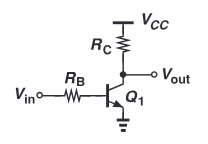

# 장말문제 11.53 — 입력 극점 500 MHz, 출력 극점 2 GHz인 CE 단(Fig 11.94) 설계: 이득이 최대인 R_B, R_C

## 원문
We wish to design the CE stage of Fig. 11.94 for an input pole at $500\ \text{MHz}$ and an output pole at $2\ \text{GHz}$. Assuming $I_C = 1\ \text{mA}$, $C_\pi = 20\ \text{fF}$, $C_\mu = 5\ \text{fF}$, $C_{CS} = 10\ \text{fF}$, and $V_A = \infty$, and using Miller's theorem, determine the values of $R_B$ and $R_C$ such that the (low-frequency) voltage gain is maximized. You may need to use iteration.

## 조건
- 설계 대상: Fig 11.94의 CE 단
- 입력 극점 $500\ \text{MHz}$, 출력 극점 $2\ \text{GHz}$
- $I_C = 1\ \text{mA}$, $C_\pi = 20\ \text{fF}$, $C_\mu = 5\ \text{fF}$, $C_{CS} = 10\ \text{fF}$, $V_A = \infty$
- 밀러 이론을 이용
- 반복 계산이 필요할 수 있음 (원문의 메모)
- $\beta$가 주어지지 않으므로 $r_\pi$는 무시함 ($r_\pi \to \infty$) (원문에 없음)

## 구할 것
- (저주파) 전압 이득이 최대가 되도록 하는 $R_B$와 $R_C$ 값

## 회로 — Fig 11.94
```spice
RC  VCC   Vout  {R_C}
Q1  Vout  n1    0     npn
RB  Vin   n1    {R_B}
```
- 단자: VCC = 전원, 값 미지정 (T 전원 기호) / Vin = 입력 (개방 원) / Vout = 출력 (개방 원)
- 표시: 노드 라벨 V_CC (T 기호 오른쪽), V_out (출력 원 오른쪽), V_in (입력 원 왼쪽) / 소자 라벨 R_C (저항 왼쪽), R_B (저항 위), Q1 (트랜지스터 오른쪽, 이미터 옆) / 부호 없음 / 화살표 없음 / 수치·면적 라벨 없음
- 배치: 세로줄 위→아래 V_CC T 기호, R_C, 컬렉터 접속점, Q1, 접지 / Q1 npn 보통 방향(베이스 왼쪽, 컬렉터 위, 이미터 아래·화살표 바깥 → 접지) / V_in 원 → 가로 R_B → Q1 베이스 / 컬렉터 접속점 → 가로선 → V_out 원 / 접속점 (세 갈래 이상, 1곳): ① 컬렉터 = 위 R_C + 아래 Q1 컬렉터 + 오른쪽 V_out 선 (점) / 교차: 없음



## 힌트
### $R_C$는 출력 극점만으로 정해진다
- 극점 조건을 하한으로 읽으면, $R_C$를 키울수록 이득은 늘고 출력 극점은 내려가므로 이득 최대는 출력 극점 조건을 등호로 맞출 때다
- 밀러로 나누면 출력 노드의 시상수에는 $R_C$와 이득만 들어가고 이득도 $R_C$로 정해지므로, 출력 극점 조건 하나로 $R_C$가 정해지고 그 이득으로 밀러 입력 커패시턴스를 구해 입력 극점에서 $R_B$를 정한다

## 풀이
### 소신호 값과 이득
- $g_m = I_C/V_T = 1\ \text{mA}/26\ \text{mV} = 38.5\ \text{mS}$ ($V_T = 26\ \text{mV}$, $g_m$: $Q_1$의 트랜스컨덕턴스)
- $r_\pi$를 무시하므로 저주파 이득 $|A_v| = g_m R_C$는 $R_B$와 무관하고 $R_C$가 클수록 크다
### 출력 극점에서 $R_C$
- $R_C$를 키우면 이득은 늘고 출력 극점은 내려가므로, 이득 최대는 출력 극점을 $2\ \text{GHz}$에 맞출 때다
- 밀러로 출력 쪽에 $(1 + \frac{1}{g_m R_C})C_\mu$: $\dfrac{1}{\omega_{p,out}} = R_C\left[C_{CS} + \left(1 + \tfrac{1}{g_m R_C}\right)C_\mu\right] = R_C(C_{CS} + C_\mu) + \dfrac{C_\mu}{g_m}$
- $R_C = \dfrac{1/(2\pi \cdot 2\ \text{GHz}) - C_\mu/g_m}{C_{CS} + C_\mu} = \dfrac{79.6\ \text{ps} - 0.130\ \text{ps}}{15\ \text{fF}} = 5.30\ \text{k}\Omega$ ($R_C$에 대해 1차식이라 반복 없이 풀린다)
### 이득과 밀러 입력 커패시턴스
- $|A_v| = g_m R_C = 204$
- $C_{in} = C_\pi + (1 + g_m R_C)C_\mu = 20\ \text{fF} + 205 \times 5\ \text{fF} = 1.04\ \text{pF}$
### 입력 극점에서 $R_B$
- $R_B = \dfrac{1}{2\pi(500\ \text{MHz})C_{in}} = 305\ \Omega$
### 답
- $R_B = 305\ \Omega$, $R_C = 5.30\ \text{k}\Omega$ (이때 저주파 이득 $|A_v| = 204$)
