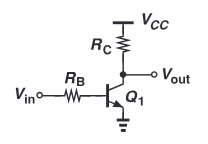

# 장말문제 11.54 — 부하 커패시턴스 20 fF를 구동하는 조건을 더해 문제 11.53 반복 (Fig 11.94)

## 조건
- 회로: Fig 11.94 (문제 11.53의 CE 단)
- 문제 11.53의 조건을 이어받음: 입력 극점 $500\ \text{MHz}$, 출력 극점 $2\ \text{GHz}$, $I_C = 1\ \text{mA}$, $C_\pi = 20\ \text{fF}$, $C_\mu = 5\ \text{fF}$, $C_{CS} = 10\ \text{fF}$, $V_A = \infty$, 밀러 이론 이용
- 추가 가정: 회로가 부하 커패시턴스 $20\ \text{fF}$를 구동해야 함

## 구할 것
- 이 추가 가정으로 문제 11.53을 다시 풂: (저주파) 전압 이득이 최대가 되도록 하는 $R_B$와 $R_C$ 값

## 상속·참조
- 문제 11.53 (P11.53): Fig 11.94의 CE 단을 입력 극점 $500\ \text{MHz}$, 출력 극점 $2\ \text{GHz}$로 설계. $I_C = 1\ \text{mA}$, $C_\pi = 20\ \text{fF}$, $C_\mu = 5\ \text{fF}$, $C_{CS} = 10\ \text{fF}$, $V_A = \infty$로 가정하고 밀러 이론을 이용해 (저주파) 전압 이득이 최대가 되는 $R_B$, $R_C$를 구함. 반복 계산이 필요할 수 있음

## 회로 — Fig 11.94
```spice
RC  VCC   Vout  {R_C}
Q1  Vout  n1    0     npn
RB  Vin   n1    {R_B}
```
- 단자: VCC = 전원, 값 미지정 (T 전원 기호) / Vin = 입력 (개방 원) / Vout = 출력 (개방 원)
- 표시: 노드 라벨 V_CC (T 기호 오른쪽), V_out (출력 원 오른쪽), V_in (입력 원 왼쪽) / 소자 라벨 R_C (저항 왼쪽), R_B (저항 위), Q1 (트랜지스터 오른쪽, 이미터 옆) / 부호 없음 / 화살표 없음 / 수치·면적 라벨 없음
- 배치: 세로줄 위→아래 V_CC T 기호, R_C, 컬렉터 접속점, Q1, 접지 / Q1 npn 보통 방향(베이스 왼쪽, 컬렉터 위, 이미터 아래·화살표 바깥 → 접지) / V_in 원 → 가로 R_B → Q1 베이스 / 컬렉터 접속점 → 가로선 → V_out 원 / 접속점 (세 갈래 이상, 1곳): ① 컬렉터 = 위 R_C + 아래 Q1 컬렉터 + 오른쪽 V_out 선 (점) / 교차: 없음


