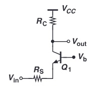

# 장말문제 11.55 — −3 dB 대역폭 10 GHz인 CB 단(Fig 11.95) 설계: 최대 R_C와 최대 이득

## 원문
We wish to design the common-base stage of Fig. 11.95 for a −3 dB bandwidth of $10\ \text{GHz}$. Assume $I_C = 1\ \text{mA}$, $V_A = \infty$, $R_S = 50\ \Omega$, $C_\pi = 20\ \text{fF}$, $C_\mu = 5\ \text{fF}$, and $C_{CS} = 20\ \text{fF}$. Determine the maximum allowable value of $R_C$ and hence the maximum achievable gain. (Note that the input and output poles may affect the bandwidth.)

## 조건
- 설계 대상: Fig 11.95의 공통 베이스 단
- −3 dB 대역폭 $10\ \text{GHz}$
- $I_C = 1\ \text{mA}$, $V_A = \infty$, $R_S = 50\ \Omega$, $C_\pi = 20\ \text{fF}$, $C_\mu = 5\ \text{fF}$, $C_{CS} = 20\ \text{fF}$
- 입력 극점과 출력 극점이 모두 대역폭에 영향을 줄 수 있음 (원문의 메모)

## 구할 것
- 허용되는 $R_C$의 최댓값
- 그에 따른 최대 달성 가능 이득

## 회로 — Fig 11.95
```spice
RC  VCC   Vout  {R_C}
Q1  Vout  Vb    n1    npn     ; 좌우 반전 (베이스 오른쪽)
RS  Vin   n1    {R_S}
```
- 단자: VCC = 전원, 값 미지정 (T 전원 기호) / Vb = 이상적 DC 바이어스, 값 미지정 (점 단자) / Vin = 입력 (개방 원) / Vout = 출력 (개방 원)
- 표시: 노드 라벨 V_CC (T 기호 오른쪽), V_out (출력 원 오른쪽), V_b (점 단자 오른쪽), V_in (입력 원 왼쪽) / 소자 라벨 R_C (저항 왼쪽), Q1 (트랜지스터 아래 오른쪽), R_S (저항 위) / 부호 없음 / 화살표 없음 / 수치·면적 라벨 없음
- 배치: 세로줄 위→아래 V_CC T 기호, R_C, 컬렉터 접속점, Q1 / Q1 npn 좌우 반전(베이스 막대 오른쪽 → 가로선 → V_b 점 단자, 컬렉터 왼쪽 위, 이미터 왼쪽 아래·화살표 바깥(왼쪽 아래)) / Q1 이미터 → 세로선 아래로 → 왼쪽으로 꺾여 가로 R_S → V_in 원 (R_S와 V_in 원은 Q1보다 아래 높이) / 컬렉터 접속점 → 가로선 → V_out 원 / 접지 없음 / 접속점 (세 갈래 이상, 1곳): ① 컬렉터 = 위 R_C + 아래 Q1 컬렉터 + 오른쪽 V_out 선 (점) / 교차: 없음



## 풀이
### 소신호 값
- $g_m = I_C/V_T = 1\ \text{mA}/26\ \text{mV} = 38.5\ \text{mS}$, $1/g_m = 26.0\ \Omega$ ($V_T = 26\ \text{mV}$, $g_m$: $Q_1$의 트랜스컨덕턴스). $\beta$가 주어지지 않아 $r_\pi$는 무시한다($\alpha \approx 1$)
- 베이스가 $V_b$로 교류 접지라 $C_\mu$에 밀러 증배가 없다
### 입력 극점
- 이미터 노드: $C_\pi$(이미터–베이스)가 접지로 보이고, 저항은 $R_S \parallel (1/g_m) = 50 \parallel 26.0 = 17.1\ \Omega$
- $f_{p,in} = \dfrac{1}{2\pi (17.1\ \Omega)(20\ \text{fF})} = 465\ \text{GHz}$로 $10\ \text{GHz}$보다 훨씬 높다
### 출력 극점과 $R_C$
- 컬렉터 노드: $C_\mu$와 $C_{CS}$가 모두 접지로 보여 $f_{p,out} = \dfrac{1}{2\pi R_C (C_\mu + C_{CS})}$
- 두 극점에서 $\left[1 + (f/f_{p,in})^2\right]\left[1 + (f/f_{p,out})^2\right] = 2$를 $f = 10\ \text{GHz}$에 맞추면 $f_{p,out} = 10.0\ \text{GHz}$ (입력 극점 영향은 0.05% 정도)
- $R_C = \dfrac{1}{2\pi(10.0\ \text{GHz})(25\ \text{fF})} = 636\ \Omega$
### 최대 이득
- $|A_v| = \dfrac{R_C}{R_S + 1/g_m} = \dfrac{636\ \Omega}{50\ \Omega + 26.0\ \Omega} = 8.37$
### 답
- $R_{C,max} = 636\ \Omega$
- 최대 이득 $|A_v| = 8.37$
