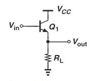

# 장말문제 11.56 — 입력 커패시턴스 50 fF 미만인 이미터 폴로어(Fig 11.96)의 최소 R_L

## 원문
The emitter follower of Fig. 11.96 must be designed for an input capacitance of less than $50\ \text{fF}$. If $C_\mu = 10\ \text{fF}$, $C_\pi = 100\ \text{fF}$, $V_A = \infty$, and $I_C = 1\ \text{mA}$, what is the minimum tolerable value of $R_L$?

## 조건
- 설계 대상: Fig 11.96의 이미터 폴로어, 입력 커패시턴스가 $50\ \text{fF}$보다 작아야 함
- $C_\mu = 10\ \text{fF}$, $C_\pi = 100\ \text{fF}$, $V_A = \infty$, $I_C = 1\ \text{mA}$

## 구할 것
- 허용 가능한 $R_L$의 최솟값

## 회로 — Fig 11.96
```spice
Q1  VCC   Vin   Vout  npn
RL  Vout  0     {R_L}
```
- 단자: VCC = 전원, 값 미지정 (T 전원 기호) / Vin = 입력 (개방 원) / Vout = 출력 (개방 원)
- 표시: 노드 라벨 V_CC (T 기호 오른쪽), V_in (입력 원 왼쪽), V_out (출력 원 오른쪽) / 소자 라벨 Q1 (트랜지스터 오른쪽, 이미터 옆), R_L (저항 오른쪽) / 부호 없음 / 화살표 없음 / 수치·면적 라벨 없음
- 배치: 세로줄 위→아래 V_CC T 기호, Q1, 이미터 접속점, R_L, 접지 / Q1 npn 보통 방향(베이스 왼쪽, 컬렉터 위 → V_CC, 이미터 아래·화살표 바깥) / V_in 원 → 가로선 → Q1 베이스 / 이미터 접속점 → 가로선 → V_out 원 / 접속점 (세 갈래 이상, 1곳): ① 이미터 = 위 Q1 이미터 + 아래 R_L + 오른쪽 V_out 선 (점) / 교차: 없음


> 참고: 문제 문장은 638쪽(PDF 37) 오른쪽 단 끝에 있고, Fig 11.96은 다음 쪽 639쪽(PDF 37) 왼쪽 단 위에 인쇄됨
