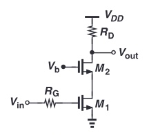

# 장말문제 11.58 — 입력 극점 5 GHz, 출력 극점 10 GHz인 MOS 캐스코드(Fig 11.97) 설계: 최대 R_G, R_D와 전압 이득

## 원문
We wish to design the MOS cascode of Fig. 11.97 for an input pole of $5\ \text{GHz}$ and an output pole of $10\ \text{GHz}$. Assume $M_1$ and $M_2$ are identical, $I_D = 0.5\ \text{mA}$, $C_{GS} = (2/3) W L C_{ox}$, $C_{ox} = 12\ \text{fF}/\mu\text{m}^2$, $\mu_n C_{ox} = 100\ \mu\text{A/V}^2$, $\lambda = 0$, $L = 0.18\ \mu\text{m}$ and $C_{GD} = C_0 W$, where $C_0 = 0.2\ \text{fF}/\mu\text{m}$ denotes the gate-drain capacitance per unit width. Determine the maximum allowable values of $R_G$, $R_D$, and the voltage gain. Use Miller's approximation for $C_{GD1}$. Assume an overdrive voltage of $200\ \text{mV}$ for each transistor.

## 조건
- 설계 대상: Fig 11.97의 MOS 캐스코드
- 입력 극점 $5\ \text{GHz}$, 출력 극점 $10\ \text{GHz}$
- $M_1$과 $M_2$는 동일, $I_D = 0.5\ \text{mA}$
- $C_{GS} = (2/3) W L C_{ox}$, $C_{ox} = 12\ \text{fF}/\mu\text{m}^2$, $\mu_n C_{ox} = 100\ \mu\text{A/V}^2$, $\lambda = 0$, $L = 0.18\ \mu\text{m}$
- $C_{GD} = C_0 W$, $C_0 = 0.2\ \text{fF}/\mu\text{m}$ (단위 폭당 게이트–드레인 커패시턴스)
- $C_{GD1}$에는 밀러 근사를 사용
- 각 트랜지스터의 과구동 전압 $200\ \text{mV}$

## 구할 것
- 허용되는 $R_G$, $R_D$의 최댓값
- 전압 이득

## 회로 — Fig 11.97
```spice
RD  VDD   Vout  {R_D}
M2  Vout  Vb    n1    nmos
M1  n1    n2    0     nmos
RG  Vin   n2    {R_G}
```
- 단자: VDD = 전원, 값 미지정 (T 전원 기호) / Vb = 이상적 DC 바이어스, 값 미지정 (점 단자) / Vin = 입력 (개방 원) / Vout = 출력 (개방 원)
- 표시: 노드 라벨 V_DD (T 기호 오른쪽), V_out (출력 원 오른쪽), V_b (점 단자 왼쪽), V_in (입력 원 왼쪽) / 소자 라벨 R_D (저항 오른쪽), M2 (M2 오른쪽, 소스 옆), R_G (저항 위), M1 (M1 오른쪽, 소스 옆) / 부호 없음 / 화살표 없음 / 수치·면적 라벨 없음
- 배치: 세로줄 위→아래 V_DD T 기호, R_D, 출력 접속점, M2, M1, 접지 / M2, M1 NMOS 보통 방향(게이트 왼쪽, 드레인 위, 소스 아래·화살표 바깥) / M2 소스에서 곧은 세로선이 M1 드레인으로 (n1, 라벨 없음) / V_b 점 단자 → 가로선 → M2 게이트 / V_in 원 → 가로 R_G → M1 게이트 / 출력 접속점 → 가로선 → V_out 원 / 접속점 (세 갈래 이상, 1곳): ① 출력 = 위 R_D + 아래 M2 드레인 + 오른쪽 V_out 선 (점) / 교차: 없음


