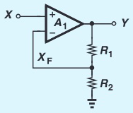

# 연습문제 12.1 — R2 = ∞일 때 비반전 증폭기의 귀환 해석 (예제 12.1 변형)

## 원문
$R_2 = \infty$일 때 위의 해석을 수행하라.

## 조건
- 예제 12.1과 같은 회로: Fig 12.2 비반전 증폭기 (연산 증폭기 $A_1$, 분배기 $R_1$, $R_2$)
- 바뀐 점: $R_2 = \infty$ ($R_2$ 개방)
- 귀환율 $K = X_F/Y$ (본문 정의, 원문에 없음)
- 식 (12.2): $\dfrac{Y}{X} = \dfrac{A_1}{1 + KA_1}$ (본문 식, 원문에 없음)
- 예제 12.1의 결과: 연산 증폭기 $A_1$이 뺄셈과 증폭, $R_1$, $R_2$가 출력 감지와 귀환, $K = R_2/(R_1 + R_2)$ (원문에 없음)

## 구할 것
- $R_2 = \infty$일 때 귀환의 관점에서 회로 해석: 귀환율 $K$, 폐루프 이득 $Y/X$

## 상속·참조
- 예제 12.1 (E12.01): 귀환율 $K = \dfrac{R_2}{R_1 + R_2}$, $\dfrac{Y}{X} = \dfrac{A_1}{1 + \dfrac{R_2}{R_1 + R_2}A_1}$ (식 12.3)
- 식 (12.2): $\dfrac{Y}{X} = \dfrac{A_1}{1 + KA_1}$

## 회로 — Fig 12.2
```spice
XA1  X   XF  Y   opamp
R1   Y   XF  {R_1}
R2   XF  0   {R_2}
```
- 단자: X = 입력 (개방 원) / Y = 출력 (개방 원)
- 표시: 노드 라벨 X (입력 원 왼쪽), Y (출력 원 오른쪽), X_F (귀환선 왼쪽 세로 부분 바로 오른쪽, 아래 가로선 위) / 소자 라벨 A1 (삼각형 안), R1, R2 (각 저항 오른쪽) / 부호 연산 증폭기 입력 + 위, − 아래 (삼각형 안쪽 왼쪽) / 화살표 없음 / 수치·면적 라벨 없음
- 배치: 왼쪽 X 원 → 가로선 → 연산 증폭기 + 입력(위) / 연산 증폭기는 오른쪽을 향한 삼각형, 출력 접속점에서 가로선이 오른쪽 Y 원까지 / 출력 접속점 아래로 R1, X_F 접속점, R2, 접지가 한 세로줄 / X_F 접속점에서 가로선이 왼쪽으로 연산 증폭기 왼쪽 바깥까지 간 뒤 위로 꺾이고, − 입력 높이에서 오른쪽으로 꺾여 − 입력 / 접속점 (세 갈래 이상, 2곳): 출력 = 왼쪽 연산 증폭기 출력 + 오른쪽 Y 선 + 아래 R1 (점), X_F = 위 R1 + 아래 R2 + 왼쪽 귀환선 (점) / 교차: 없음


> 참고: 그림은 $R_2$가 있는 그대로 인쇄돼 있음. 이 연습문제는 $R_2 = \infty$(개방)인 경우
