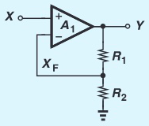

# 연습문제 12.4 — A1이 200으로 감소할 때 이득의 % 변화율 (예제 12.4 변형)

## 원문
$A_1$이 200으로 감소할 때 이득의 % 변화율을 결정하라.

## 조건
- 예제 12.4와 같은 회로·설계: Fig 12.2 비반전 증폭기, 공칭 이득 4 ($R_1/R_2 = 3$, $K = R_2/(R_1 + R_2) = 1/4$) (괄호 안은 원문에 없음)
- 바뀐 점: $A_1$이 200으로 감소 (예제 (b)는 500)
- 감소 전 기준값은 예제 (a)의 $A_1 = 1000$ (원문에 없음)
- 식 (12.2): $\dfrac{Y}{X} = \dfrac{A_1}{1 + KA_1}$ (본문 식, 원문에 없음)
- 예제 12.4의 결과: $A_1 = 1000$일 때 $Y/X = 3.984$ (원문에 없음)

## 구할 것
- $A_1$이 200으로 감소할 때 이득의 % 변화율

## 상속·참조
- 예제 12.4 (E12.04): 공칭 이득 4 → 식 (12.15) $Y/X \approx 1 + R_1/R_2$에서 $R_1/R_2 = 3$, $K = 1/4$. (a) $A_1 = 1000$: $Y/X = 3.984$ (식 12.17), 루프 이득 $KA_1 = 250$. (b) $A_1 = 500$: $Y/X = 3.968$, 변화율 $(3.984 - 3.968)/3.984 = 0.4\%$
- 예제 원문의 "공칭 전압이 4"는 공칭 이득 4로 읽음 (예제 풀이와 같음)

## 회로 — Fig 12.2
```spice
XA1  X   XF  Y   opamp
R1   Y   XF  {R_1}
R2   XF  0   {R_2}
```
- 단자: X = 입력 (개방 원) / Y = 출력 (개방 원)
- 표시: 노드 라벨 X (입력 원 왼쪽), Y (출력 원 오른쪽), X_F (귀환선 왼쪽 세로 부분 바로 오른쪽, 아래 가로선 위) / 소자 라벨 A1 (삼각형 안), R1, R2 (각 저항 오른쪽) / 부호 연산 증폭기 입력 + 위, − 아래 (삼각형 안쪽 왼쪽) / 화살표 없음 / 수치·면적 라벨 없음
- 배치: 왼쪽 X 원 → 가로선 → 연산 증폭기 + 입력(위) / 연산 증폭기는 오른쪽을 향한 삼각형, 출력 접속점에서 가로선이 오른쪽 Y 원까지 / 출력 접속점 아래로 R1, X_F 접속점, R2, 접지가 한 세로줄 / X_F 접속점에서 가로선이 왼쪽으로 연산 증폭기 왼쪽 바깥까지 간 뒤 위로 꺾이고, − 입력 높이에서 오른쪽으로 꺾여 − 입력 / 접속점 (세 갈래 이상, 2곳): 출력 = 왼쪽 연산 증폭기 출력 + 오른쪽 Y 선 + 아래 R1 (점), X_F = 위 R1 + 아래 R2 + 왼쪽 귀환선 (점) / 교차: 없음


