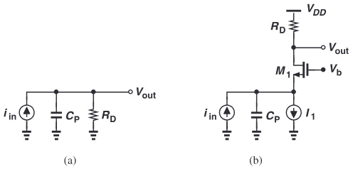

# 연습문제 12.9 — 기생 커패시턴스가 있는 두 회로의 전달 함수

## 원문
위 회로의 각각에 대하여 전달 함수 $V_{out}/I_{in}$을 결정하라.

## 조건
- "위 회로"는 예제 12.9 풀이의 Fig 12.20(a), (b) 두 회로 (원문에 없음)
- (a): 입력 전류원 $i_{in}$이 $C_P$와 $R_D$의 병렬에 직접 인가됨, 출력 $V_{out}$은 그 노드
- (b): 입력 전류원 $i_{in}$과 $C_P$가 CG 단 $M_1$의 소스에 연결 (소스 바이어스 전류원 $I_1$, 게이트 바이어스 $V_b$, 드레인 부하 $R_D$), 출력 $V_{out}$은 드레인
- $C_P$: 입력 전류원의 기생 커패시턴스 (예제 12.9, 원문에 없음)
- 원문의 $I_{in}$은 그림의 $i_{in}$ (원문에 없음)
- 소자 값은 주어지지 않음 (답은 기호와 $s$의 함수로) (원문에 없음)
- $\lambda = 0$ (본문 12.3.2절의 가정, 원문에 없음)
- 바디 효과 무시, $I_1$은 이상적 전류원 (원문에 없음)

## 구할 것
- Fig 12.20(a), (b) 각 회로의 전달 함수 $V_{out}/I_{in}$

## 상속·참조
- 예제 12.9 (E12.09): 입력 전류원이 큰 기생 커패시턴스 $C_p$를 가진다고 가정. 저항 $R_D$에 직접 인가하면(Fig 12.20(a)) −3 dB 대역폭이 $(R_D C_p)^{-1}$이고, CG 단을 쓰면(Fig 12.20(b)) 입력 극점이 $g_m/C_p$로 옮겨짐
- 본문 12.3.2절: 그림 12.19의 이득은 $\lambda = 0$으로 보고 구함
- 본문은 $C_p$, 그림은 $C_P$로 인쇄됨 (같은 소자)

## 회로 — Fig 12.20(a)
```spice
IIN  0     Vout       ; i_in (화살표 위쪽: 접지 → Vout)
CP   Vout  0    {C_P}
RD   Vout  0    {R_D}
```
- 단자: Vout = 출력 (개방 원) / 입력은 단자 없이 전류원 i_in
- 표시: 노드 라벨 V_out (출력 원 오른쪽) / 소자 라벨 i_in (전류원 왼쪽), C_P (커패시터 오른쪽), R_D (저항 오른쪽) / 부호 없음 / 화살표 없음 / 수치·면적 라벨 없음
- 배치: 위쪽 가로 도선 하나에 왼쪽부터 i_in, C_P, R_D가 나란히 매달리고 각각 아래 끝이 접지 / 가로 도선 오른쪽 끝이 V_out 원 / 접속점 (세 갈래 이상, 2곳): C_P 위 (점), R_D 위 (점) / 교차: 없음

## 회로 — Fig 12.20(b)
```spice
RD   VDD   Vout  {R_D}
M1   Vout  Vb    n1   nmos
IIN  0     n1         ; i_in (화살표 위쪽: 접지 → n1)
CP   n1    0     {C_P}
I1   n1    0          ; I_1 (값 없음, 화살표 아래쪽)
```
- 단자: VDD = 전원, 값 미지정 (T 전원 기호) / Vb = 게이트 DC 바이어스, 값 미지정 (점 단자) / Vout = 출력 (개방 원) / 입력은 단자 없이 전류원 i_in
- 표시: 노드 라벨 V_DD (T 기호 오른쪽), V_out (출력 원 오른쪽), V_b (점 단자 오른쪽) / 소자 라벨 R_D (저항 왼쪽), M1 (트랜지스터 왼쪽), i_in (전류원 왼쪽), C_P (커패시터 오른쪽), I_1 (전류원 오른쪽) / 부호 없음 / 화살표 없음 / 수치·면적 라벨 없음
- 배치: 오른쪽 세로줄 위→아래 V_DD T 기호, R_D, Vout 접속점, M1(좌우 반전 NMOS, 게이트 오른쪽 → V_b 점 단자), 소스 접속점, I_1 전류원, 접지 / Vout 접속점에서 가로선이 오른쪽 V_out 원 / 소스 접속점에서 가로 도선이 왼쪽으로 가서 C_P, i_in이 매달림 (각각 아래 접지) / 접속점 (세 갈래 이상, 3곳): Vout = R_D + M1 드레인 + 출력선 (점), C_P 위 (점), M1 소스 = 위 M1 + 아래 I_1 + 왼쪽 가로 도선 (점) / 교차: 없음


