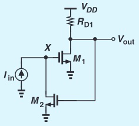

# 연습문제 12.14 — $M_2$가 PMOS일 때의 귀환 극성과 $R_D \to \infty$

## 원문
$M_2$가 PMOS 소자(아직 CS 단으로 동작함)일 때 위의 예제를 다시 풀어라. 만일 $R_D \to \infty$이라면 어떤 일이 일어나는가? 이 결과가 예상되는가?

## 조건
- 예제 12.14와 같은 회로: Fig 12.30 (CS 단 $M_1$–$R_{D1}$, 입력 전류원 $I_{in}$이 게이트 노드 $X$를 구동, $V_{out}$이 $M_2$ 게이트를 구동하고 $M_2$ 드레인이 $X$에 연결)
- 바뀐 점: $M_2$가 PMOS 소자이고 여전히 CS 단으로 동작
- PMOS $M_2$의 소스는 $V_{DD}$에 연결되는 것으로 봄 (원문에 없음)
- 원문의 $R_D$: 그림에 드레인 저항은 $R_{D1}$ 하나뿐이므로 $R_{D1}$을 가리키는 것으로 봄 (원문에 없음)
- 소자 값은 주어지지 않음 (답은 정성적 판정) (원문에 없음)

## 구할 것
- (1) $M_2$가 PMOS일 때 귀환의 극성 (번호는 원문에 없음)
- (2) $R_D \to \infty$이면 어떤 일이 일어나는가? 이 결과가 예상되는가? (번호는 원문에 없음)

## 상속·참조
- 예제 12.14 (E12.14): 원래 회로($M_2$가 NMOS)에서 $I_{in}$이 증가하면 $V_X$가 증가하려 하고 $I_{D1}$이 증가 → $V_{out}$은 떨어지고 $I_{D2}$는 감소하며 $V_X$를 증가시킴. 반송된 신호가 $I_{in}$이 만든 효과를 개선 → 귀환의 극성은 양(정귀환)
- 본문 12.5절: 입력 신호가 증가한다고 가정하고 순방향 증폭기와 귀환 회로망을 통하는 변화를 따라가, 반송된 양이 원래의 효과를 방해하는지 개선하는지 결정

## 회로 — Fig 12.30
```spice
* 그림은 바뀌기 전 회로 (문제 조건으로 M2가 PMOS CS 단이 됨)
RD1  VDD   Vout  {R_D1}
M1   Vout  X     0     nmos
M2   X     Vout  0     nmos
IIN  0     X           ; I_in (화살표 위쪽: 접지 → X)
```
- 단자: VDD = 전원, 값 미지정 (T 전원 기호) / Vout = 출력 (개방 원) / 입력은 단자 없이 전류원 I_in
- 표시: 노드 라벨 V_DD (T 기호 오른쪽), X (접속점 위), V_out (출력 원 오른쪽) / 소자 라벨 R_D1 (저항 오른쪽), M1 (오른쪽), M2 (왼쪽), I_in (전류원 왼쪽) / 부호 없음 / 화살표 없음 / 수치·면적 라벨 없음
- 배치: 가운데 세로줄 위→아래 V_DD T 기호, R_D1, M1 드레인 접속점, M1(보통 NMOS, 게이트 왼쪽), 접지 / M1 드레인 접속점에서 가로선이 오른쪽으로 가서 두 번째 접속점, 다시 오른쪽 V_out 원 / 두 번째 접속점에서 세로선이 맨 아래 M2 게이트 높이까지 내려가 왼쪽으로 꺾여 M2 게이트 / I_in 전류원은 맨 왼쪽(아래 접지), 위 끝에서 가로선이 오른쪽 X 접속점, 다시 오른쪽 M1 게이트 / X 접속점에서 세로선이 아래로 M2 드레인 / M2는 좌우 반전 NMOS(게이트 오른쪽), M1 아래 왼쪽, 소스 아래 접지 / 접속점 (세 갈래 이상, 3곳): X (점), M1 드레인 (점), 오른쪽 Vout 갈래 (점) / 교차: 없음


