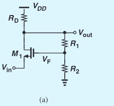

# 연습문제 12.16 — $R_2 \to \infty$일 때 귀환 CG 단의 입력 임피던스 (예제 12.16 변형)

## 원문
$R_2 \to \infty$일 때 무슨 일이 일어나는가? 이 결과는 예상되는가?

## 조건
- 예제 12.16과 같은 회로: Fig 12.34(a) ($M_1$ 공통 게이트 단, 소스 = $V_{in}$, 드레인 = $V_{out}$ ($R_D$를 거쳐 $V_{DD}$), 게이트 = $R_1$–$R_2$ 분배기 가운데 노드 $V_F$), $R_1 + R_2$가 매우 큼
- 바뀐 점: $R_2 \to \infty$
- 묻는 양은 예제의 폐루프 입력 임피던스 (원문에 없음)
- 예제 12.16의 결과 (식 12.65): $\dfrac{V_{in}}{I_{in}} = \dfrac{1}{g_m}\left(1 + \dfrac{R_2}{R_1 + R_2}g_mR_D\right)$ (원문에 없음)

## 구할 것
- $R_2 \to \infty$일 때 (입력 임피던스에) 일어나는 일 (괄호 안은 원문에 없음)
- 이 결과가 예상되는 것인지

## 상속·참조
- 예제 12.16 (E12.16): 게이트를 접지해 루프를 연 개루프 입력 저항 $R_{in} = 1/g_m$ (식 12.64), 폐루프 입력 임피던스는 식 (12.65) (식 12.63 $V_{in}/I_{in} = R_{in}(1 + KA_0)$에서 $K = R_2/(R_1 + R_2)$, $A_0 = g_mR_D$)

## 회로 — Fig 12.34(a)
```spice
RD  VDD   Vout  {R_D}
M1  Vout  VF    Vin  nmos
R1  Vout  VF    {R_1}
R2  VF    0     {R_2}
```
- 단자: VDD = 전원, 값 미지정 (T 전원 기호) / Vin = 입력, M1 소스 (개방 원) / Vout = 출력 (개방 원)
- 표시: 노드 라벨 V_DD (T 기호 오른쪽), V_out (출력 원 오른쪽), V_in (입력 원 왼쪽), V_F (게이트 가로선 아래, 게이트와 R1–R2 접속점 사이) / 소자 라벨 R_D (저항 왼쪽), M1 (트랜지스터 왼쪽, 소스 화살표 왼쪽 위), R1, R2 (각 저항 오른쪽) / 부호 없음 / 화살표 없음 / 수치·면적 라벨 없음
- 배치: 왼쪽 세로줄 위→아래 V_DD T 기호, R_D, 드레인 접속점, M1 / M1은 좌우 반전된 NMOS (게이트가 오른쪽, 드레인·소스 인출선이 왼쪽, 소스 화살표는 채널에서 왼쪽 바깥을 향함) / 소스에서 세로선이 아래로 내려가 왼쪽으로 꺾여 V_in 원에서 끝남 / 드레인 접속점에서 가로선이 오른쪽으로 가 R1 위 접속점을 지나 V_out 원까지 / 오른쪽 세로줄 위→아래 R1 위 접속점, R1, V_F 접속점, R2, 접지 / M1 게이트에서 가로선이 오른쪽으로 곧장 V_F 접속점 / 접속점 (세 갈래 이상, 3곳): 드레인 = 위 R_D + 아래 M1 드레인 + 오른쪽 가로선 (점), R1 위 = 왼쪽 가로선 + 아래 R1 + 오른쪽 V_out 선 (점), V_F = 위 R1 + 아래 R2 + 왼쪽 게이트 선 (점) / 교차: 없음


