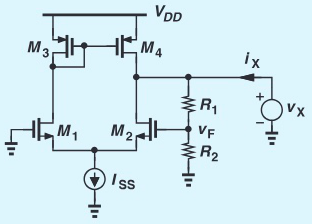

# 연습문제 12.17 — $R_2 \to \infty$일 때 폐루프 출력 임피던스와 직접 해석 (예제 12.17 변형)

## 원문
$R_2 \to \infty$일 때 무슨 일이 일어나는가? 회로의 직접적인 해석으로부터 이 결과를 증명할 수 있는가?

## 조건
- 예제 12.17과 같은 회로: Fig 12.36 (능동 부하 차동쌍 $M_1$–$M_4$, $M_1$ 게이트 접지, 꼬리 전류원 $I_{SS}$, 출력 노드와 접지 사이 $R_1$–$R_2$ 분배기, 가운데 노드 $v_F$가 $M_2$ 게이트로, 출력 노드에 테스트 전압원 $v_X$), $R_1 + R_2$가 매우 큼
- 바뀐 점: $R_2 \to \infty$
- 묻는 양은 예제의 폐루프 출력 임피던스 (원문에 없음)
- 예제 12.17의 결과 (식 12.68): $R_{out,closed} = \dfrac{r_{ON} \parallel r_{OP}}{1 + \dfrac{R_2}{R_1 + R_2}g_{mN}(r_{ON} \parallel r_{OP})}$ (원문에 없음)

## 구할 것
- $R_2 \to \infty$일 때 (출력 임피던스에) 일어나는 일 (괄호 안은 원문에 없음)
- 회로를 직접 해석해 이 결과를 증명

## 상속·참조
- 예제 12.17 (E12.17): 개루프 출력 임피던스 $r_{ON} \parallel r_{OP}$, $KA_0 = \dfrac{R_2}{R_1 + R_2}g_{mN}(r_{ON} \parallel r_{OP})$ (예제 12.15의 $A_0 = g_{mN}(r_{ON} \parallel r_{OP})$), 폐루프 출력 임피던스는 식 (12.68), 루프 이득이 크면 $\approx (1 + R_1/R_2)/g_{mN}$ (식 12.69)

## 회로 — Fig 12.36
```spice
M3   n1    n1  VDD  pmos
M4   n3    n1  VDD  pmos
M1   n1    0   n2   nmos   ; 게이트 접지
M2   n3    vF  n2   nmos
ISS  n2    0   {I_SS}
R1   n3    vF  {R_1}
R2   vF    0   {R_2}
VX   n3    0   {v_X}
```
- 단자: VDD = 전원, 값 미지정 (가로 레일) / v_X = 테스트 전압원, 출력 노드 n3를 구동 (개방 단자 없음)
- 표시: 노드 라벨 V_DD (레일 오른쪽 끝), v_F (분배기 가운데 접속점 오른쪽) / 소자 라벨 M3 (왼쪽), M4 (오른쪽), M1 (오른쪽), M2 (왼쪽), I_SS (전류원 오른쪽), R1, R2 (각 저항 오른쪽), v_X (전압원 원 오른쪽) / 부호 v_X 원 왼쪽 위 +, 왼쪽 아래 − / 화살표 "i_X": v_X에서 R1 위 접속점으로 가는 가로 도선, 왼쪽 방향(회로 쪽으로), 도선 위, 글자는 화살표 위 / 수치·면적 라벨 없음
- 배치: 맨 위 V_DD 가로 레일에 M3(좌우 반전 PMOS, 게이트 오른쪽), M4(보통 PMOS, 게이트 왼쪽)의 소스가 매달림 / 두 게이트를 잇는 가로선의 M3 게이트 바로 오른쪽 접속점에서 세로선이 내려와 왼쪽으로 꺾여 M3 드레인 접속점에 닿음 (다이오드 연결) / 왼쪽 세로줄 M3 – n1 접속점 – M1(보통 NMOS, 게이트 왼쪽), 오른쪽 세로줄 M4 – n3 접속점 – M2(좌우 반전 NMOS, 게이트 오른쪽) / M1 게이트에서 가로선이 왼쪽으로 가 아래로 꺾여 접지 기호 / M1, M2 소스는 아래 가로선으로 모여 꼬리 접속점, 그 아래 I_SS(화살표 아래쪽)와 접지 / n3 접속점에서 가로선이 오른쪽으로 R1 위 접속점을 지나 오른쪽 끝에서 아래로 꺾여 v_X 위 단자, v_X 아래 접지 / R1 오른쪽 세로줄 위→아래 R1 위 접속점, R1, v_F 접속점, R2, 접지 / v_F 접속점에서 가로선이 왼쪽으로 M2 게이트 / 접속점 (세 갈래 이상, 6곳): 게이트선 M3 게이트 쪽 (점), M3 드레인 n1 (점), M4 드레인 n3 (점), R1 위 (점), v_F (점), 꼬리 n2 (점) / 교차: 없음


