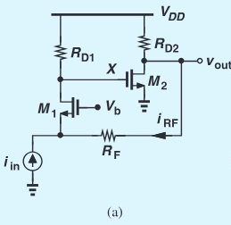

# 연습문제 12.20 — $R_{D1} \to \infty$일 때 폐루프 출력 임피던스 (예제 12.20 변형)

## 원문
$R_{D1} \to \infty$이면 무슨 일이 일어나는지 설명하라.

## 조건
- 예제 12.18의 회로: Fig 12.38(a) ($M_1$ 공통 게이트 첫째 단(게이트 $V_b$, 드레인 $X$ – $R_{D1}$ – $V_{DD}$, 소스 = 입력 노드, 입력 전류원 $i_{in}$), $M_2$ 공통 소스 둘째 단(게이트 $X$, 드레인 $v_{out}$ – $R_{D2}$ – $V_{DD}$), $v_{out}$과 입력 노드 사이 귀환 저항 $R_F$)
- 예제 12.18의 가정을 이어받음: $\lambda = 0$, $R_F$가 매우 큼 (원문에 없음)
- 바뀐 점: $R_{D1} \to \infty$
- 묻는 양은 예제 12.20의 폐루프 출력 임피던스 (원문에 없음)
- 예제 12.20의 결과 (식 12.83): $R_{out,closed} = \dfrac{R_{D2}}{1 + \dfrac{g_{m2}R_{D1}R_{D2}}{R_F}}$ (원문에 없음)

## 구할 것
- $R_{D1} \to \infty$일 때 (폐루프 출력 임피던스에) 일어나는 일 (괄호 안은 원문에 없음)

## 상속·참조
- 예제 12.20 (E12.20): 개루프 출력 저항 $R_{out} \approx R_{D2}$ ($R_F$가 매우 크다는 가정), 폐루프 출력 임피던스는 식 (12.83) (식 12.82 $V_X/I_X = R_{out}/(1 + KR_0)$에서 $K = -1/R_F$, $R_0 = R_{D1}(-g_{m2}R_{D2})$)

## 회로 — Fig 12.38(a)
```spice
RD1  VDD   X     {R_D1}
RD2  VDD   vout  {R_D2}
M2   vout  X     0     nmos
M1   X     Vb    n1    nmos
Iin  0     n1    {i_in}
RF   vout  n1    {R_F}
```
- 단자: VDD = 전원, 값 미지정 (가로 레일) / Vb = 이상적 DC 바이어스, 값 미지정 (점 단자) / vout = 출력 (개방 원)
- 표시: 노드 라벨 V_DD (레일 오른쪽 끝), X (X–M2 게이트 가로선 위, M2 게이트 가까이), V_b (점 단자 오른쪽), v_out (출력 원 오른쪽) / 소자 라벨 R_D1 (저항 오른쪽), R_D2 (저항 오른쪽), M2 (트랜지스터 오른쪽), M1 (트랜지스터 왼쪽), i_in (전류원 왼쪽), R_F (저항 아래) / 부호 없음 / 화살표 "i_RF": 아래 가로 도선(R_F 오른쪽 끝과 오른쪽 모서리 사이), 왼쪽 방향(v_out 쪽에서 R_F 쪽으로), 도선 위, 글자는 화살표 위 / 수치·면적 라벨 없음
- 배치: 맨 위 V_DD 가로 레일 / 왼쪽 세로줄 위→아래 R_D1, X 접속점, M1, 입력 접속점(n1) / M1은 좌우 반전된 NMOS (게이트가 오른쪽 → 가로선 → V_b 점 단자, 드레인·소스 인출선이 왼쪽, 소스 화살표는 채널에서 왼쪽 바깥을 향함) / X 접속점에서 가로선이 오른쪽으로 곧장 M2 게이트 / 오른쪽 세로줄 위→아래 R_D2, 드레인 접속점, M2(보통 NMOS, 게이트 왼쪽), 소스 아래 접지 / 드레인 접속점에서 가로선이 오른쪽으로 귀환 접속점을 지나 v_out 원까지 / 귀환 접속점에서 세로선이 아래로 내려가 아래 가로선 높이에서 왼쪽으로 꺾여 R_F를 지나 n1 접속점 / n1 접속점에서 왼쪽으로 가로선이 가서 아래로 꺾여 i_in 전류원(화살표 위쪽) 위 단자, 전류원 아래 접지 / 접속점 (세 갈래 이상, 4곳): X = 위 R_D1 + 아래 M1 드레인 + 오른쪽 M2 게이트 선 (점), M2 드레인 = 위 R_D2 + 아래 M2 + 오른쪽 가로선 (점), 귀환 접속점 = 왼쪽 가로선 + 오른쪽 v_out 선 + 아래 귀환선 (점), n1 = 위 M1 소스 + 왼쪽 i_in 선 + 오른쪽 R_F (점) / 교차: 없음


> 참고: 그림 12.38은 예제 12.18의 그림으로 교재 675쪽(PDF 18 오른쪽)에 인쇄됨
