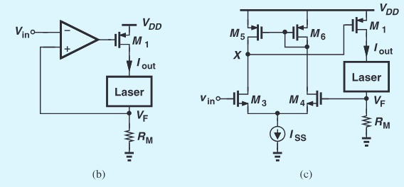

# 연습문제 12.21 — 정현파 입력에서 $V_F$와 레이저 전류의 시간 파형 (예제 12.21 변형)

## 원문
$V_{in}$이 $100\ \text{mV}$의 피크값을 갖는 정현파라고 가정하자. $R_M = 10\ \Omega$과 $G_m = 1/(0.5\ \Omega)$일 때 $V_F$와 레이저를 통하는 전류를 시간의 함수로 도시하라. $M_1$의 게이트에서의 전압은 반드시 정현파인가?

## 조건
- 예제 12.21의 레이저 구동 전류-전압 귀환 회로: Fig 12.42(b) (연산 증폭기 − 입력 = $V_{in}$, + 입력 = $V_F$, 출력이 PMOS $M_1$ 게이트, $M_1$ 드레인 – 레이저 – $V_F$ – $R_M$ – 접지), 트랜지스터 레벨 실현 Fig 12.42(c)
- 원문은 (b)와 (c) 중 어느 회로인지 적지 않음. 개루프 트랜스컨덕턴스 $G_m$이 주어지므로 순방향 시스템 + 귀환 $K = R_M$ 모델로 봄 (원문에 없음)
- $V_{in}$: 피크값 $100\ \text{mV}$인 정현파
- $R_M = 10\ \Omega$, $G_m = 1/(0.5\ \Omega)$
- 예제 12.21의 결과: 귀환율 $K = V_F/I_{out} = R_M$, 폐루프 이득 $\dfrac{I_{out}}{V_{in}} = \dfrac{G_m}{1 + G_mR_M}$ (식 12.85, 12.88), $V_F = R_MI_{out}$ (원문에 없음)

## 구할 것
- $V_F$를 시간의 함수로 도시
- 레이저를 통하는 전류를 시간의 함수로 도시
- $M_1$의 게이트 전압이 반드시 정현파인지

## 상속·참조
- 예제 12.21 (E12.21): 연산 증폭기 이득이 매우 높으면 $I_{out} \approx V_{in}/R_M$ (식 12.86). (c)의 개루프 트랜스컨덕턴스 $G_m = g_{m1}g_{m3}(r_{O3} \parallel r_{O5})$ (식 12.87), $K = R_M$, 폐루프 $\left.\dfrac{I_{out}}{V_{in}}\right|_{closed} = \dfrac{G_m}{1 + G_mR_M}$ (식 12.88), 루프 이득이 크면 $\approx 1/R_M$ (식 12.89)
- 식 (12.85): $\dfrac{I_{out}}{V_{in}} = \dfrac{G_m}{1 + KG_m}$

## 회로 — Fig 12.42(b)
```spice
XA  VF  Vin  n1  opamp
M1  n2  n1   VDD  pmos
XL  n2  VF   box "Laser"   ; 레이저 다이오드 (상자로 그려짐)
RM  VF  0    {R_M}
```
- 단자: VDD = 전원, 값 미지정 (T 전원 기호) / Vin = 입력 (개방 원)
- 표시: 노드 라벨 V_in (입력 원 왼쪽), V_DD (T 기호 오른쪽), V_F (V_F 접속점 오른쪽) / 소자 라벨 M1 (트랜지스터 오른쪽), "Laser" (상자 안), R_M (저항 오른쪽) / 부호 연산 증폭기 입력 − 위, + 아래 (삼각형 안) / 화살표 "I_out": M1 드레인에서 레이저 상자로 가는 세로 도선, 아래 방향, 도선 위, 글자는 화살표 오른쪽 / 수치·면적 라벨 없음
- 배치: 왼쪽에 오른쪽을 향한 연산 증폭기 삼각형 / V_in 원에서 가로선이 오른쪽으로 − 입력 / 연산 증폭기 출력에서 가로선이 오른쪽으로 M1 게이트 / 오른쪽 세로줄 위→아래 V_DD T 기호, M1(보통 PMOS, 게이트 왼쪽), I_out 화살표, Laser 상자, V_F 접속점, R_M, 접지 / + 입력에서 가로선이 왼쪽으로 가서 아래로 꺾여 V_F 높이에서 오른쪽으로 꺾여 V_F 접속점 / 접속점 (세 갈래 이상, 1곳): V_F = 위 Laser + 아래 R_M + 왼쪽 귀환선 (점) / 교차: 없음

## 회로 — Fig 12.42(c)
```spice
M5   X    n1   VDD  pmos
M6   n1   n1   VDD  pmos
M1   n2   X    VDD  pmos
M3   X    vin  n3   nmos
M4   n1   VF   n3   nmos
ISS  n3   0    {I_SS}
XL   n2   VF   box "Laser"   ; 레이저 다이오드 (상자로 그려짐)
RM   VF   0    {R_M}
```
- 단자: VDD = 전원, 값 미지정 (가로 레일) / vin = 입력 (개방 원)
- 표시: 노드 라벨 V_DD (레일 오른쪽 끝), X (X 접속점 왼쪽), v_in (입력 원 왼쪽), V_F (V_F 접속점 오른쪽) / 소자 라벨 M5 (왼쪽), M6 (오른쪽), M1 (오른쪽), M3 (오른쪽), M4 (왼쪽), I_SS (전류원 오른쪽), "Laser" (상자 안), R_M (저항 오른쪽) / 부호 없음 / 화살표 "I_out": M1 드레인에서 레이저 상자로 가는 세로 도선, 아래 방향, 도선 위, 글자는 화살표 오른쪽 / 수치·면적 라벨 없음
- 배치: 맨 위 V_DD 가로 레일에 M5(좌우 반전 PMOS, 게이트 오른쪽), M6(보통 PMOS, 게이트 왼쪽), 맨 오른쪽 M1(보통 PMOS, 게이트 왼쪽)의 소스가 매달림 / M5–M6 게이트를 잇는 가로선의 M6 게이트 바로 왼쪽 접속점에서 세로선이 내려와 오른쪽으로 꺾여 M6 드레인 접속점에 닿음 (M6 다이오드 연결) / 왼쪽 세로줄 M5 – X 접속점 – M3(보통 NMOS, 게이트 왼쪽 ← v_in 원), 가운데 세로줄 M6 – n1 접속점 – M4(좌우 반전 NMOS, 게이트 오른쪽) / X 접속점에서 가로선이 오른쪽으로 가서 위로 꺾여 M1 게이트 / M3, M4 소스는 아래 가로선으로 모여 꼬리 접속점, 그 아래 I_SS(화살표 아래쪽)와 접지 / 오른쪽 세로줄 위→아래 M1, I_out 화살표, Laser 상자, V_F 접속점, R_M, 접지 / V_F 접속점에서 가로선이 왼쪽으로 M4 게이트 / 접속점 (세 갈래 이상, 5곳): 게이트선 M6 게이트 쪽 (점), M6 드레인 n1 (점), X (점), 꼬리 n3 (점), V_F (점) / 교차: X에서 M1 게이트로 가는 가로선이 M6 드레인–M4 드레인 세로선과 점 없이 교차


> 참고: 연습문제 문장은 교재 680쪽(PDF 21 왼쪽)에 있고, 그림 12.42는 예제 12.21의 그림으로 교재 679쪽(PDF 20 오른쪽)에 인쇄됨
