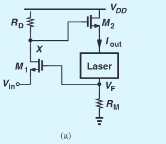

# 연습문제 12.22 — 목표 I/O 임피던스에 필요한 gm1, gm2 (예제 12.22 변형)

## 원문
$500\ \Omega$의 입력 임피던스와 $5\ \text{k}\Omega$의 출력 임피던스를 원할 때 필요한 $g_{m1}$과 $g_{m2}$의 값을 결정하라. $R_D = 1\ \text{k}\Omega$과 $R_M = 100\ \Omega$이라고 가정하라.

## 조건
- 예제 12.22와 같은 회로: Fig 12.44(a) ($M_1$ CG 뺄셈 소자, $M_2$ 소스 폴로어가 "Laser" 구동, 감지 저항 $R_M$)
- $R_D = 1\ \text{k}\Omega$, $R_M = 100\ \Omega$
- 목표: 입력 임피던스 $500\ \Omega$, 출력 임피던스 $5\ \text{k}\Omega$
- 두 임피던스는 폐루프 값 $R_{in,closed}$, $R_{out,closed}$ (원문에 없음)
- 예제 12.22의 결과: $R_{in,closed} = \dfrac{1}{g_{m1}}(1 + g_{m1}g_{m2}R_DR_M)$, $R_{out,closed} = \dfrac{1}{g_{m2}}(1 + g_{m1}g_{m2}R_DR_M)$ (식 12.96, 12.97) (원문에 없음)

## 구할 것
- 필요한 $g_{m1}$과 $g_{m2}$

## 상속·참조
- 예제 12.22 (E12.22): $R_M$이 매우 작아 개루프 회로에서 $G_m = g_{m1}R_Dg_{m2}$, 개루프 입력 임피던스 $1/g_{m1}$, 출력 임피던스 $1/g_{m2}$, 귀환율 $K = R_M$. 폐루프 $\dfrac{I_{out}}{V_{in}} = \dfrac{g_{m1}g_{m2}R_D}{1 + g_{m1}g_{m2}R_DR_M}$ (식 12.95), $R_{in,closed} = \dfrac{1}{g_{m1}}(1 + g_{m1}g_{m2}R_DR_M)$ (식 12.96), $R_{out,closed} = \dfrac{1}{g_{m2}}(1 + g_{m1}g_{m2}R_DR_M)$ (레이저에서 본 임피던스, 식 12.97)

## 회로 — Fig 12.44(a)
```spice
RD   VDD  X    {R_D}
M1   X    VF   Vin  nmos
M2   VDD  X    n1   nmos
XL   n1   VF   box "Laser"   ; 레이저 다이오드 (상자로 그려짐)
RM   VF   0    {R_M}
```
- 단자: VDD = 전원, 값 미지정 (가로 레일) / Vin = 입력, M1 소스 (개방 원)
- 표시: 노드 라벨 V_DD (레일 오른쪽 끝), X (X 접속점 오른쪽 아래, M1 드레인 선 오른쪽), V_in (입력 원 왼쪽), V_F (V_F 접속점 오른쪽 아래) / 소자 라벨 R_D (저항 왼쪽), M1 (트랜지스터 왼쪽, 소스 화살표 왼쪽 위), M2 (트랜지스터 오른쪽, 소스 화살표 오른쪽), R_M (저항 오른쪽), "Laser" (상자 안) / 부호 없음 / 화살표 "I_out": M2 소스와 Laser 상자 사이 세로 도선, 아래 방향(Laser 쪽으로), 도선 위, 글자는 화살표 오른쪽 / 수치·면적 라벨 없음
- 배치: 맨 위 V_DD 가로 레일 / 왼쪽 세로줄 위→아래 레일, R_D, X 접속점, M1 / M1은 좌우 반전된 NMOS (게이트가 오른쪽, 드레인 위·소스 아래 인출선이 왼쪽, 소스 화살표는 채널에서 왼쪽 바깥을 향함) / M1 소스에서 세로선이 아래로 내려가 왼쪽으로 꺾여 V_in 원에서 끝남 / X 접속점에서 가로선이 오른쪽으로 가다 위로 꺾여 M2 게이트 높이에서 다시 오른쪽으로 꺾여 M2 게이트 / M2는 보통 방향 NMOS (게이트 왼쪽, 드레인 위에서 레일로 올라감, 소스 아래·화살표가 오른쪽 바깥) / 오른쪽 세로줄 위→아래 레일, M2, I_out 화살표, Laser 상자, V_F 접속점, R_M, 접지 / M1 게이트에서 짧은 가로선이 오른쪽으로 가다 아래로 꺾여 V_F 높이에서 오른쪽으로 V_F 접속점 / 접속점 (세 갈래 이상, 2곳): X = 위 R_D + 아래 M1 드레인 + 오른쪽 M2 게이트 선 (점), V_F = 위 Laser + 아래 R_M + 왼쪽 M1 게이트 선 (점) / 교차: 없음


> 참고: 그림 12.44는 예제 12.22에 인쇄됨 (교재 681쪽, PDF 21 오른쪽)
