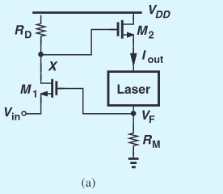

# 연습문제 12.23 — 그림 12.44 회로에 잘못된 출력 임피던스 테스트를 걸었을 때 (예제 12.23 변형)

## 원문
그림 12.44의 회로에 위의 (잘못된) 테스트를 인가하고 결과를 조사하라.

## 조건
- 회로: Fig 12.44(a) (예제 12.22의 레이저 전류 조절 회로, $M_1$ CG 뺄셈 소자, $M_2$ 소스 폴로어가 "Laser" 구동, 감지 저항 $R_M$)
- 위의 (잘못된) 테스트: 예제 12.23의 Fig 12.45 방식
  - 참고 회로 (본문 Fig 12.45, 예제 12.23): 입력을 0(접지)으로 두고, 테스트 전압원 $V_X$를 순방향 증폭기 출력 노드와 접지 사이에 출력과 병렬로 연결해 $V_X/I_X$를 출력 임피던스로 계산 (원문에 없음)
- 이 회로에 적용하면 $V_{in}$을 교류 접지하고 $V_X$를 출력 쪽 노드(레이저를 구동하는 $M_2$ 소스)와 접지 사이에 병렬로 연결하는 것으로 해석 (원문에 없음)
- 예제 12.22의 결과 (올바른 테스트, 테스트 전원을 출력선과 직렬): $R_{out,closed} = \dfrac{1}{g_{m2}}(1 + g_{m1}g_{m2}R_DR_M)$ (식 12.97) (원문에 없음)
- 소자 값은 주어지지 않음 (원문에 없음)

## 구할 것
- 잘못된 테스트로 얻은 결과($V_X/I_X$)와 그 의미 조사 (괄호 안은 원문에 없음)

## 상속·참조
- 예제 12.23 (E12.23), 본문 Fig 12.45 (교재 682쪽, 이 파일의 그림 목록에는 넣지 않음, 크롭은 fig12-45.png): 덧셈기 + 입력 접지, − 입력은 $K$ 출력, 덧셈기 출력 $V_A$ → $G_m$ (삼각형) → 출력 노드, 출력–접지 $R_{out}$, 출력 노드에서 $K$ 입력으로 귀환, 같은 노드에 $V_X$ (+ 위, − 아래 접지)가 $I_X$를 흘려 줌. 예제 풀이: 출력 전류를 감지하려면 귀환 회로망과 테스트 신호원이 순방향 증폭기 출력 포트와 직렬이어야 하는데, $V_X$가 출력과 병렬이라 원리를 어김 (귀환 회로망이 이상적이면 $V_X$가 무한대 전류를 공급해야 함)
- 예제 12.22 (E12.22): 개루프 $G_m = g_{m1}R_Dg_{m2}$, $K = R_M$, $R_{out,closed} = \dfrac{1}{g_{m2}}(1 + g_{m1}g_{m2}R_DR_M)$ (식 12.97)

## 회로 — Fig 12.44(a)
```spice
RD   VDD  X    {R_D}
M1   X    VF   Vin  nmos
M2   VDD  X    n1   nmos
XL   n1   VF   box "Laser"   ; 레이저 다이오드 (상자로 그려짐)
RM   VF   0    {R_M}
```
- 단자: VDD = 전원, 값 미지정 (가로 레일) / Vin = 입력, M1 소스 (개방 원)
- 표시: 노드 라벨 V_DD (레일 오른쪽 끝), X (X 접속점 오른쪽 아래, M1 드레인 선 오른쪽), V_in (입력 원 왼쪽), V_F (V_F 접속점 오른쪽 아래) / 소자 라벨 R_D (저항 왼쪽), M1 (트랜지스터 왼쪽, 소스 화살표 왼쪽 위), M2 (트랜지스터 오른쪽, 소스 화살표 오른쪽), R_M (저항 오른쪽), "Laser" (상자 안) / 부호 없음 / 화살표 "I_out": M2 소스와 Laser 상자 사이 세로 도선, 아래 방향(Laser 쪽으로), 도선 위, 글자는 화살표 오른쪽 / 수치·면적 라벨 없음
- 배치: 맨 위 V_DD 가로 레일 / 왼쪽 세로줄 위→아래 레일, R_D, X 접속점, M1 / M1은 좌우 반전된 NMOS (게이트가 오른쪽, 드레인 위·소스 아래 인출선이 왼쪽, 소스 화살표는 채널에서 왼쪽 바깥을 향함) / M1 소스에서 세로선이 아래로 내려가 왼쪽으로 꺾여 V_in 원에서 끝남 / X 접속점에서 가로선이 오른쪽으로 가다 위로 꺾여 M2 게이트 높이에서 다시 오른쪽으로 꺾여 M2 게이트 / M2는 보통 방향 NMOS (게이트 왼쪽, 드레인 위에서 레일로 올라감, 소스 아래·화살표가 오른쪽 바깥) / 오른쪽 세로줄 위→아래 레일, M2, I_out 화살표, Laser 상자, V_F 접속점, R_M, 접지 / M1 게이트에서 짧은 가로선이 오른쪽으로 가다 아래로 꺾여 V_F 높이에서 오른쪽으로 V_F 접속점 / 접속점 (세 갈래 이상, 2곳): X = 위 R_D + 아래 M1 드레인 + 오른쪽 M2 게이트 선 (점), V_F = 위 Laser + 아래 R_M + 왼쪽 M1 게이트 선 (점) / 교차: 없음


> 참고: 원문은 패널 없이 "그림 12.44의 회로"로 적음. 그림은 예제 12.22에 인쇄됨 (교재 681쪽, PDF 21 오른쪽)
