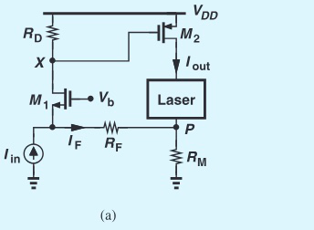

# 연습문제 12.24 — 레이저를 구동하는 전류-전류 귀환 회로의 노턴 등가 회로 (예제 12.24 변형)

## 원문
$R_{out}|_{closed}$가 폐루프 회로에서 레이저에서 본 임피던스임을 유의하고, 레이저를 구동할 수 있는 전체 회로에 대한 노턴 등가 회로를 만들어라.

## 조건
- 예제 12.24와 같은 회로·가정: Fig 12.49(a), $R_M$은 매우 작고 $R_F$는 매우 큼
- $R_{out}|_{closed}$는 폐루프 회로에서 레이저에서 본 임피던스 (원문의 메모)
- 예제 12.24의 결과: $A_{I,closed} = \dfrac{-g_{m2}R_D}{1 + g_{m2}R_D\dfrac{R_M}{R_F}}$ (식 12.112), $R_{out,closed} = r_{O2}\left(1 + g_{m2}R_D\dfrac{R_M}{R_F}\right)$ (식 12.114) (원문에 없음)
- 노턴 등가 회로: 레이저 양 끝에서 본 나머지 회로를 전류원과 병렬 저항으로 나타냄 (원문에 없음)

## 구할 것
- 레이저를 구동하는 전체 회로의 노턴 등가 회로 (전류원 값과 병렬 저항) (괄호 안은 원문에 없음)

## 상속·참조
- 예제 12.24 (E12.24): 개루프 $A_I = -g_{m2}R_D$ (식 12.108), 개루프 입력 임피던스 $\approx 1/g_{m1}$, 출력 임피던스 $r_{O2}$, 귀환율 $K = I_F/I_{out} = -R_M/R_F$ (식 12.111). 폐루프 $A_{I,closed} = \dfrac{-g_{m2}R_D}{1 + g_{m2}R_D\dfrac{R_M}{R_F}}$ (식 12.112), $R_{in,closed} = \dfrac{1}{g_{m1}} \cdot \dfrac{1}{1 + g_{m2}R_D\dfrac{R_M}{R_F}}$ (식 12.113), $R_{out,closed} = r_{O2}\left(1 + g_{m2}R_D\dfrac{R_M}{R_F}\right)$ (식 12.114)

## 회로 — Fig 12.49(a)
```spice
RD   VDD  X    {R_D}
M1   X    Vb   n1   nmos
M2   n2   X    VDD  pmos
XL   n2   P    box "Laser"   ; 레이저 다이오드 (상자로 그려짐)
RF   n1   P    {R_F}
RM   P    0    {R_M}
IIN  0    n1   {I_in}
```
- 단자: VDD = 전원, 값 미지정 (가로 레일) / Vb = M1 게이트 바이어스, 값 미지정 (점 단자)
- 표시: 노드 라벨 V_DD (레일 오른쪽 끝), X (X 접속점 왼쪽), V_b (점 단자 오른쪽), P (P 접속점 오른쪽 아래) / 소자 라벨 R_D (저항 왼쪽), M1 (트랜지스터 왼쪽, 소스 화살표 왼쪽 위), M2 (트랜지스터 오른쪽), R_F (저항 아래), R_M (저항 오른쪽), I_in (전류원 원 왼쪽), "Laser" (상자 안) / 부호 없음 / 화살표 "I_out": M2 드레인과 Laser 상자 사이 세로 도선, 아래 방향(Laser 쪽으로), 도선 위, 글자는 화살표 오른쪽; "I_F": M1 소스 접속점과 R_F 사이 가로 도선, 오른쪽 방향(R_F 쪽으로), 도선 위, 글자는 화살표 아래 / 수치·면적 라벨 없음
- 배치: 맨 위 V_DD 가로 레일 / 왼쪽 세로줄 위→아래 레일, R_D, X 접속점, M1, M1 소스 접속점 / M1은 좌우 반전된 NMOS (게이트가 오른쪽, 소스 화살표는 채널에서 왼쪽 바깥을 향함), 게이트에서 짧은 가로선이 오른쪽 V_b 점 단자 / I_in 전류원은 M1 소스 접속점 왼쪽 아래: 위 단자에서 세로선이 올라가 오른쪽으로 꺾여 소스 접속점, 아래 단자 접지, 원 안 화살표 위 방향 / X 접속점에서 가로선이 오른쪽으로 가다 위로 꺾여 M2 게이트 높이에서 오른쪽으로 꺾여 M2 게이트 / M2는 보통 방향 PMOS (게이트 왼쪽, 소스 위에서 레일로 올라감·화살표가 채널 쪽(왼쪽)을 향함, 드레인 아래) / 오른쪽 세로줄 위→아래 레일, M2, I_out 화살표, Laser 상자, P 접속점, R_M, 접지 / M1 소스 접속점에서 가로선이 오른쪽으로 I_F 화살표, R_F를 지나 P 접속점 / 접속점 (세 갈래 이상, 3곳): X = 위 R_D + 아래 M1 드레인 + 오른쪽 M2 게이트 선 (점), M1 소스 = 위 M1 소스 + 왼쪽 I_in 선 + 오른쪽 R_F 선 (점), P = 위 Laser + 아래 R_M + 왼쪽 R_F 선 (점) / 교차: 없음


> 참고: 그림 12.49는 예제 12.24에 인쇄됨 (교재 685쪽, PDF 23 오른쪽)
