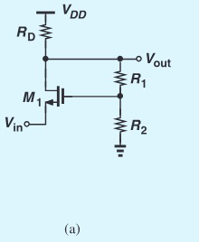

# 연습문제 12.26 — RD를 이상적인 전류원으로 바꾸어 일반적인 방법으로 다시 해석 (예제 12.26 변형)

## 원문
$R_D$가 이상적인 전류원으로 대체될 때 위의 해석을 반복하라.

## 조건
- 예제 12.26과 같은 회로·방법: Fig 12.55(a), 12.7.1절의 일반적인 방법 (복제 종지 법칙과 귀환율 계산)
- 바뀐 점: $R_D$를 이상적인 전류원으로 대체 ($V_{DD}$와 $V_{out}$ 사이, 소신호 저항 무한대) (괄호 안은 원문에 없음)
- 전압-전압 귀환에서 귀환 회로망을 끊는 법칙 (본문 Fig 12.53(a)): 감지 복제의 출력 포트는 개방, 반송 복제의 입력 포트는 단락. 귀환율은 입력 포트에 $V_1$을 인가하고 출력 포트를 개방해 $K = V_2/V_1$ (본문 Fig 12.54(a)) (본문 정의, 원문에 없음)
- 예제 12.26의 결과 ($R_D$일 때): $K = R_2/(R_1 + R_2)$ (식 12.121), $A_0 = g_{m1}[R_D \parallel (R_1 + R_2)]$, $R_{in,open} = 1/g_{m1}$, $R_{out,open} = R_D \parallel (R_1 + R_2)$ (원문에 없음)
- 소자 값은 주어지지 않음 (답은 $g_{m1}$, $R_1$, $R_2$의 식으로) (원문에 없음)

## 구할 것
- $R_D$를 이상적인 전류원으로 바꾼 증폭기의 해석: 개루프 회로, 귀환율, 개루프·폐루프 전압 이득, 폐루프 입력·출력 임피던스 (콜론 뒤는 원문에 없음)

## 상속·참조
- 예제 12.26 (E12.26): 순방향 시스템은 $M_1$과 $R_D$, 귀환 회로망은 $R_1$과 $R_2$. 개루프 회로 (Fig 12.55(b)): 반송 복제 ($R_1$ 위 끝을 접지로 단락, $R_1$–$R_2$ 사이가 $M_1$ 게이트), 감지 복제 ($V_{out}$–$R_1$–$R_2$–접지, 가운데 개방). 귀환율 테스트 (Fig 12.55(c)): $K = V_2/V_1 = R_2/(R_1 + R_2)$ (식 12.120, 12.121). 결과 (식 12.123–12.125): $A_{v,closed} = \dfrac{g_{m1}[R_D \parallel (R_1 + R_2)]}{1 + \dfrac{R_2}{R_1 + R_2}g_{m1}[R_D \parallel (R_1 + R_2)]}$, $R_{in,closed} = \dfrac{1}{g_{m1}}\left\{1 + \dfrac{R_2}{R_1 + R_2}g_{m1}[R_D \parallel (R_1 + R_2)]\right\}$, $R_{out,closed} = \dfrac{R_D \parallel (R_1 + R_2)}{1 + \dfrac{R_2}{R_1 + R_2}g_{m1}[R_D \parallel (R_1 + R_2)]}$
- 본문 Fig 12.53, 12.54 (교재 689–690쪽, 크롭 안 함): 종지 법칙과 귀환율 계산

## 회로 — Fig 12.55(a)
```spice
RD  VDD   Vout  {R_D}
M1  Vout  n1    Vin  nmos
R1  Vout  n1    {R_1}
R2  n1    0     {R_2}
```
- 단자: VDD = 전원, 값 미지정 (T 전원 기호) / Vin = 입력, M1 소스 (개방 원) / Vout = 출력 (개방 원)
- 표시: 노드 라벨 V_DD (T 기호 오른쪽), V_in (입력 원 왼쪽), V_out (출력 원 오른쪽) / 소자 라벨 R_D (저항 왼쪽), M1 (트랜지스터 왼쪽, 소스 화살표 바로 왼쪽 위), R1, R2 (각 저항 오른쪽) / 부호 없음 / 화살표 없음 / 수치·면적 라벨 없음
- 배치: 왼쪽 세로줄 위→아래 V_DD T 기호, R_D, 드레인 접속점, M1 / M1은 좌우 반전된 NMOS (게이트가 오른쪽, 소스 화살표는 채널에서 왼쪽 바깥을 향함) / 소스에서 세로선이 아래로 내려가 왼쪽으로 꺾여 V_in 원에서 끝남 / 드레인 접속점에서 가로선이 오른쪽으로 가 R1 위 접속점을 지나 V_out 원까지 / 오른쪽 세로줄 위→아래 R1 위 접속점, R1, 게이트 접속점(n1), R2, 접지 / M1 게이트에서 가로선이 오른쪽으로 곧장 n1 접속점 / 접속점 (세 갈래 이상, 3곳): 드레인 = 위 R_D + 아래 M1 드레인 + 오른쪽 가로선 (점), R1 위 = 왼쪽 가로선 + 아래 R1 + 오른쪽 V_out 선 (점), n1 = 위 R1 + 아래 R2 + 왼쪽 게이트 선 (점) / 교차: 없음


> 참고: 그림 12.55는 예제 12.26에 인쇄됨 (교재 690쪽, PDF 26 왼쪽). 이 문제에서는 R_D 자리에 이상적인 전류원이 들어감
