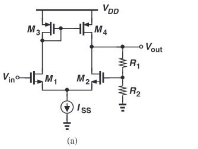

# 연습문제 12.27 — 출력에 부하 저항 RL을 단 분배기 귀환 차동 증폭기 (예제 12.27 변형)

## 원문
부하 저항 $R_L$이 회로의 출력과 접지 사이에 연결되었을 때 위의 예제를 다시 풀어라.

## 조건
- 예제 12.27과 같은 회로·가정: Fig 12.56(a), $R_1 + R_2$가 $r_{OP} \parallel r_{ON}$보다 충분히 크지 않음
- 바뀐 점: 부하 저항 $R_L$을 출력 $V_{out}$과 접지 사이에 연결
- $r_{ON}$, $r_{OP}$: NMOS와 PMOS의 출력 저항, $g_{mN}$: NMOS 입력 쌍의 트랜스컨덕턴스 (예제 풀이의 기호, 원문에 없음)
- 예제 12.27의 결과 ($R_L$ 없을 때): $A_0 = g_{mN}[r_{ON} \parallel r_{OP} \parallel (R_1 + R_2)]$, $R_{in,open} = \infty$, $R_{out,open} = r_{ON} \parallel r_{OP} \parallel (R_1 + R_2)$, $K = R_2/(R_1 + R_2)$ (원문에 없음)
- 소자 값은 주어지지 않음 (원문에 없음)

## 구할 것
- $R_L$을 단 회로의 해석: 개루프·폐루프 전압 이득, 폐루프 입력·출력 임피던스 (콜론 뒤는 원문에 없음)

## 상속·참조
- 예제 12.27 (E12.27): $M_1$–$M_4$는 순방향 증폭기, $R_1$과 $R_2$는 귀환 회로망. 예제 12.26처럼 루프를 끊음 (Fig 12.56(b): 반송 복제는 $R_1$ 위 끝 접지 단락·가운데가 $M_2$ 게이트, 감지 복제는 $V_{out}$–$R_1$–$R_2$–접지·가운데 개방). 식 (12.126)–(12.132): $A_0 = g_{mN}[r_{ON} \parallel r_{OP} \parallel (R_1 + R_2)]$, $R_{in,open} = \infty$, $R_{out,open} = r_{ON} \parallel r_{OP} \parallel (R_1 + R_2)$, $K = R_2/(R_1 + R_2)$, $\left.\dfrac{V_{out}}{V_{in}}\right|_{closed} = \dfrac{A_0}{1 + KA_0}$, $R_{in,closed} = \infty$, $R_{out,closed} = \dfrac{R_{out,open}}{1 + KA_0}$

## 회로 — Fig 12.56(a)
```spice
M3   n1    n1   VDD  pmos
M4   Vout  n1   VDD  pmos
M1   n1    Vin  n2   nmos
M2   Vout  n3   n2   nmos
ISS  n2    0    {I_SS}
R1   Vout  n3   {R_1}
R2   n3    0    {R_2}
```
- 단자: VDD = 전원, 값 미지정 (가로 레일) / Vin = 입력, M1 게이트 (개방 원) / Vout = 출력 (개방 원)
- 표시: 노드 라벨 V_DD (레일 오른쪽 끝), V_in (입력 원 왼쪽), V_out (출력 원 오른쪽) / 소자 라벨 M3 (트랜지스터 왼쪽), M4 (트랜지스터 오른쪽), M1 (트랜지스터 오른쪽), M2 (트랜지스터 왼쪽), I_SS (전류원 원 오른쪽), R1, R2 (각 저항 오른쪽) / 부호 없음 / 화살표 없음 / 수치·면적 라벨 없음
- 배치: 맨 위 V_DD 가로 레일 / 위 줄 M3 (좌우 반전된 PMOS: 게이트가 오른쪽, 소스 위에서 레일로, 소스 화살표는 채널 쪽(오른쪽)을 향함, 드레인 아래 왼쪽), M4 (보통 방향 PMOS: 게이트 왼쪽, 소스 위에서 레일로, 드레인 아래 오른쪽) / M3·M4 게이트 공통선은 게이트 높이로 가로지르고 M3 게이트 바로 오른쪽에 접속점, 거기서 선이 아래로 내려가 왼쪽으로 꺾여 M3 드레인 접속점 (다이오드 연결) / 아래 줄 M1 (보통 방향 NMOS: 게이트 왼쪽, 소스 화살표 오른쪽 바깥), M2 (좌우 반전된 NMOS: 게이트가 오른쪽, 소스 화살표 왼쪽 바깥) / M3 드레인 접속점–M1 드레인 세로선, M4 드레인 접속점–M2 드레인 세로선 / V_in 원 → 가로선 → M1 게이트 / M1·M2 소스는 아래 가로선으로 이어지고 가운데 꼬리 접속점에서 I_SS가 아래로, I_SS 원 안 화살표 아래 방향, I_SS 아래 접지 / M4 드레인 접속점에서 가로선이 오른쪽으로 R1 위 접속점을 지나 V_out 원 / 오른쪽 세로줄 R1 위 접속점, R1, n3 접속점, R2, 접지 / M2 게이트에서 가로선이 오른쪽으로 곧장 n3 접속점 / 접속점 (세 갈래 이상, 6곳): M3 게이트 오른쪽 = 왼쪽 M3 게이트 + 오른쪽 M4 게이트 선 + 아래 다이오드 연결선 (점), M3 드레인 = 위 M3 드레인 + 아래 M1 드레인 + 오른쪽 다이오드 연결선 (점), M4 드레인 = 위 M4 드레인 + 아래 M2 드레인 + 오른쪽 출력선 (점), 꼬리 = 왼쪽 M1 소스 선 + 오른쪽 M2 소스 선 + 아래 I_SS (점), R1 위 = 왼쪽 출력선 + 아래 R1 + 오른쪽 V_out 원 선 (점), n3 = 위 R1 + 아래 R2 + 왼쪽 M2 게이트 선 (점) / 교차: 없음


> 참고: 그림 12.56은 예제 12.27 풀이와 같은 쪽에 인쇄됨 (교재 692쪽, PDF 27 왼쪽). 이 문제에서는 V_out과 접지 사이에 R_L이 더해짐
