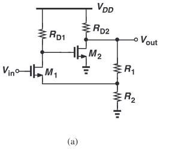

# 연습문제 12.28 — M2를 RS로 축퇴한 2단 귀환 증폭기 (예제 12.28 변형)

## 원문
$M_2$가 저항 $R_S$에 의해 축퇴되었을 때 위의 예제를 다시 풀어라.

## 조건
- 예제 12.28과 같은 회로: Fig 12.57(a)
- 바뀐 점: $M_2$가 저항 $R_S$로 축퇴됨
- $R_S$는 $M_2$ 소스와 접지 사이에 연결 (원문에 없음)
- 예제 12.28의 결과 ($R_S$ 없을 때): $A_0 = \dfrac{-R_{D1}}{\dfrac{1}{g_m} + R_1 \parallel R_2} \cdot \{-g_{m2}[R_{D2} \parallel (R_1 + R_2)]\}$, $R_{in,open} = \infty$, $R_{out,open} = R_{D2} \parallel (R_1 + R_2)$, 귀환율 $K = R_2/(R_1 + R_2)$ (원문에 없음)
- 소자 값은 주어지지 않음 (원문에 없음)

## 구할 것
- $R_S$를 단 회로의 해석: 개루프·폐루프 전압 이득, 폐루프 입력·출력 임피던스 (콜론 뒤는 원문에 없음)

## 상속·참조
- 예제 12.28 (E12.28): 순방향 시스템은 $M_1$, $R_{D1}$, $M_2$, $R_{D2}$, 귀환 회로망은 $R_1$과 $R_2$로 전압을 $M_1$ 소스에 반송. 개루프 회로 (Fig 12.57(b)): 반송 복제는 $R_1$ 위 끝 접지 단락·가운데가 $M_1$ 소스 ($M_1$이 $R_1 \parallel R_2$로 축퇴), 감지 복제는 $V_{out}$–$R_1$–$R_2$–접지·가운데 개방. $A_0 = (V_X/V_{in})(V_{out}/V_X)$, 식 (12.133)–(12.138): $A_0 = \dfrac{-R_{D1}}{\dfrac{1}{g_m} + R_1 \parallel R_2} \cdot \{-g_{m2}[R_{D2} \parallel (R_1 + R_2)]\}$, $R_{in,open} = \infty$, $R_{out,open} = R_{D2} \parallel (R_1 + R_2)$, $\left.\dfrac{V_{out}}{V_{in}}\right|_{closed} = \dfrac{A_0}{1 + \dfrac{R_2}{R_1 + R_2}A_0}$, $R_{in,closed} = \infty$, $R_{out,closed} = \dfrac{R_{D2} \parallel (R_1 + R_2)}{1 + \dfrac{R_2}{R_1 + R_2}A_0}$

## 회로 — Fig 12.57(a)
```spice
RD1  VDD   n1    {R_D1}
RD2  VDD   Vout  {R_D2}
M1   n1    Vin   n2   nmos
M2   Vout  n1    0    nmos
R1   Vout  n2    {R_1}
R2   n2    0     {R_2}
```
- 단자: VDD = 전원, 값 미지정 (가로 레일) / Vin = 입력, M1 게이트 (개방 원) / Vout = 출력 (개방 원)
- 표시: 노드 라벨 V_DD (레일 오른쪽 끝), V_in (입력 원 왼쪽), V_out (출력 원 오른쪽) / 소자 라벨 R_D1, R_D2 (각 저항 오른쪽), M1 (트랜지스터 오른쪽), M2 (트랜지스터 오른쪽), R1, R2 (각 저항 오른쪽) / 부호 없음 / 화살표 없음 / 수치·면적 라벨 없음
- 배치: 맨 위 V_DD 가로 레일 / 왼쪽 세로줄 위→아래 레일, R_D1, M1 드레인 접속점(n1), M1 / M1은 보통 방향 NMOS (게이트 왼쪽, 소스 화살표 오른쪽 바깥) / V_in 원 → 가로선 → M1 게이트 / 가운데 세로줄 위→아래 레일, R_D2, M2 드레인 접속점, M2 (보통 방향 NMOS), 소스 아래 접지 / n1 접속점에서 가로선이 오른쪽으로 곧장 M2 게이트 / M2 드레인 접속점에서 가로선이 오른쪽으로 R1 위 접속점을 지나 V_out 원 / 오른쪽 세로줄 위→아래 R1 위 접속점, R1, n2 접속점, R2, 접지 / M1 소스에서 세로선이 아래로 내려가 오른쪽으로 꺾여 M2 아래를 지나 n2 접속점 / 접속점 (세 갈래 이상, 4곳): n1 = 위 R_D1 + 아래 M1 드레인 + 오른쪽 M2 게이트 선 (점), M2 드레인 = 위 R_D2 + 아래 M2 드레인 + 오른쪽 출력선 (점), R1 위 = 왼쪽 출력선 + 아래 R1 + 오른쪽 V_out 원 선 (점), n2 = 위 R1 + 아래 R2 + 왼쪽 M1 소스 선 (점) / 교차: 없음


> 참고: 그림 12.57은 예제 12.28 풀이와 같은 쪽에 인쇄됨 (교재 693쪽, PDF 27 오른쪽). 이 문제에서는 M2 소스와 접지 사이에 R_S가 더해짐
