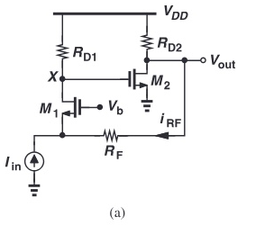

# 연습문제 12.29 — R_D2를 이상적인 전류원으로 바꾼 전압-전류 귀환 증폭기 (예제 12.29 변형)

## 원문
$R_{D2}$가 이상적인 전류원으로 대체되었을 때 위의 예제를 다시 풀어라.

## 조건
- 예제 12.29의 회로: Fig 12.58(a), $R_F$가 매우 크지 않음
- 바뀐 점: $R_{D2}$를 이상적인 전류원으로 대체 ($V_{DD}$에서 $V_{out}$ 노드로 전류를 공급, 소신호 임피던스 무한대로 봄) (방향과 소신호 해석은 원문에 없음)
- 소자 값은 주어지지 않음 (답은 소신호 파라미터 기호로, $\lambda = 0$으로 봄) (원문에 없음)
- 전압-전류 귀환의 종지 법칙 (본문 Fig 12.53(b)): 감지 복제의 출력 포트와 반송 복제의 입력 포트를 모두 단락 (본문 정의, 원문에 없음)
- 전압-전류 귀환의 귀환율 (본문 Fig 12.54(b)): $K = I_2/V_1$, 귀환 회로망 입력에 $V_1$, 출력 포트 단락 전류 $I_2$ (본문 정의, 원문에 없음)
- 예제 12.29의 결과 ($R_{D2}$가 있을 때): $R_0 = \dfrac{R_F R_{D1}}{R_F + 1/g_{m1}}\cdot[-g_{m2}(R_{D2} \parallel R_F)]$, $R_{in,open} = \dfrac{1}{g_{m1}} \parallel R_F$, $R_{out,open} = R_{D2} \parallel R_F$, $K = -1/R_F$ (원문에 없음)

## 구할 것
- $R_{D2}$를 이상적인 전류원으로 바꾼 회로의 개루프 이득 $R_0$, 개루프 입력·출력 임피던스, 귀환율 $K$, 폐루프 이득과 폐루프 입력·출력 임피던스 (구할 양의 목록은 원문에 없음, 원문은 "다시 풀어라"만 적음)

## 상속·참조
- 예제 12.29 (E12.29): 순방향 증폭기 $M_1$, $R_{D1}$, $M_2$, $R_{D2}$, 귀환 회로망 $R_F$. 루프를 열면 $R_F$가 입력 노드와 출력 노드에 각각 접지로 붙음 (Fig 12.58(b)), 테스트 회로 Fig 12.58(c)로 $K$
  - $V_X = I_{in}\dfrac{R_F R_{D1}}{R_F + 1/g_{m1}}$ (식 12.139), $R_0 = \dfrac{R_F R_{D1}}{R_F + 1/g_{m1}}\cdot[-g_{m2}(R_{D2} \parallel R_F)]$ (식 12.140)
  - $R_{in,open} = \dfrac{1}{g_{m1}} \parallel R_F$, $R_{out,open} = R_{D2} \parallel R_F$ (식 12.141, 12.142), $K = -1/R_F$ (식 12.144)
  - $\left.\dfrac{V_{out}}{I_{in}}\right|_{closed} = \dfrac{R_0}{1 - R_0/R_F}$, $R_{in,closed} = \dfrac{(1/g_{m1}) \parallel R_F}{1 - R_0/R_F}$, $R_{out,closed} = \dfrac{R_{D2} \parallel R_F}{1 - R_0/R_F}$ (식 12.145–12.147)

## 회로 — Fig 12.58(a)
```spice
RD1  VDD   X     {R_D1}
RD2  VDD   Vout  {R_D2}
M1   X     Vb    n1    nmos
M2   Vout  X     0     nmos
RF   n1    Vout  {R_F}
IIN  0     n1    {I_in}
```
- 단자: VDD = 전원, 값 미지정 (가로 레일) / Vb = M1 게이트 DC 바이어스, 값 미지정 (점 단자) / Vout = 출력 (개방 원)
- 표시: 노드 라벨 VDD (레일 오른쪽 끝 위), X (X 접속점 왼쪽), V_b (점 단자 오른쪽), V_out (출력 원 오른쪽) / 소자 라벨 R_D1 (왼쪽 저항 오른쪽), R_D2 (오른쪽 저항 오른쪽), M1 (M1 왼쪽), M2 (M2 오른쪽), R_F (R_F 저항 아래), I_in (전류원 왼쪽) / 부호 없음 / 화살표 "i_RF": R_F 오른쪽 끝과 오른쪽 아래 모서리 사이 가로 도선, 왼쪽 방향(V_out 쪽에서 R_F 쪽으로), 도선 위, 글자는 화살표 오른쪽 위 / 수치·면적 라벨 없음
- 배치: 맨 위 굵은 가로 레일 VDD, 왼쪽에 R_D1, 오른쪽에 R_D2가 매달림 / 왼쪽 세로줄 위→아래 R_D1, X 접속점, M1, M1 소스 접속점(n1) / M1은 좌우 반전(게이트가 오른쪽, 게이트 선이 오른쪽으로 V_b 점 단자), 드레인 위·소스 아래 / n1에서 가로선이 왼쪽으로 가다 아래로 꺾여 I_in 전류원(원 안 화살표 위쪽), 그 아래 접지 / 오른쪽 세로줄 위→아래 R_D2, M2 드레인 접속점, M2(보통 방향, 게이트 왼쪽), 접지 / X에서 가로선이 오른쪽으로 곧장 M2 게이트 / M2 드레인 접속점에서 가로선이 오른쪽으로 V_out 접속점을 지나 V_out 원 / V_out 접속점에서 세로선이 n1 높이까지 내려가 모서리에서 왼쪽으로 꺾여 R_F를 지나 n1 / 접속점 (세 갈래 이상, 4곳): X = 위 R_D1 + 아래 M1 드레인 + 오른쪽 M2 게이트 선 (점), M2 드레인 = 위 R_D2 + 아래 M2 드레인 + 오른쪽 선 (점), V_out 접속점 = 왼쪽 선 + 오른쪽 출력 원 + 아래 귀환 선 (점), n1 = 위 M1 소스 + 왼쪽 I_in 선 + 오른쪽 R_F (점) / 교차: 없음


> 참고: 그림은 원래 회로(R_D2가 저항). 이 연습문제는 R_D2 자리에 이상적인 전류원을 둔 경우
