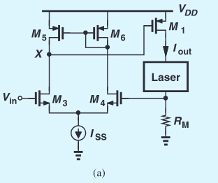

# 연습문제 12.30 — 그림 12.59(a)에서 레이저를 구동하는 회로의 노턴 등가 (예제 12.30 변형)

## 원문
레이저를 구동하는 전체 회로의 노턴 등가 회로를 만들어라.

## 조건
- 예제 12.30의 회로: Fig 12.59(a), $R_M$이 작지 않음, $r_{O1} < \infty$, 레이저 다이오드는 임피던스 $R_L$
- 레이저를 구동하는 전체 회로(레이저를 뺀 나머지, 귀환 포함)를 레이저 단자에서 본 노턴 등가 회로로 나타냄 (노턴 전류원 $I_N$과 병렬 저항 $R_N$을 $V_{in}$과 회로 파라미터로) (기호 $I_N$, $R_N$은 원문에 없음)
- 소자 값은 주어지지 않음 (답은 소신호 파라미터 기호로) (원문에 없음)
- 예제 12.30의 결과: $G_m = \dfrac{g_{m3}(r_{O3} \parallel r_{O5}) g_{m1} r_{O1}}{r_{O1} + R_L + R_M}$ (식 12.150), $\left.\dfrac{I_{out}}{V_{in}}\right|_{closed} = \dfrac{G_m}{1 + R_M G_m}$ (식 12.155), $R_{out,closed} = (r_{O1} + R_M)(1 + R_M G_m)$ (식 12.157) (원문에 없음)

## 구할 것
- 레이저를 구동하는 전체 회로의 노턴 등가 회로 (노턴 전류와 노턴 저항)

## 상속·참조
- 예제 12.30 (E12.30): 전류-전압 귀환. 순방향 증폭기 $M_1$, $M_3$–$M_6$, 귀환 회로망 $R_M$. 루프를 열 때 두 복제의 포트를 모두 개방 (Fig 12.59(b))
  - $V_X/V_{in} = -g_{m3}(r_{O3} \parallel r_{O5})$ (식 12.148), $I_{out} = -\dfrac{r_{O1}}{r_{O1} + R_L + R_M} g_{m1} V_X$ (식 12.149)
  - $G_m = \dfrac{g_{m3}(r_{O3} \parallel r_{O5}) g_{m1} r_{O1}}{r_{O1} + R_L + R_M}$ (식 12.150), 개루프 출력 임피던스 $r_{O1} + R_M$ (식 12.152, $R_L$ 대신 테스트 전압원)
  - $K = R_M$ (식 12.154), $\left.\dfrac{I_{out}}{V_{in}}\right|_{closed} = \dfrac{G_m}{1 + R_M G_m}$, $R_{in,closed} = \infty$, $R_{out,closed} = (r_{O1} + R_M)(1 + R_M G_m)$ (식 12.155–12.157)
  - 예제의 $G_m$과 폐루프 이득은 부하 $R_L$을 포함한 값 (원문에 없음)

## 회로 — Fig 12.59(a)
```spice
M5    X    n2   VDD  pmos
M6    n2   n2   VDD  pmos
M3    X    Vin  n1   nmos
M4    n2   n3   n1   nmos
ISS   n1   0    {I_SS}
M1    n4   X    VDD  pmos
XLAS  n4   n3   box "Laser"  ; 레이저 다이오드 (상자로 그려짐)
RM    n3   0    {R_M}
```
- 단자: VDD = 전원, 값 미지정 (가로 레일) / Vin = 입력 (개방 원)
- 표시: 노드 라벨 VDD (레일 오른쪽 끝 위), X (X 접속점 왼쪽), V_in (입력 원 왼쪽) / 소자 라벨 M5 (M5 왼쪽), M6 (M6 오른쪽), M3 (M3 오른쪽), M4 (M4 왼쪽), M1 (M1 오른쪽), I_SS (전류원 오른쪽), R_M (저항 오른쪽), "Laser" (굵은 사각 상자 안 글자) / 부호 없음 / 화살표 "I_out": M1 드레인과 Laser 상자 윗변 사이 세로 도선, 아래 방향, 도선 위, 글자는 화살표 오른쪽 / 수치·면적 라벨 없음
- 배치: 맨 위 굵은 가로 레일 VDD에 M5, M6, M1의 소스가 매달림 / M5는 좌우 반전(게이트 오른쪽), M6은 보통 방향(게이트 왼쪽), 두 게이트가 가로선으로 이어지고 그 가운데 접속점에서 선이 아래로 내려가 오른쪽으로 꺾여 M6 드레인 접속점에 닿음(M6 다이오드 연결) / 왼쪽 세로줄 위→아래 M5, X 접속점, M3(보통 방향, 게이트 왼쪽에서 V_in 원) / 가운데 세로줄 위→아래 M6, M6 드레인 접속점, M4(좌우 반전, 게이트 오른쪽) / M3, M4 소스가 아래에서 가로선으로 이어져 가운데 꼬리 접속점, 그 아래 I_SS(원 안 화살표 아래쪽), 접지 / X에서 가로선이 오른쪽으로 길게 가다 모서리에서 위로 꺾여 M1 게이트(M1은 보통 방향, 게이트 왼쪽) / 오른쪽 세로줄 위→아래 M1, I_out 화살표, Laser 상자, 상자 아래 접속점, R_M, 접지 / 상자 아래 접속점에서 가로선이 왼쪽으로 가 M4 게이트 / 접속점 (세 갈래 이상, 5곳): X = 위 M5 드레인 + 아래 M3 드레인 + 오른쪽 M1 게이트 선 (점), 게이트 선 가운데 = 왼쪽 M5 게이트 + 오른쪽 M6 게이트 + 아래로 내려가는 다이오드 연결선 (점), M6 드레인 = 위 M6 드레인 + 왼쪽 다이오드 연결선 + 아래 M4 드레인 선 (점), 꼬리 = M3 소스 + M4 소스 + 아래 I_SS (점), 상자 아래 = 위 Laser + 아래 R_M + 왼쪽 M4 게이트 선 (점) / 교차: X에서 M1 게이트로 가는 가로선이 M6 드레인에서 M4 드레인으로 내려가는 세로선과 점 없이 교차


