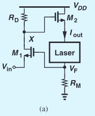

# 연습문제 12.31 — M2 소스와 접지 사이에 R_1을 더한 레이저 구동 회로 (예제 12.31 변형)

## 원문
저항 $R_1$이 $M_2$의 소스와 접지 사이에 연결되었을 때 위의 예제를 다시 풀어라.

## 조건
- 예제 12.31의 회로: Fig 12.60(a), $R_M$이 작지 않음, 레이저 다이오드는 임피던스 $R_L$
- 바뀐 점: 저항 $R_1$을 $M_2$의 소스(레이저 위쪽 노드)와 접지 사이에 연결
- 소자 값은 주어지지 않음 (답은 소신호 파라미터 기호로, $\lambda = 0$으로 봄) (원문에 없음)
- 전류-전압 귀환의 종지 법칙 (본문 Fig 12.53(d)): 감지 복제의 출력 포트와 반송 복제의 입력 포트를 모두 개방 (본문 정의, 원문에 없음)
- 전류-전압 귀환의 귀환율 (본문 Fig 12.54(d)): $K = V_2/I_1$, 귀환 회로망 입력에 $I_1$, 개방 출력 포트 전압 $V_2$ (본문 정의, 원문에 없음)
- 예제 12.31의 결과 ($R_1$이 없을 때): $G_m = \dfrac{g_{m1} R_D}{R_L + R_M + 1/g_{m2}}$, 개루프 입력 임피던스 $1/g_{m1}$, 개루프 출력 임피던스 $1/g_{m2} + R_M$, $K = R_M$ (원문에 없음)

## 구할 것
- $R_1$을 더한 회로의 개루프 이득 $G_m = I_{out}/V_{in}$, 개루프 입력·출력 임피던스, 귀환율 $K$, 폐루프 이득과 폐루프 입력·출력 임피던스 (구할 양의 목록은 원문에 없음, 원문은 "다시 풀어라"만 적음)

## 상속·참조
- 예제 12.31 (E12.31): 순방향 증폭기 $M_1$, $R_D$, $M_2$, 귀환 회로망 $R_M$. 루프를 열면 $M_1$ 게이트에 $R_M$(반송 복제), $R_L$ 아래에 $R_M$(감지 복제), 두 포트 모두 개방 (Fig 12.60(b))
  - $V_X/V_{in} = g_{m1} R_D$ (공통 게이트), $M_2$ 소스 폴로어로 $\dfrac{V_A}{V_X} = \dfrac{R_L + R_M}{R_L + R_M + 1/g_{m2}}$ (식 12.158), $I_{out} = \dfrac{V_A}{R_L + R_M}$
  - $G_m = \dfrac{g_{m1} R_D}{R_L + R_M + 1/g_{m2}}$ (식 12.161), 개루프 입력 임피던스 $1/g_{m1}$, 개루프 출력 임피던스 $V_X/I_X = 1/g_{m2} + R_M$ (식 12.162, $R_L$ 대신 테스트 전압원)
  - $K = R_M$ (예제 12.30과 같음), $\left.\dfrac{I_{out}}{V_{in}}\right|_{closed} = \dfrac{G_m}{1 + R_M G_m}$, $R_{in,closed} = \dfrac{1}{g_{m1}}(1 + R_M G_m)$, $R_{out,closed} = \left(\dfrac{1}{g_{m2}} + R_M\right)(1 + R_M G_m)$ (식 12.163–12.165)

## 회로 — Fig 12.60(a)
```spice
RD    VDD  X    {R_D}
M1    X    VF   Vin  nmos
M2    VDD  X    n1   nmos
XLAS  n1   VF   box "Laser"  ; 레이저 다이오드 (상자로 그려짐)
RM    VF   0    {R_M}
```
- 단자: VDD = 전원, 값 미지정 (가로 레일) / Vin = 입력, M1 소스 (개방 원)
- 표시: 노드 라벨 VDD (레일 오른쪽 끝 위), X (X 접속점 오른쪽 아래), V_in (입력 원 왼쪽), V_F (상자 아래 접속점 오른쪽) / 소자 라벨 R_D (저항 왼쪽), M1 (M1 왼쪽), M2 (M2 오른쪽), R_M (저항 오른쪽), "Laser" (굵은 사각 상자 안 글자) / 부호 없음 / 화살표 "I_out": M2 소스와 Laser 상자 윗변 사이 세로 도선, 아래 방향, 도선 위, 글자는 화살표 오른쪽 / 수치·면적 라벨 없음
- 배치: 맨 위 굵은 가로 레일 VDD, 왼쪽에 R_D, 오른쪽에 M2 드레인이 매달림 / 왼쪽 세로줄 위→아래 R_D, X 접속점, M1 / M1은 좌우 반전(게이트 오른쪽), 드레인 위, 소스 아래에서 내려가 왼쪽으로 꺾여 V_in 원 / X에서 가로선이 오른쪽으로 가다 위로 꺾여 M2 게이트(M2는 보통 방향, 게이트 왼쪽, 드레인 위·소스 아래) / 오른쪽 세로줄 위→아래 M2, I_out 화살표, Laser 상자, V_F 접속점, R_M, 접지 / M1 게이트 선은 오른쪽으로 짧게 가 아래로 꺾여 V_F 높이에서 다시 오른쪽으로 꺾여 V_F 접속점 (Laser 상자 왼쪽 아래를 지남) / 접속점 (세 갈래 이상, 2곳): X = 위 R_D + 아래 M1 드레인 + 오른쪽 M2 게이트 선 (점), V_F = 위 Laser + 아래 R_M + 왼쪽 M1 게이트 선 (점) / 교차: 없음


> 참고: 그림은 원래 회로. 이 연습문제는 M2 소스(레이저 상자 윗단) 노드와 접지 사이에 R_1을 더한 경우
