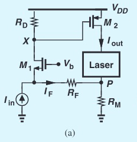

# 연습문제 12.32 — 그림 12.61(a)에서 레이저를 구동하는 회로의 노턴 등가 (예제 12.32 변형)

## 원문
레이저를 구동하는 전체 회로의 노턴 등가 회로를 만들어라.

## 조건
- 예제 12.32의 회로: Fig 12.61(a), $R_F$가 크지 않음, $R_M$이 작지 않음, 레이저 다이오드는 저항 $R_L$, $r_{O2} < \infty$
- 레이저를 구동하는 전체 회로(레이저를 뺀 나머지, 귀환 포함)를 레이저 단자에서 본 노턴 등가 회로로 나타냄 (노턴 전류원 $I_N$과 병렬 저항 $R_N$을 $I_{in}$과 회로 파라미터로) (기호 $I_N$, $R_N$은 원문에 없음)
- 소자 값은 주어지지 않음 (답은 소신호 파라미터 기호로) (원문에 없음)
- 예제 12.32의 결과: $A_{I,open} = \dfrac{(R_F + R_M) R_D}{R_F + R_M + 1/g_{m1}}\cdot\dfrac{-g_{m2} r_{O2}}{r_{O2} + R_L + R_M \parallel R_F}$ (식 12.166), $A_{I,closed} = \dfrac{A_{I,open}}{1 - \frac{R_M}{R_M + R_F} A_{I,open}}$ (식 12.171), $R_{out,closed} = (r_{O2} + R_F \parallel R_M)\left(1 - \dfrac{R_M}{R_M + R_F} A_{I,open}\right)$ (식 12.173) (원문에 없음)

## 구할 것
- 레이저를 구동하는 전체 회로의 노턴 등가 회로 (노턴 전류와 노턴 저항)

## 상속·참조
- 예제 12.32 (E12.32): 전류-전류 귀환. 순방향 시스템 $M_1$, $R_D$, $M_2$, 귀환 회로망 $R_M$과 $R_F$. 루프를 열면 반송 복제 $R_F + R_M$(입력 포트 개방), 감지 복제의 출력 포트 단락 (Fig 12.61(b))
  - $A_{I,open} = \dfrac{(R_F + R_M) R_D}{R_F + R_M + 1/g_{m1}}\cdot\dfrac{-g_{m2} r_{O2}}{r_{O2} + R_L + R_M \parallel R_F}$ (식 12.166)
  - $R_{in,open} = \dfrac{1}{g_{m1}} \parallel (R_F + R_M)$, $R_{out,open} = r_{O2} + R_F \parallel R_M$ (식 12.167, 12.168)
  - $K = -\dfrac{R_M}{R_M + R_F}$ (식 12.170), $A_{I,closed} = \dfrac{A_{I,open}}{1 - \frac{R_M}{R_M + R_F} A_{I,open}}$ (식 12.171), $R_{out,closed} = (r_{O2} + R_F \parallel R_M)\left(1 - \dfrac{R_M}{R_M + R_F} A_{I,open}\right)$ (식 12.173)
  - 예제의 $A_{I,open}$, $A_{I,closed}$는 부하 $R_L$을 포함한 값 (원문에 없음)

## 회로 — Fig 12.61(a)
```spice
RD    VDD  X    {R_D}
M1    X    Vb   n1   nmos
IIN   0    n1   {I_in}
RF    n1   P    {R_F}
M2    n2   X    VDD  pmos
XLAS  n2   P    box "Laser"  ; 레이저 다이오드 (상자로 그려짐)
RM    P    0    {R_M}
```
- 단자: VDD = 전원, 값 미지정 (가로 레일) / Vb = M1 게이트 DC 바이어스, 값 미지정 (점 단자)
- 표시: 노드 라벨 VDD (레일 오른쪽 끝 위), X (X 접속점 왼쪽), V_b (점 단자 오른쪽), P (P 접속점 오른쪽 아래) / 소자 라벨 R_D (저항 왼쪽), M1 (M1 왼쪽), M2 (M2 오른쪽), I_in (전류원 왼쪽), R_F (저항 아래), R_M (저항 오른쪽), "Laser" (굵은 사각 상자 안 글자) / 부호 없음 / 화살표 "I_out": M2 드레인과 Laser 상자 윗변 사이 세로 도선, 아래 방향, 도선 위, 글자는 화살표 오른쪽; "I_F": n1 접속점과 R_F 사이 가로 도선, 오른쪽 방향(입력 노드 → R_F), 도선 위, 글자는 화살표 아래 / 수치·면적 라벨 없음
- 배치: 맨 위 굵은 가로 레일 VDD, 왼쪽에 R_D, 오른쪽에 M2 소스가 매달림 / 왼쪽 세로줄 위→아래 R_D, X 접속점, M1, M1 소스 접속점(n1) / M1은 좌우 반전(게이트 오른쪽, 게이트 선이 오른쪽으로 V_b 점 단자) / n1에서 가로선이 왼쪽으로 가다 아래로 꺾여 I_in 전류원(원 안 화살표 위쪽), 그 아래 접지 / X에서 가로선이 오른쪽으로 가다 위로 꺾여 M2 게이트(M2 PMOS, 보통 방향, 게이트 왼쪽, 소스 위·드레인 아래) / 오른쪽 세로줄 위→아래 M2, I_out 화살표, Laser 상자, P 접속점, R_M, 접지 / n1에서 오른쪽으로 I_F 화살표, R_F를 지나 P 접속점 / 접속점 (세 갈래 이상, 3곳): X = 위 R_D + 아래 M1 드레인 + 오른쪽 M2 게이트 선 (점), n1 = 위 M1 소스 + 왼쪽 I_in 선 + 오른쪽 R_F 선 (점), P = 위 Laser + 아래 R_M + 왼쪽 R_F (점) / 교차: 없음


