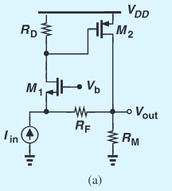

# 연습문제 12.33 — M2를 R_S로 축퇴한 그림 12.62(a) 증폭기 (예제 12.33 변형)

## 원문
$M_2$가 저항 $R_S$에 의해 축퇴되었을 때 위의 예제를 다시 풀어라.

## 조건
- 예제 12.33의 회로: Fig 12.62(a) (관심 있는 출력은 $V_{out}$)
- 바뀐 점: $M_2$(PMOS)를 저항 $R_S$로 축퇴, 즉 $M_2$ 소스와 $V_{DD}$ 사이에 $R_S$ (연결 위치는 원문에 없음, 원문은 "축퇴되었을 때"만 적음)
- 소자 값은 주어지지 않음 (답은 소신호 파라미터 기호로, $\lambda = 0$으로 봄) (원문에 없음)
- 전압-전류 귀환의 종지 법칙 (본문 Fig 12.53(b)): 감지 복제의 출력 포트와 반송 복제의 입력 포트를 모두 단락 (본문 정의, 원문에 없음)
- 전압-전류 귀환의 귀환율 (본문 Fig 12.54(b)): $K = I_2/V_1$, 귀환 회로망 입력에 $V_1$, 출력 포트 단락 전류 $I_2$ (본문 정의, 원문에 없음)
- 예제 12.33의 결과 ($R_S$가 없을 때): $R_O = \dfrac{R_F R_D}{R_F + 1/g_{m1}}\,[-g_{m2}(R_F \parallel R_M)]$, $R_{in,open} = \dfrac{1}{g_{m1}} \parallel R_F$, $R_{out,open} = R_F \parallel R_M$, $K = -1/R_F$ (원문에 없음)

## 구할 것
- $M_2$를 $R_S$로 축퇴한 회로의 개루프 이득 $R_O = V_{out}/I_{in}$, 개루프 입력·출력 임피던스, 귀환율 $K$, 폐루프 이득과 폐루프 입력·출력 임피던스 (구할 양의 목록은 원문에 없음, 원문은 "다시 풀어라"만 적음)

## 상속·참조
- 예제 12.33 (E12.33): 전압-전류 귀환, $R_M$은 순방향 증폭기에 포함. 루프를 열면 입력 노드에 $R_F$(반송 복제)가 접지로, 출력 노드에 $R_F$(감지 복제)가 접지로 붙음 (Fig 12.62(b)), 출력 임피던스는 $V_{out}$ 노드에 테스트 전압원 (Fig 12.62(c))
  - $R_O = \dfrac{R_F R_D}{R_F + 1/g_{m1}}\,[-g_{m2}(R_F \parallel R_M)]$ (식 12.175), $R_{in,open} = \dfrac{1}{g_{m1}} \parallel R_F$ (식 12.176), $R_{out,open} = R_F \parallel R_M$ (식 12.178)
  - $K = -1/R_F$ (식 12.180), $\left.\dfrac{V_{out}}{I_{in}}\right|_{closed} = \dfrac{R_O}{1 - R_O/R_F}$, $R_{in,closed} = \dfrac{(1/g_{m1}) \parallel R_F}{1 - R_O/R_F}$, $R_{out,closed} = \dfrac{R_F \parallel R_M}{1 - R_O/R_F}$ (식 12.181–12.183)

## 회로 — Fig 12.62(a)
```spice
RD    VDD   n2    {R_D}
M1    n2    Vb    n1    nmos
IIN   0     n1    {I_in}
RF    n1    Vout  {R_F}
M2    Vout  n2    VDD   pmos
RM    Vout  0     {R_M}
```
- 단자: VDD = 전원, 값 미지정 (가로 레일) / Vb = M1 게이트 DC 바이어스, 값 미지정 (점 단자) / Vout = 출력 (개방 원)
- 표시: 노드 라벨 VDD (레일 오른쪽 끝 위), V_b (점 단자 오른쪽), V_out (출력 원 오른쪽) / 소자 라벨 R_D (저항 왼쪽), M1 (M1 왼쪽), M2 (M2 오른쪽), I_in (전류원 왼쪽), R_F (저항 아래), R_M (저항 오른쪽) / 부호 없음 / 화살표 없음 / 수치·면적 라벨 없음
- 배치: 맨 위 굵은 가로 레일 VDD, 왼쪽에 R_D, 오른쪽에 M2 소스가 매달림 / 왼쪽 세로줄 위→아래 R_D, 드레인 접속점(n2, 라벨 없음), M1, M1 소스 접속점(n1) / M1은 좌우 반전(게이트 오른쪽, 게이트 선이 오른쪽으로 V_b 점 단자) / n1에서 가로선이 왼쪽으로 가다 아래로 꺾여 I_in 전류원(원 안 화살표 위쪽), 그 아래 접지 / n2에서 가로선이 오른쪽으로 가다 위로 꺾여 M2 게이트(M2 PMOS, 보통 방향, 게이트 왼쪽, 소스 위·드레인 아래) / M2 드레인에서 세로선이 n1 높이까지 내려와 V_out 접속점 / n1에서 오른쪽으로 R_F를 지나 V_out 접속점, 거기서 오른쪽으로 V_out 원, 아래로 R_M과 접지 / 접속점 (세 갈래 이상, 3곳): n2 = 위 R_D + 아래 M1 드레인 + 오른쪽 M2 게이트 선 (점), n1 = 위 M1 소스 + 왼쪽 I_in 선 + 오른쪽 R_F (점), V_out 접속점 = 위 M2 드레인 + 왼쪽 R_F + 오른쪽 출력 원 + 아래 R_M, 네 갈래 (점) / 교차: 없음


> 참고: 그림은 원래 회로. 이 연습문제는 M2 소스와 VDD 레일 사이에 R_S를 둔 경우
