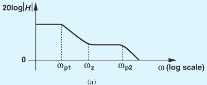

# 연습문제 12.34 — ω_p1이 ω_z와 ω_p2 사이에 있을 때 위상 응답 (예제 12.34 변형)

## 원문
$\omega_{p1}$이 $\omega_z$와 $\omega_{p2}$ 사이에 있을 때 위의 예제를 다시 풀어라.

## 조건
- 예제 12.34: 극점 2개($\omega_{p1}$, $\omega_{p2}$)와 영점 1개($\omega_z$)를 갖는 증폭기의 크기 특성(Fig 12.63(a), $\omega_{p1} < \omega_z < \omega_{p2}$)에서 보데의 규칙으로 위상 응답을 그림
- 바뀐 점: $\omega_{p1}$이 $\omega_z$와 $\omega_{p2}$ 사이, 즉 $\omega_z < \omega_{p1} < \omega_{p2}$ (부등식 표기는 원문에 없음)
- 극점과 영점은 좌반면에 있고 서로 충분히 떨어져 있다고 봄 (예제의 가정, 원문에 없음)
- 보데의 규칙 (본문 12.8.1절): 크기의 기울기는 주파수가 극점(영점)을 지나면 20 dB/dec씩 감소(증가). 위상은 극점(영점) 주파수의 1/10부터 감소(증가)하기 시작해 극점(영점) 주파수에서 −45°(+45°), 10배에서 거의 −90°(+90°)만큼 바뀜 (본문 규칙, 원문에 없음)

## 구할 것
- 바뀐 극점·영점 순서에서의 크기 특성과 위상 응답 $\angle H$ 도시 (크기 특성도 다시 그림은 원문에 없음)

## 상속·참조
- 예제 12.34 (E12.34): 위상은 $0.1\omega_{p1}$에서 하강 시작, $\omega_{p1}$에서 $-45^\circ$, $10\omega_{p1}$에서 $-90^\circ$. $0.1\omega_z$에서 상승 시작, $\omega_z$에서 $-45^\circ$, $10\omega_z$에서 근사적으로 $0^\circ$. $0.1\omega_{p2}$에서 하강 시작, $\omega_{p2}$에서 $-45^\circ$, $10\omega_{p2}$에서 $-90^\circ$. 가정 $10\omega_{p1} < 0.1\omega_z$, $10\omega_z < 0.1\omega_{p2}$
- Fig 12.63(a) (예제의 문제 그림, 크롭함): 세로축 "20log|H|", 가로축 "ω (log scale)", 눈금 "0". 높은 수평선 → "ω_p1"에서 내려감 → "ω_z"에서 중간 높이 수평 → "ω_p2"에서 내려가 0에 닿음. 세 꺾임점에서 가로축까지 세로 점선. 이 연습문제의 순서($\omega_z < \omega_{p1}$)와는 다름

## 회로 — 없음 (특성 그래프 문제, 예제의 크기 특성 그래프 12.63(a)를 상속·참조에 적음)
