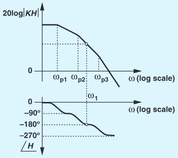

# 연습문제 12.37 — ω_p1이 절반일 때 3극점 시스템의 발진 여부

## 원문
$\omega_{p1}$이 반으로 줄었다고 가정하라. 이 시스템은 아직도 발진하는가?

## 조건
- 예제 12.37의 3극점 귀환 시스템 (Fig 12.67의 주파수 응답)
- 바뀐 점: 첫 번째 극점 $\omega_{p1}$이 절반으로 줄어듦 ($\omega_{p2}$, $\omega_{p3}$, 저주파 루프 이득은 그대로) (괄호 안은 원문에 없음)
- 예제 12.37의 결과: $\angle KH = -180^\circ$인 $\omega_1$($\omega_{p2}$와 $\omega_{p3}$ 사이)에서 $|KH| > 1$이라 발진함 (원문에 없음)
- 식 (12.185), (12.186): 발진 조건 $|KH(j\omega_1)| = 1$ (인쇄는 닫는 괄호 빠짐), $\angle KH(j\omega_1) = -180^\circ$ (본문 식, 원문에 없음)

## 구할 것
- $\omega_{p1}$이 반으로 줄었을 때 이 시스템이 아직도 발진하는가?

## 상속·참조
- 예제 12.37 (E12.37): Fig 12.67의 3극점 시스템은 $\omega_1$에서 루프 이득이 1보다 커서 발진함
- Fig 12.67 (예제 12.37 문제 그림, 크롭함): 위 $20\log|KH|$ 곡선은 평탄 → $\omega_{p1}$, $\omega_{p2}$, $\omega_{p3}$에서 차례로 더 가파르게 꺾여 0을 지나 내려감. $\omega_{p2}$와 $\omega_{p3}$ 사이의 $\omega_1$(빈 원)에서 크기는 0보다 위. 아래 $\angle H$ 곡선은 0 → $-90^\circ$ 근처 평탄 → $\omega_1$에서 $-180^\circ$(빈 원) → $-270^\circ$. 눈금 −90°, −180°, −270°에 가로 점선

## 회로 — 없음 (특성 그래프 문제, 예제 12.37의 그림 12.67을 상속·참조에 적음)
