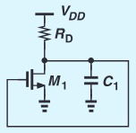

# 연습문제 12.39 — R_D → ∞, λ → 0일 때 단일 이득 귀환 CS 단

## 원문
$R_D \to \infty, \lambda \to 0$일 때 무슨 일이 일어나는가?

## 조건
- 예제 12.39와 같은 회로: Fig 12.70 공통 소스 단($M_1$, $R_D$, $C_1$)을 단일 이득 귀환 루프에 놓음 (드레인이 게이트로 이어짐)
- 바뀐 점: $R_D \to \infty$, $\lambda \to 0$
- 예제 12.39의 결과: 극점이 1개뿐이라 위상 시프트가 $180^\circ$에 도달할 수 없어 안정 (원문에 없음)

## 구할 것
- $R_D \to \infty$, $\lambda \to 0$일 때 무슨 일이 일어나는가?

## 상속·참조
- 예제 12.39 (E12.39): 회로가 극점을 1개만 가지므로 어떤 주파수에서도 위상 시프트가 $180^\circ$에 도달하지 않아 안정함

## 회로 — Fig 12.70
```spice
RD  VDD  n1  {R_D}
M1  n1   n1  0  nmos   ; 게이트는 아래로 도는 귀환선으로 드레인 노드에 연결
C1  n1   0   {C_1}
```
- 단자: VDD = 전원, 값 미지정 (T 전원 기호)
- 표시: 노드 라벨 V_DD (T 기호 오른쪽) / 소자 라벨 R_D (저항 오른쪽), M1 (트랜지스터 오른쪽, 소스 옆), C_1 (커패시터 오른쪽) / 부호 없음 / 화살표 없음 / 수치·면적 라벨 없음
- 배치: 한 세로줄 위→아래 VDD T 기호, R_D, 드레인 노드, M1(NMOS, 게이트 왼쪽, 소스 아래·화살표 바깥), 접지 / 드레인 노드에서 가로선이 오른쪽으로 C_1 위 접속점을 지나 오른쪽 끝에서 아래로 꺾임 → 접지 기호들보다 아래 높이로 왼쪽으로 가로질러 → 왼쪽 끝에서 위로 올라가 게이트 높이에서 오른쪽으로 꺾여 M1 게이트로 들어감 (회로를 감싸는 사각 루프) / C_1 아래 접지 / 접속점 (세 갈래 이상, 2곳): 드레인 = 위 R_D + 아래 드레인 + 오른쪽 가로선 (점), C_1 위 = 왼쪽 가로선 + 아래 C_1 + 오른쪽 귀환선 (점) / 교차: 없음


