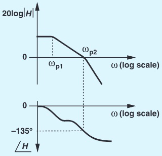

# 연습문제 12.41 — K = 0.5일 때 위상 마진이 45°보다 큰지

## 원문
$K = 0.5$일 때 위상 마진은 $45^\circ$보다 큰가? 작은가?

## 조건
- 예제 12.41의 증폭기: Fig 12.73의 주파수 응답, 두 번째 극점 주파수 $\omega_{p2}$에서 $|H|$가 1로 떨어짐
- 바뀐 점: 귀환율 $K = 0.5$ (예제는 $K = 1$)
- 예제 12.41의 결과: $K = 1$에서 $\omega_{p2}$에서 위상이 $-135^\circ$ → 위상 마진 $45^\circ$ (원문에 없음)
- 식 (12.195): 위상 마진 $\text{PM} = \angle H(\omega_{GX}) + 180^\circ$, $\angle KH = \angle H$ (본문 식, 원문에 없음)

## 구할 것
- $K = 0.5$일 때 위상 마진이 $45^\circ$보다 큰가, 작은가?

## 상속·참조
- 예제 12.41 (E12.41): 그림은 두 번째 극점 주파수에서 위상이 $-135^\circ$에 도달함을 보여 주므로 $K = 1$일 때 위상 마진은 $45^\circ$
- 식 (12.195) (교재 711쪽): $\text{Phase Margin} = \angle H(\omega_{GX}) + 180^\circ$
- Fig 12.73 (예제 12.41 문제 그림, 크롭함): 위 $20\log|H|$ 곡선은 평탄 → $\omega_{p1}$에서 꺾여 완만히 내려가 $\omega_{p2}$에서 0 축과 만나고 더 가파르게 내려감. 아래 $\angle H$ 곡선은 0 → 중간 평탄 → $\omega_{p2}$에서 $-135^\circ$(가로 점선) → 더 아래에서 평탄

## 회로 — 없음 (특성 그래프 문제, 예제 12.41의 그림 12.73을 상속·참조에 적음)
