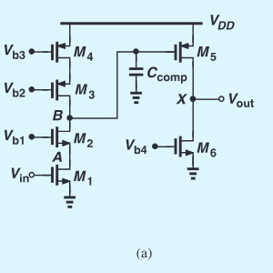

# 연습문제 12.42 — 첫째 단이 간단한 CS 증폭기일 때 주파수 응답과 보상

## 원문
$M_2$와 $M_3$가 생략될 때, 즉 첫째 단이 간단한 CS 증폭기일 때 위의 예제를 다시 풀어라.

## 조건
- 예제 12.42의 회로: Fig 12.75(a) (캐스코드 첫째 단 + CS 둘째 단, 노드 $B$에 $C_{comp}$)
- 바뀐 점: $M_2$와 $M_3$를 생략 → 첫째 단이 간단한 CS 증폭기 ($M_1$ 드레인과 $M_4$ 드레인이 바로 노드 $B$에서 만나고, $B$가 $M_5$ 게이트와 $C_{comp}$를 구동) (괄호 안은 원문에 없음)
- 예제 12.42에서 이어받는 가정: 노드 $B$의 극점이 우성 (원문에 없음)
- 예제 12.42의 결과: $\omega_{p,A} \approx g_{m2}/C_A$, $\omega_{p,B} \approx \dfrac{1}{[(g_{m2} r_{O2} r_{O1}) \| (g_{m3} r_{O3} r_{O4})] C_B}$, $\omega_{p,out} = \dfrac{1}{(r_{O5} \| r_{O6}) C_{out}}$, $\omega_{p,B} < \omega_{p,out} < \omega_{p,A}$. $C_{comp}$로 $\omega_{p,B}$를 낮춰 이득 교차를 위상 교차보다 훨씬 밑으로 보냄 (원문에 없음)

## 구할 것
- $M_2$, $M_3$를 생략했을 때 주파수 응답과 보상 방식 (예제 12.42 다시 풀기)

## 상속·참조
- 예제 12.42 (E12.42): "그림 12.75(a)의 증폭기가 캐스코드 단과 CS 단을 사용한다. 노드 $B$에서의 극점이 우성이라고 가정하여 주파수 응답을 그리고, 회로가 어떻게 '보상'되었는지 설명하라."
- 예제 12.42의 풀이: 식 (12.196) $\omega_{p,A} \approx \dfrac{g_{m2}}{C_A}$, 식 (12.197) $\omega_{p,B} \approx \dfrac{1}{[(g_{m2} r_{O2} r_{O1}) \| (g_{m3} r_{O3} r_{O4})] C_B}$, 식 (12.198) $\omega_{p,out} = \dfrac{1}{(r_{O5} \| r_{O6}) C_{out}}$ ($C_A$, $C_B$, $C_{out}$: 각 노드에서 접지로 본 전체 커패시턴스). $\omega_{p,B} < \omega_{p,out} < \omega_{p,A}$ 가정. 노드 $B$에 $C_{comp}$를 더해 $\omega_{p,B}$를 낮추면 이득 교차가 위상 교차보다 훨씬 밑에서 일어나 위상 마진이 커지고, 속도는 감소

## 회로 — Fig 12.75(a)
```spice
M4     n1  Vb3  VDD  pmos
M3     B   Vb2  n1   pmos
M2     B   Vb1  A    nmos
M1     A   Vin  0    nmos
M5     X   B    VDD  pmos   ; 게이트는 노드 B에서 오른쪽으로 꺾여 올라온 선
Ccomp  B   0    {C_comp}    ; M5 게이트 선의 접속점에서 접지로
M6     X   Vb4  0    nmos
* X 노드에서 오른쪽 가로선 끝 개방 원 = V_out
```
- 단자: VDD = 전원, 값 미지정 (가로 레일) / Vb1, Vb2, Vb3, Vb4 = 이상적 DC 바이어스, 값 미지정 (점 단자) / Vin = 입력 (개방 원) / X = 출력 V_out (개방 원)
- 표시: 노드 라벨 V_DD (레일 오른쪽 끝), V_b3, V_b2, V_b1 (왼쪽 세로줄 각 점 단자 왼쪽), V_in (입력 원 왼쪽), V_b4 (M6 점 단자 왼쪽), B (M3–M2 사이 접속점 왼쪽), A (M2–M1 사이 노드 왼쪽), X (M5–M6 사이 접속점 왼쪽), V_out (출력 원 오른쪽) / 소자 라벨 M1, M2, M3, M4 (각 트랜지스터 오른쪽), M5, M6 (각 트랜지스터 오른쪽), C_comp (커패시터 오른쪽) / 부호 없음 / 화살표 없음 / 수치·면적 라벨 없음
- 배치: 맨 위 가로 레일 VDD가 왼쪽 세로줄에서 오른쪽 세로줄까지, 라벨은 오른쪽 끝 / 왼쪽 세로줄 위→아래 M4(PMOS, 소스 위가 레일), M3(PMOS), 노드 B, M2(NMOS), 노드 A, M1(NMOS), 접지. 네 트랜지스터 모두 게이트 왼쪽 / 오른쪽 세로줄 위→아래 M5(PMOS, 소스 위가 레일, 게이트 왼쪽), 노드 X, M6(NMOS, 게이트 왼쪽), 접지 / 노드 B에서 가로선이 오른쪽으로 두 세로줄 사이까지 가서 위로 꺾여 M5 게이트 높이에서 다시 오른쪽으로 꺾여 C_comp 위 접속점을 지나 M5 게이트로 들어감 / C_comp는 그 접속점에서 아래로 접지 / X에서 가로선이 오른쪽으로 V_out 원 / 접속점 (세 갈래 이상, 3곳): B = 위 M3 드레인 + 아래 M2 드레인 + 오른쪽 가로선 (점), C_comp 위 = 왼쪽 선 + 아래 C_comp + 오른쪽 M5 게이트 선 (점), X = 위 M5 드레인 + 아래 M6 드레인 + 오른쪽 V_out 선 (점) / 교차: 없음


> 참고: 그림은 예제의 원래 회로이고, 연습문제는 여기서 $M_2$와 $M_3$를 뺀 회로를 씀
