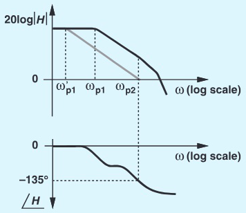

# 연습문제 12.43 — K = 0.5에서 위상 마진 45°가 되도록 보상하고 비교

## 원문
$K = 0.5$일 경우 위의 예제를 다시 풀고 결과를 비교하라.

## 조건
- 예제 12.43의 증폭기: Fig 12.77의 주파수 응답(검은 곡선), 극점들은 멀리 떨어져 있음, 목표 위상 마진 $45^\circ$
- 바뀐 점: 귀환율 $K = 0.5$ (예제는 $K = 1$)
- 예제 12.43의 결과 ($K = 1$): $\omega_{p2}$에서 위상이 $-135^\circ$이므로 $\omega_{PM} = \omega_{p2}$, $\omega_{p2}$(0 dB)에서 $-20$ dB/dec 선을 그려 우성 극점을 $\omega'_{p1}$으로 옮김 (원문에 없음)
- 보상 절차 (본문 그림 12.76): $\angle KH = -180^\circ + \text{PM}$이 되는 $\omega_{PM}$을 찾고, $|KH|$ 응답의 $\omega_{PM}$(0 dB)에서 20 dB/dec 기울기의 선을 그려 원래 $|KH|$ 응답과 만나는 점을 새 우성 극점으로 함 (본문 절차, 원문에 없음)

## 구할 것
- $K = 0.5$일 때 $45^\circ$ 위상 마진을 위한 보상 (새 우성 극점)
- $K = 1$의 결과와 비교

## 상속·참조
- 예제 12.43 (E12.43): Fig 12.77의 증폭기를 $K = 1$에서 위상 마진 $45^\circ$가 되도록 보상. $\omega_{p2}$에서 위상이 $-135^\circ$ → $\omega_{PM} = \omega_{p2}$. $\omega_{p2}$로부터 $-20$ dB/dec 선을 그어 우성 극점을 $\omega'_{p1}$으로 이동. 실제로는 $\omega_{PM} < \omega_{p2}$
- 식 (12.195): $\text{Phase Margin} = \angle H(\omega_{GX}) + 180^\circ$, $K$는 위상이 없으므로 $\angle KH = \angle H$
- Fig 12.77 (예제 12.43 문제 그림, 크롭함): 위 $20\log|H|$ 검은 곡선은 평탄 → $\omega_{p1}$에서 꺾여 내려가고 $\omega_{p2}$에서 조금 더, 그 오른쪽(0 dB 바로 위)에서 한 번 더 급하게 꺾여 0을 지나 내려감. 회색 직선은 $\omega'_{p1}$에서 0 dB의 $\omega_{p2}$까지 (예제의 보상 결과). 아래 $\angle H$는 $\omega_{p2}$에서 $-135^\circ$(가로 점선)

> 참고: 그림의 회색 선과 ω'_p1은 예제 12.43($K = 1$)의 보상 결과

## 회로 — 없음 (특성 그래프 문제, 예제 12.43의 그림 12.77을 상속·참조에 적음)
