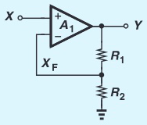

# 예제 12.1 — 귀환의 관점으로 본 비반전 증폭기

## 원문
귀환의 관점으로 그림 12.2의 비반전 증폭기를 해석하라.

## 조건
- 회로: Fig 12.2 비반전 증폭기 (연산 증폭기 $A_1$, 출력과 접지 사이 분배기 $R_1$, $R_2$, 분배 노드 전압 $X_F$가 반전 입력으로 귀환)
- 소자 값은 주어지지 않음 (답은 $A_1$, $R_1$, $R_2$의 식으로) (원문에 없음)
- 귀환 시스템의 네 성분: 피드포워드(순방향) 시스템 $A_1$, 출력 감지 장치, 귀환 회로망(귀환율 $K = X_F/Y$), 비교(반송) 장치(오차 $E = X - X_F$) (본문 정의, 원문에 없음)
- 식 (12.2): $\dfrac{Y}{X} = \dfrac{A_1}{1 + KA_1}$ (본문 식, 원문에 없음)

## 구할 것
- 귀환의 관점에서 Fig 12.2 회로 해석: 뺄셈·증폭을 맡는 부분, 감지·귀환을 맡는 부분, 귀환율 $K$, 폐루프 이득 $Y/X$

## 상속·참조
- 본문 Fig 12.1 (교재 643쪽, 이 파일의 그림 목록에는 넣지 않음, 크롭은 fig12-01.png): 일반적인 귀환 시스템 블록도. 입력 $X$ → 덧셈기(+ $X$, − $X_F$) → 순방향 블록 $A_1$ → 출력 $Y$, $Y$를 감지해 귀환 회로망 $K$(삼각형)를 거쳐 $X_F$가 덧셈기 − 입력으로
  - 본문 정의 (643쪽): (1) 피드포워드 시스템, (2) 출력 감지 장치, (3) 귀환 회로망: 감지된 출력으로부터 귀환 신호 $X_F$를 생성, $K = X_F/Y$를 귀환율, (4) 비교 또는 반송 장치: 오차 $E = X - X_F$
- 식 (12.1): $(X - KY)A_1 = Y$, 식 (12.2): $\dfrac{Y}{X} = \dfrac{A_1}{1 + KA_1}$ (폐루프 이득)

## 회로 — Fig 12.2
```spice
XA1  X   XF  Y   opamp
R1   Y   XF  {R_1}
R2   XF  0   {R_2}
```
- 단자: X = 입력 (개방 원) / Y = 출력 (개방 원)
- 표시: 노드 라벨 X (입력 원 왼쪽), Y (출력 원 오른쪽), X_F (귀환선 왼쪽 세로 부분 바로 오른쪽, 아래 가로선 위) / 소자 라벨 A1 (삼각형 안), R1, R2 (각 저항 오른쪽) / 부호 연산 증폭기 입력 + 위, − 아래 (삼각형 안쪽 왼쪽) / 화살표 없음 / 수치·면적 라벨 없음
- 배치: 왼쪽 X 원 → 가로선 → 연산 증폭기 + 입력(위) / 연산 증폭기는 오른쪽을 향한 삼각형, 출력 접속점에서 가로선이 오른쪽 Y 원까지 / 출력 접속점 아래로 R1, X_F 접속점, R2, 접지가 한 세로줄 / X_F 접속점에서 가로선이 왼쪽으로 연산 증폭기 왼쪽 바깥까지 간 뒤 위로 꺾이고, − 입력 높이에서 오른쪽으로 꺾여 − 입력 / 접속점 (세 갈래 이상, 2곳): 출력 = 왼쪽 연산 증폭기 출력 + 오른쪽 Y 선 + 아래 R1 (점), X_F = 위 R1 + 아래 R2 + 왼쪽 귀환선 (점) / 교차: 없음



## 답 (검증용)
- 연산 증폭기 $A_1$이 $X$에서 $X_F$를 빼는 뺄셈과 증폭을 함께 수행하고, $R_1$, $R_2$가 출력 전압을 감지하면서 귀환율 $K = R_2/(R_1 + R_2)$를 제공함
- 식 (12.2)에서 $\dfrac{Y}{X} = \dfrac{A_1}{1 + \dfrac{R_2}{R_1 + R_2}A_1}$ (식 12.3), 8장에서 얻은 결과와 같음
