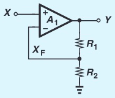

# 예제 12.2 — 루프 이득이 클 때 Y/X가 1 + R1/R2로 접근하는 이유

## 원문
그림 12.2의 회로에서 $[R_2/(R_1+R_2)]A_1$이 1보다 훨씬 크게 됨에 따라 왜 $Y/X$가 $1+R_1/R_2$로 접근하는지 설명하라.

## 조건
- 회로: Fig 12.2 비반전 증폭기 (연산 증폭기 $A_1$, 출력과 접지 사이 분배기 $R_1$, $R_2$, 분배 노드 전압 $X_F$가 반전 입력으로 귀환)
- $[R_2/(R_1 + R_2)]A_1 \gg 1$로 커지는 경우
- 예제 12.1의 결과: 귀환율 $K = X_F/Y = R_2/(R_1 + R_2)$ (원문에 없음)
- 식 (12.4): 오차 $E = X - X_F = \dfrac{X}{1 + KA_1}$ (본문 식, 원문에 없음)

## 구할 것
- $[R_2/(R_1 + R_2)]A_1 \gg 1$일 때 $Y/X \to 1 + R_1/R_2$가 되는 이유 설명

## 상속·참조
- 예제 12.1 (교재 644쪽): 연산 증폭기 $A_1$이 뺄셈과 증폭, $R_1$, $R_2$가 출력 감지와 귀환율 $K = R_2/(R_1 + R_2)$ 제공. 식 (12.3): $\dfrac{Y}{X} = \dfrac{A_1}{1 + \dfrac{R_2}{R_1 + R_2}A_1}$
- 식 (12.4) (교재 645쪽): $E = \dfrac{X}{1 + KA_1}$ — $KA_1$이 커질수록 귀환 신호와 입력의 차가 줄어 귀환 신호가 입력의 '복제'에 가까워짐 (본문 Fig 12.3)

## 회로 — Fig 12.2
```spice
XA1  X   XF  Y   opamp
R1   Y   XF  {R_1}
R2   XF  0   {R_2}
```
- 단자: X = 입력 (개방 원) / Y = 출력 (개방 원)
- 표시: 노드 라벨 X (입력 원 왼쪽), Y (출력 원 오른쪽), X_F (귀환선 왼쪽 세로 부분 바로 오른쪽, 아래 가로선 위) / 소자 라벨 A1 (삼각형 안), R1, R2 (각 저항 오른쪽) / 부호 연산 증폭기 입력 + 위, − 아래 (삼각형 안쪽 왼쪽) / 화살표 없음 / 수치·면적 라벨 없음
- 배치: 왼쪽 X 원 → 가로선 → 연산 증폭기 + 입력(위) / 연산 증폭기는 오른쪽을 향한 삼각형, 출력 접속점에서 가로선이 오른쪽 Y 원까지 / 출력 접속점 아래로 R1, X_F 접속점, R2, 접지가 한 세로줄 / X_F 접속점에서 가로선이 왼쪽으로 연산 증폭기 왼쪽 바깥까지 간 뒤 위로 꺾이고, − 입력 높이에서 오른쪽으로 꺾여 − 입력 / 접속점 (세 갈래 이상, 2곳): 출력 = 왼쪽 연산 증폭기 출력 + 오른쪽 Y 선 + 아래 R1 (점), X_F = 위 R1 + 아래 R2 + 왼쪽 귀환선 (점) / 교차: 없음


> 참고: 그림 12.2는 예제 12.1 상자(교재 644쪽, PDF 3 왼쪽)에 인쇄돼 있음. 예제 12.2 상자(645쪽)에는 그림이 다시 인쇄되지 않음

## 답 (검증용)
- $KA_1 = [R_2/(R_1 + R_2)]A_1$이 크면 $X_F \approx X$ → 전압 분배기가 $Y\dfrac{R_2}{R_1 + R_2} \approx X$ (식 12.5)를 요구 → $\dfrac{Y}{X} \approx 1 + \dfrac{R_1}{R_2}$ (식 12.6)
- $[R_2/(R_1 + R_2)]A_1 \gg 1$이면 식 (12.3)도 같은 결과를 줌
