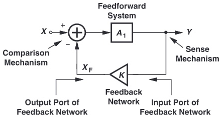
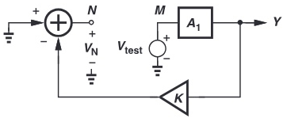

# 예제 12.3 — A1의 입력에서 루프를 끊어 구한 루프 이득

## 원문
$A_1$의 입력에서 루프를 끊음으로써 그림 12.1의 귀환 시스템의 루프 이득을 계산하라.

## 조건
- 회로: Fig 12.1 일반적인 귀환 시스템 (덧셈기, 순방향 블록 $A_1$, 귀환 회로망 $K$)
- 루프를 끊는 위치: $A_1$의 입력
- 루프 이득 계산법: 입력 $X$를 0으로 놓고 루프를 끊은 뒤, 끊은 점의 한쪽(M)에 테스트 신호 $V_{test}$를 인가하고 다른 쪽(N)에서 신호 $V_N$을 얻음 (본문 방법, 원문에 없음)
- 식 (12.8): $KA_1 = -\dfrac{V_N}{V_{test}}$ (본문 식, 원문에 없음)

## 구할 것
- $A_1$의 입력에서 루프를 끊었을 때 루프 이득

## 상속·참조
- 본문 Fig 12.4 (교재 646쪽, 크롭 안 함): (a) 입력을 접지(덧셈기 + 입력에 접지)하고 $A_1$ 출력과 $K$ 입력 사이에서 루프를 끊음. $A_1$ 출력 쪽 끝이 N(개방 원), $K$ 입력 쪽 끝이 M(개방 원). (b) M에 $V_{test}$(+ 위, − 아래 접지)를 인가하고 N에서 $V_N$(+ 위, − 아래 접지)을 관측
- 식 (12.7): $V_N = -KV_{test}A_1$ ($A_1$의 입력은 $-KV_{test}$), 식 (12.8): $KA_1 = -\dfrac{V_N}{V_{test}}$ — 신호가 루프를 따라 흐르면 루프 이득 $-KA_1$과 같은 이득을 얻음. 폐루프 이득 $A_1/(1 + KA_1)$과 루프 이득 $KA_1$을 혼동하지 않음
- 본문 각주 (646쪽): 이 예제에서는 전압 양을 사용하나 다른 양도 작동함

## 회로 — Fig 12.1
```spice
XCMP  X   XF  n1  sum   ; X +, XF −
XA1   n1  Y   gain "A1"
XK    Y   XF  gain "K" tri
```
- 단자: X = 입력 (개방 원) / Y = 출력 (선 끝, 화살촉)
- 표시: 노드 라벨 X (입력 원 왼쪽), Y (출력 화살촉 오른쪽), X_F (덧셈기 아래 세로선 오른쪽, K 왼쪽 가로선 위) / 소자 라벨 A1 (사각 상자 안), K (삼각형 안), 덧셈기 ⊕ (라벨 없음), 설명 글자 "Feedforward System" (A1 위 두 줄), "Feedback Network" (K 아래 두 줄) / 부호 덧셈기 왼쪽 입력 위쪽에 +, 덧셈기 왼쪽 아래(아래 입력 왼쪽)에 − / 화살표 신호 흐름 (라벨 없음): X 원 → 덧셈기 왼쪽 입력, 오른쪽, 도선 위; 덧셈기 → A1, 오른쪽, 도선 위; Y 접속점 → Y, 오른쪽, 도선 위; 귀환선 → 덧셈기 아래 입력, 위 방향, 도선 위 / "Comparison Mechanism": 덧셈기 왼쪽 아래를 가리킴, 오른쪽 위 방향, 도선 옆 별도 화살표 (직선, 글자 두 줄은 화살표 왼쪽 아래) / "Sense Mechanism": Y 접속점 바로 오른쪽 아래를 가리킴, 왼쪽 위 방향, 도선 옆 별도 화살표 (직선, 글자 두 줄은 화살표 오른쪽 아래) / "Output Port of Feedback Network": K 왼쪽 귀환선(X_F 쪽)을 가리킴, 오른쪽 방향, 도선 옆 별도 화살표 (┌ 꺾임: 글자 위에서 세로선이 올라가 위 끝에서 오른쪽으로 꺾임, 화살촉 오른쪽 끝) / "Input Port of Feedback Network": K 오른쪽 귀환선을 가리킴, 왼쪽 방향, 도선 옆 별도 화살표 (┌ 꺾임을 좌우 반전: 글자 위에서 세로선이 올라가 위 끝에서 왼쪽으로 꺾임, 화살촉 왼쪽 끝) / 수치·면적 라벨 없음
- 배치: 위 줄 왼쪽→오른쪽 X 원, 덧셈기(⊕ 원), A1 상자, Y 접속점, Y 화살촉 / Y 접속점에서 세로선이 아래로 내려가 K 높이에서 왼쪽으로 꺾여 K 삼각형 오른쪽(입력) / K는 왼쪽을 향한 삼각형, 왼쪽(출력)에서 가로선이 덧셈기 바로 아래까지 가서 위로 꺾여 덧셈기 아래 입력 / 두 Port 설명 화살표는 귀환선 아래, K 양옆에서 귀환선 높이보다 약간 아래를 향함 / 접속점 (세 갈래 이상, 1곳): Y = 왼쪽 A1 출력 + 오른쪽 Y 화살촉 + 아래 귀환선 (점) / 교차: 없음


> 참고: 그림 12.1은 본문 그림 (교재 643쪽, PDF 2 오른쪽). 예제 상자 안에는 다시 인쇄되지 않음

## 답 (검증용)
- 테스트 신호를 $A_1$의 입력에 가하는 시스템이 Fig 12.5. 귀환 회로망의 출력은 $KA_1V_{test}$ → $V_N = -KA_1V_{test}$ (식 12.9) → 식 (12.8)과 같은 결과, 루프 이득 $KA_1$

### 정답 회로 — Fig 12.5
```spice
XCMP   0   n1  N   sum   ; 0(접지) +, n1 −
VTEST  M   0   {V_test}
XA1    M   Y   gain "A1"
XK     Y   n1  gain "K" tri
```
- 단자: N = 덧셈기 출력, 루프를 끊은 한쪽 끝 (개방 원) / M = A1 입력, 루프를 끊은 다른 쪽 끝 (선 끝, V_test가 구동) / Y = 출력 (선 끝, 화살촉)
- 표시: 노드 라벨 N (개방 원 위), M (A1 왼쪽 입력선 위), Y (출력 화살촉 오른쪽), "V_N" (N 원 아래, + 위·− 아래, 그 아래 접지 기호) / 소자 라벨 V_test (전원 원 왼쪽), A1 (상자 안), K (삼각형 안) / 부호 덧셈기 왼쪽 입력 위 +, 덧셈기 왼쪽 아래 −; V_N 위 +, 아래 −; V_test 원 오른쪽 위 +, 오른쪽 아래 − / 화살표 신호 흐름 (라벨 없음): 접지 → 덧셈기 왼쪽 입력, 오른쪽, 도선 위; A1 출력 → Y, 오른쪽, 도선 위; 귀환선 → 덧셈기 아래 입력, 위 방향, 도선 위 / 수치·면적 라벨 없음
- 배치: 왼쪽 접지 기호에서 세로선이 위로 올라가 오른쪽으로 꺾여 덧셈기 왼쪽 입력 / 덧셈기 출력은 짧은 선으로 오른쪽 N 원에서 끝남 (A1과 이어지지 않음) / N 원 아래에 + V_N − 글자와 접지 기호가 세로로 (도선 없음) / 가운데 V_test 전원: 위 단자에서 세로선이 올라가 오른쪽으로 꺾여 A1 상자 왼쪽(M), 아래 단자 접지 / A1 출력 → Y 접속점 → Y 화살촉, Y 접속점에서 세로선이 아래로 내려가 왼쪽으로 꺾여 K 오른쪽(입력) / K(왼쪽을 향한 삼각형) 왼쪽에서 긴 가로선이 덧셈기 바로 아래까지 가서 위로 꺾여 덧셈기 아래 입력 / 접속점 (세 갈래 이상, 1곳): Y = 왼쪽 A1 출력 + 오른쪽 Y 화살촉 + 아래 귀환선 (점) / 교차: 없음


