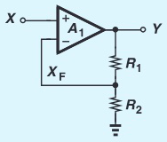

# 예제 12.4 — 공칭 이득 4인 비반전 증폭기의 실제 이득과 A1 변화에 따른 % 변화율

## 원문
공칭 전압이 4가 되도록 그림 12.2의 회로가 설계되었다. (a) $A_1 = 1000$일 때 실제 이득을 결정하라. (b) $A_1$이 500으로 감소할 때 이득의 % 변화율을 결정하라.

## 조건
- 회로: Fig 12.2 비반전 증폭기 (연산 증폭기 $A_1$, 출력과 접지 사이 분배기 $R_1$, $R_2$, 분배 노드 전압 $X_F$가 반전 입력으로 귀환)
- 공칭값이 4가 되도록 설계됨 (인쇄는 "공칭 전압이 4")
  - 문맥과 맞지 않음(오식으로 보임): 전압이 아니라 공칭 (전압) 이득 $Y/X \approx 1 + R_1/R_2 = 4$로 읽어야 뜻이 통함. 풀이도 식 (12.15)에서 $R_1/R_2 = 3$으로 씀 (원문에 없음)
- 식 (12.15): $KA_1 \gg 1$이면 $\dfrac{Y}{X} \approx \dfrac{1}{K} \approx 1 + \dfrac{R_1}{R_2}$ (본문 식, 원문에 없음)
- 식 (12.2): $\dfrac{Y}{X} = \dfrac{A_1}{1 + KA_1}$, 귀환율 $K = R_2/(R_1 + R_2)$ (본문 식, 원문에 없음)
- (a) $A_1 = 1000$
- (b) $A_1$이 $1000$에서 $500$으로 감소

## 구할 것
- (a) $A_1 = 1000$일 때 실제 이득 $Y/X$
- (b) $A_1$이 500으로 감소할 때 이득의 % 변화율

## 상속·참조
- 식 (12.2) (교재 644쪽): $\dfrac{Y}{X} = \dfrac{A_1}{1 + KA_1}$
- 예제 12.1 (교재 644쪽): Fig 12.2에서 귀환율 $K = R_2/(R_1 + R_2)$
- 식 (12.14), (12.15) (교재 650쪽): $A_1R_2/(R_1 + R_2) \gg 1$이면 $\dfrac{Y}{X} \approx \dfrac{1}{K} \approx 1 + \dfrac{R_1}{R_2}$

## 회로 — Fig 12.2
```spice
XA1  X   XF  Y   opamp
R1   Y   XF  {R_1}
R2   XF  0   {R_2}
```
- 단자: X = 입력 (개방 원) / Y = 출력 (개방 원)
- 표시: 노드 라벨 X (입력 원 왼쪽), Y (출력 원 오른쪽), X_F (귀환선 왼쪽 세로 부분 바로 오른쪽, 아래 가로선 위) / 소자 라벨 A1 (삼각형 안), R1, R2 (각 저항 오른쪽) / 부호 연산 증폭기 입력 + 위, − 아래 (삼각형 안쪽 왼쪽) / 화살표 없음 / 수치·면적 라벨 없음
- 배치: 왼쪽 X 원 → 가로선 → 연산 증폭기 + 입력(위) / 연산 증폭기는 오른쪽을 향한 삼각형, 출력 접속점에서 가로선이 오른쪽 Y 원까지 / 출력 접속점 아래로 R1, X_F 접속점, R2, 접지가 한 세로줄 / X_F 접속점에서 가로선이 왼쪽으로 연산 증폭기 왼쪽 바깥까지 간 뒤 위로 꺾이고, − 입력 높이에서 오른쪽으로 꺾여 − 입력 / 접속점 (세 갈래 이상, 2곳): 출력 = 왼쪽 연산 증폭기 출력 + 오른쪽 Y 선 + 아래 R1 (점), X_F = 위 R1 + 아래 R2 + 왼쪽 귀환선 (점) / 교차: 없음


> 참고: 그림 12.2는 예제 12.1 상자(교재 644쪽, PDF 3 왼쪽)에 인쇄돼 있음. 예제 12.4(650쪽)에는 다시 인쇄되지 않음

## 답 (검증용)
- 공칭 4 → 식 (12.15)에서 $R_1/R_2 = 3$, $K = 1/4$
- (a) $\dfrac{Y}{X} = \dfrac{A_1}{1 + KA_1} = 3.984$ (식 12.16, 12.17), 루프 이득 $KA_1 = 1000/4 = 250$
- (b) $A_1 = 500$이면 $Y/X = 3.968$ (식 12.18) → $A_1$이 1/2로 줄 때 폐루프 이득은 $(3.984 - 3.968)/3.984 = 0.4\%$만 변함
