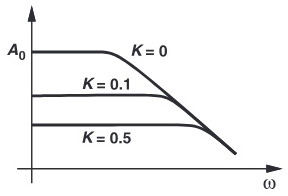

# 예제 12.5 — K = 0, 0.1, 0.5일 때 단일 극점 증폭기의 폐루프 주파수 응답

## 원문
$K = 0, 0.1, 0.5$일 때 식 (12.22)로 주어지는 폐루프 주파수 응답을 도시하라. $A_0 = 200$으로 가정하라.

## 조건
- 순방향 증폭기: 단일 극점 개루프 증폭기, 식 (12.19): $A_1(s) = \dfrac{A_0}{1 + \dfrac{s}{\omega_0}}$, $A_0$는 저주파 이득, $\omega_0$는 $-3\ \text{dB}$ 대역폭 (본문 식, 원문에 없음)
- 식 (12.22): $\dfrac{Y}{X}(s) = \dfrac{\dfrac{A_0}{1 + KA_0}}{1 + \dfrac{s}{(1 + KA_0)\omega_0}}$ (본문 식, 원문에 없음)
- $A_0 = 200$
- $K = 0$, $0.1$, $0.5$의 세 경우
- $\omega_0$ 값은 주어지지 않음 (응답 모양을 $\omega_0$ 기준으로 그림) (원문에 없음)

## 구할 것
- $K = 0, 0.1, 0.5$일 때 식 (12.22)의 폐루프 주파수 응답 도시

## 상속·참조
- 식 (12.19) (교재 651쪽): $A_1(s) = \dfrac{A_0}{1 + s/\omega_0}$
- 식 (12.2)의 $A_1$에 식 (12.19)를 대입하고 분자·분모에 $1 + s/\omega_0$를 곱해 식 (12.21), (12.22)를 얻음 (교재 652쪽): $\dfrac{Y}{X}(s) = \dfrac{A_0}{1 + KA_0 + \dfrac{s}{\omega_0}} = \dfrac{\dfrac{A_0}{1 + KA_0}}{1 + \dfrac{s}{(1 + KA_0)\omega_0}}$
- 식 (12.23), (12.24): 폐루프 이득 $= \dfrac{A_0}{1 + KA_0}$, 폐루프 대역폭 $= (1 + KA_0)\omega_0$ — 이득과 대역폭이 같은 인수만큼 반대 방향으로 스케일링되어 곱이 일정

## 회로 — 없음 (식으로 주어진 시스템, 문제 그림 없음)

## 답 (검증용)
- $K = 0$: 귀환이 사라지고 $Y/X$는 식 (12.19)의 $A_1(s)$로 바뀜. $K = 0.1$: $1 + KA_0 = 21$이므로 이득은 21배 감소하고 대역폭은 같은 인수만큼 증가. $K = 0.5$: $1 + KA_0 = 101$이므로 이득은 비례적으로 감소하고 대역폭은 증가 → Fig 12.9
- Fig 12.9: 세로축 화살표(라벨 없음, 높이 라벨 "A_0"가 맨 위 평탄선 왼쪽), 가로축 화살표 "ω". 곡선 세 개가 모두 평탄하다가 꺾여 같은 기울기의 직선으로 내려감: "K = 0"은 높이 A_0에서 가장 먼저 꺾임(라벨은 꺾이는 곳 오른쪽 위), "K = 0.1"은 더 낮은 높이에서 더 오른쪽에서 꺾여 K = 0의 하강선에 합류(라벨은 평탄선 위), "K = 0.5"는 가장 낮은 높이에서 가장 오른쪽에서 꺾여 같은 하강선에 합류(라벨은 평탄선 아래). 세 곡선의 하강선은 오른쪽 아래 한 직선으로 겹쳐 끝남

