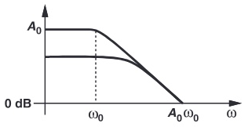

# 예제 12.6 — 단일 이득 대역폭이 K와 관계없이 일정함을 증명

## 원문
$1+KA_0 \gg 1$과 $K^2 \ll 1$일 때 위 시스템의 단일 이득 대역폭이 $K$와 관계없이 일정하게 유지됨을 증명하라.

## 조건
- "위 시스템": 단일 극점 개루프 증폭기 식 (12.19) $A_1(s) = \dfrac{A_0}{1 + s/\omega_0}$에 귀환율 $K$인 부귀환을 건 시스템 ($A_0$: 저주파 이득, $\omega_0$: $-3\ \text{dB}$ 대역폭) (원문에 없음)
- 식 (12.22): $\dfrac{Y}{X}(s) = \dfrac{\dfrac{A_0}{1 + KA_0}}{1 + \dfrac{s}{(1 + KA_0)\omega_0}}$ (본문 식, 원문에 없음)
- 가정: $1 + KA_0 \gg 1$, $K^2 \ll 1$
- 단일 이득 대역폭 $\omega_u$: 폐루프 이득의 크기가 1이 되는 주파수 (원문에 없음)

## 구할 것
- 위 가정에서 단일 이득 대역폭이 $K$와 관계없이 일정함을 증명

## 상속·참조
- 식 (12.19) (교재 651쪽): $A_1(s) = \dfrac{A_0}{1 + s/\omega_0}$
- 식 (12.22) (교재 652쪽): 폐루프 전달 함수, 폐루프 이득 $A_0/(1 + KA_0)$ (식 12.23), 폐루프 대역폭 $(1 + KA_0)\omega_0$ (식 12.24)
- 예제 12.5 (교재 652쪽): $A_0 = 200$에서 $K = 0, 0.1, 0.5$일 때 응답 (Fig 12.9). 이 예제의 "위 시스템"은 식 (12.22)의 시스템

## 회로 — 없음 (식으로 주어진 시스템, 문제 그림 없음)

## 답 (검증용)
- 식 (12.22)의 크기 $\left|\dfrac{Y}{X}(j\omega)\right| = \dfrac{\dfrac{A_0}{1 + KA_0}}{\sqrt{1 + \dfrac{\omega^2}{(1 + KA_0)^2\omega_0^2}}}$ (식 12.25)를 1로 놓고 제곱: $\left(\dfrac{A_0}{1 + KA_0}\right)^2 = 1 + \dfrac{\omega_u^2}{(1 + KA_0)^2\omega_0^2}$ (식 12.26)
- $\omega_u = \omega_0\sqrt{A_0^2 - (1 + KA_0)^2} \approx \omega_0\sqrt{A_0^2 - K^2A_0^2} \approx \omega_0A_0$ (식 12.27–12.29): 개루프 시스템의 이득-대역폭 곱과 같아 $K$와 무관
- Fig 12.10: 세로축 화살표(라벨 없음), 가로축 화살표 "ω"는 "0 dB" 높이(왼쪽에 "0 dB" 눈금 라벨). 위 곡선은 높이 "A_0"에서 평탄하다가 "ω_0"에서 꺾여(꺾이는 점에서 가로축까지 수직 점선, 가로축 아래 라벨 "ω_0") 직선으로 내려가 가로축의 "A_0ω_0"에서 0 dB에 닿음. 아래 곡선(폐루프, 라벨 없음)은 더 낮은 높이에서 평탄하다가 더 오른쪽에서 완만히 꺾여 위 곡선의 하강선에 합류, 같은 점 A_0ω_0에서 0 dB

